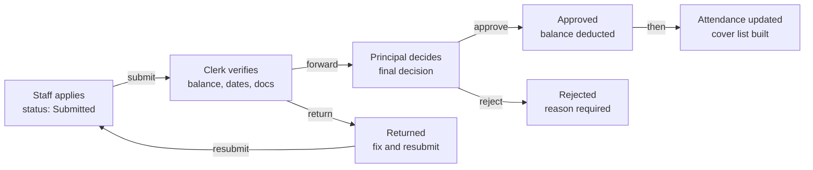
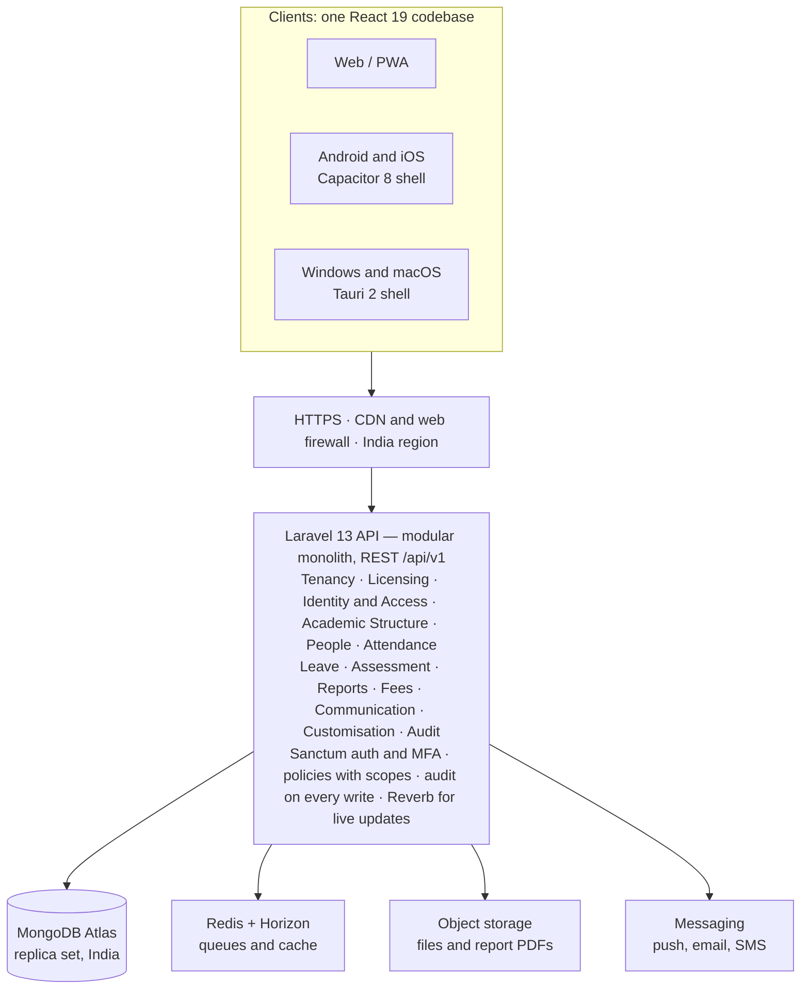

# Campus TAB — Product & System Blueprint

Last updated 27 Nov 2026 · Live version: https://claude.ai/artifact/DQX9CxJZAVWpjdLx3WkMby

## Executive summary

We build Campus TAB, one multi-tenant school platform under our brand. Each school gets one licence key that activates its Chief Admin login, and the app shows our name top-left with the school's logo and name below it. The stack is a Laravel 13 API, one React 19 codebase shipped as web, Android/iOS (Capacitor) and Windows/Mac (Tauri) apps, and MongoDB Atlas hosted in India.

**The design calls that matter most**

- **Authority = role + assignment + scope.** One teacher can be class teacher of 7-B and Maths teacher of 8-A and 8-B at the same time. Their powers follow those assignments, not separate logins.
- **Ten ranked levels,** from our Platform Admin down to Student. Parent is added: the brief missed it, Indian schools expect a parent app, and online fee payment needs it.
- **Staff leave runs Staff → Clerk (verify) → Principal (decide).** The applicant sees every step live. Approved leave writes into staff attendance and lists the classes that need a substitute.
- **One assessment engine for every test** — weekly, monthly, half-yearly, annual. Subject teacher enters, class teacher verifies, principal or clerk locks and publishes. Any change after lock is a correction request that only the Principal can approve, from their own account.
- **The yearly report card is computed, not typed.** Each school's Principal sets up its own board, scheme and report format; the PDF carries a QR code that proves it is genuine.
- **Fees are fully school-defined.** Principal and Clerk build the fee plans. Online payments mark themselves paid, counter payments are entered by fee staff, and only the Principal grants rebates or waivers. Every rupee keeps its history.
- **Every custom column has an owner level and a scope** (subject, class, school). Nobody can change a field owned above their level. Values are stored as JSON on the record — this is where "JSON based" pays off.
- **English by default, a regional language per person.** Anyone can switch at sign-up or later in settings; the switch changes only their own screens.
- **No standing vendor access to school data.** Our support team gets in only when the Chief grants it, for a fixed time, and every action is logged.

**Chairman's decisions (26 Nov 2026)**

| # | Decision | Chairman's answer | What it means for the build |
| --- | --- | --- | --- |
| 1 | Name, logo, domain | **Campus TAB**; logo **C** (school outline on an app tile); domain to come | Logo files and rules are in "Logo and brand mark" |
| 2 | Code and credit | Code lives in the RookieP2004 GitHub account; Sujal commits and pushes; no file named "claude" and no AI credit anywhere | Claude Code only writes files locally; its rules live in `docs/CONVENTIONS.md` |
| 3 | Parent login | **Yes** | Parents get their own login: child's attendance, marks, report card, notices, leave and fees |
| 4 | Fees | Fully customisable by Principal and Clerk; online payments auto-marked paid; counter payments entered by fee staff; Principal can rebate, waive and adjust | Fees is in v1 with its own section and build phase |
| 5 | Boards | The Principal sets up the school's own board, scheme and formats | No hard-coded boards; presets are optional starting points |
| 6 | Changing locked marks | Only after the Principal manually approves from his own account; the old mark, new mark and reason are recorded | A fixed rule in code, not a setting: Clerk and Chief can only request |
| 7 | Hosting | To be planned later | Code stays cloud-neutral; an Indian region is still my recommendation |
| 8 | Languages | English is the default for everyone; each person can pick a regional language at sign-up or later in settings | Per-user language setting; English wherever no choice is made |
| 9 | Application Report | A full, plain-language report written while the code is built, explaining every tool, request, file and link, and every update and its reason | A living `docs/report/` folder, updated in the same session as every code change; see "Application Report" |

## Market research: what the leaders teach us

Indian leaders win on board compliance, fee collection and WhatsApp reach to parents. They lose on clunky mobile apps and complexity. We copy the first and fix the second.

| Product | Market | Does well | Falls short | What we take |
| --- | --- | --- | --- | --- |
| [Entab CampusCare 10X](https://entab.in/entab-blog-management.html) | India, 2,000+ institutions | 21+ modules; CBSE/ICSE/state boards; deep UDISE+ coverage | Mobile is a web wrapper; module costs grow ([review](https://schoolites.com/compare/top-10-school-management-software-india)) | Match the compliance depth; ship a real responsive app |
| [Teachmint](https://www.teachmint.com/reasons-to-choose-teachmint) | India + 30 countries | Mobile-first; custom roles and permissions per staff member | Modules sold in tiers | Custom roles belong in the core, not an add-on |
| [Fedena](https://support.fedena.com/support/solutions/articles/266503) | Global, open source | Admin superuser assigns privileges; plugin modules; branded apps; multi-school dashboard | Self-hosting needs IT staff | Module flags per licence; a group level above schools |
| [Gibbon](https://docs.gibbonedu.org/tutorials/school-setup/roles-permissions) | Global, open source | Roles × actions × permissions; separate "mine" and "edit all" rights | Generic, not India-specific | Scope-based permissions (own / class / school) |
| [Samarth leave module](https://docs.demosamarthx.du.ac.in/books/user-guides/page/leave-management) | India, government | Configurable approval chains; leave types and balances by policy | — | Approval chain as configuration, not code |
| [Schoolites](https://schoolites.com/school-whatsapp-integration) | India | Official WhatsApp Business API; UPI fee reminders; India-hosted | Vendor-written ranking that puts itself first | WhatsApp and UPI are now expected |
| [PowerSchool](https://techcrunch.com/2025/01/17/malware-stole-internal-powerschool-passwords-from-engineers-hacked-computer/) | US, largest SIS | Depth across SIS, analytics, LMS | 2024 breach through a support account with no MFA | No standing support access; MFA everywhere |
| [Infinite Campus](https://g2.com/categories/k-12-student-information-systems?page=2) | US districts | Integrations, analytics | Ease of use 7.1 vs 8.0 category average on G2 | Simplicity is a feature we sell |

**Patterns we adopt**

- Approval chains per leave type with stages that can be switched on or off — the same idea as [Odoo's school leave app](https://apps.odoo.com/apps/modules/16.0/do_school_leave), which toggles class teacher, coordinator and principal stages.
- Plan for poor internet: only [67.4% of Indian schools had internet in 2025-26](https://www.freepressjournal.in/education/udise-2025-26-2472-crore-students-103-crore-teachers-1-in-3-schools-still-without-internet). Campus TAB stays online-only, with a paper fallback that the teacher enters later.
- Buyers check board support, UDISE+ and NEP fit, fees, WhatsApp parent access and clear pricing first ([buyer checklist](https://schoolites.com/compare/top-10-school-management-software-india)).
- UPI fee payments carry zero MDR by RBI rule, so online fees cost schools little ([source](https://schoolites.com/school-fee-payment-gateway)).

## Product scope

v1 ships everything in your brief — now including fees — plus parent access, notices, the customisation engine and an audit trail. Timetable and WhatsApp follow in v1.5; the rest waits for v2 behind module flags.

| Module | What it covers | Release | Why now |
| --- | --- | --- | --- |
| Platform console and licensing | Schools, licence keys, plans, module flags, support-access grants | v1 | How we sell and control the product |
| School setup and branding | Name, logo, board, academic year, classes, sections, subjects | v1 | Brief: same app, many schools |
| Users, roles, permissions | Ten levels, custom roles, class and subject assignments, fee-collector duty | v1 | Brief: ranked authority |
| Student information | Admission, profile, guardians, siblings, documents, optional PEN/APAAR | v1 | Base for everything else |
| Staff information | Profile, designation, teaching or non-teaching, documents | v1 | Principal creates and removes staff |
| My Dashboard | Role-based home for every login | v1 | Brief |
| Attendance | Students daily or period-wise; staff check-in; holiday calendar | v1 | Brief |
| Leave | Staff two-stage approval; student leave via parent and class teacher; balances | v1 | Brief |
| Tests and marks | Weekly, monthly, half-yearly, annual; markbook; lock and publish | v1 | Brief |
| Yearly report card | School-defined scheme and template, PDF, QR verification, promotion | v1 | Brief |
| Fees | School-defined fee heads and plans, online and counter payments, receipts, full history, rebates and waivers, dues reports | v1 | Chairman's decision |
| Notices and notifications | Circulars by audience; in-app, push and email | v1 | Missed in brief; needed for every workflow |
| Customisation engine | Scoped custom fields, columns, lists and settings | v1 | Brief |
| Languages | English by default; each person picks a regional language at sign-up or in settings | v1 | Chairman's decision |
| Audit log and recycle bin | Every change recorded; restore deletions for 30 days | v1 | Makes "highest deletion rights" safe |
| Import and export | Excel templates for students and staff; full school export | v1 | Schools arrive with spreadsheets |
| Parent app | Child switcher, attendance, tests, results, notices, child leave, fee dues and online payment | v1 | Missed in brief; fees need it |
| Timetable and substitution | Periods, teacher load, arrangement periods when a teacher is on leave | v1.5 | Closes the loop on leave |
| Homework and class diary | Daily work by subject, parent acknowledgement | v1.5 | Daily parent touchpoint |
| WhatsApp and SMS | Official WhatsApp Business API, DLT-registered SMS templates | v1.5 | The channel parents read |
| Certificates and ID cards | TC, bonafide, character certificate, ID cards with QR | v1.5 | Clerk's daily work |
| Calendar, events, PTM | School calendar, parent-teacher meeting slots | v1.5 | Low effort, high use |
| Admissions CRM | Enquiry → application → test → admission | v2 | Sales feature for private schools |
| Transport | Routes, stops, live bus location for safety | v2 | Paid add-on |
| Library, inventory, hostel | Standard back-office modules | v2 | Add-ons |
| Payroll | Salary from staff attendance and leave | v2 | Builds on v1 data |
| Full Holistic Progress Card | Self, peer and parent inputs per NEP 2020 | v2 | v1 template is HPC-ready |
| Analytics and AI assistant | At-risk students, draft report remarks | v2 | Differentiator |
| School groups | One trust, many branches, one group dashboard | v2 | Data model ready in v1 |
| UDISE+ export | Student and teacher data in government format | v2 | Compliance help for clerks |

## Multi-tenancy, licence keys and the JSON config

Each school is a tenant. One signed licence key activates it and creates the Chief Admin. The same app serves every school by loading that school's branding and rules from a versioned JSON config.

### Levels of tenancy

Platform (us) → Group (optional: a trust with several branches) → School (the tenant) → Academic year. The Group level exists in the data model from day one, even though its dashboard ships in v2.

### The licence key

- **What the school sees:** a short key such as `CTAB-7F3K-92QD-LX4M-8ZTA`.
- **What it unlocks:** a server record holding a signed payload (Ed25519): school id, plan, enabled modules, seat limits for students and staff, valid-from and valid-to dates.
- **What it is for:** one-time activation of the Chief Admin login. After activation the Chief signs in with their own password and MFA; the key can't be reused.

Activation runs in five steps:

1. We create the school record and issue the key.
2. The school's contact opens the app, picks **Activate school**, enters the key and confirms an OTP sent to the registered phone or email.
3. They create the Chief Admin account and enrol MFA (mandatory).
4. A setup wizard collects name, logo, board, academic year, classes, sections, and imports students and staff from Excel.
5. The key is marked active; the licence term now lives on the server.

**Licence rules**

- Renewal extends the term on the server; no new key needed.
- Expiry: 15 days' grace with a banner, then read-only. Data is never deleted for expiry, and export stays open.
- Seats: warning at 90% of the student limit; new admissions blocked past the limit plus grace.
- A module switched off hides its menus, and its API returns `403 module_disabled`.
- Lost Chief access: we restore it only after identity checks and a signed letter from the school.

### One app, many schools

- At first launch the user enters a **school code** (for example `SUNRISE-BPL`), opens a school sub-domain, or scans the school's QR code.
- The app calls `GET /public/tenants/{code}/config` and receives public branding only: name, logo, accent colour, languages, login methods. Nothing private loads before sign-in.
- Brand stack on every screen: our logo and app name top-left, the school's logo and name directly below.

### The school config (JSON)

Every school-level choice lives in one versioned document. People edit it through settings screens, never raw JSON. Each save creates a new version with who, when and a diff; the Chief can roll back.

```json
{
  "tenant_id": "t_01JD8K",
  "config_version": 14,
  "school": {
    "name": "Sunrise Public School",
    "short_name": "SPS",
    "logo_url": "tenants/t_01JD8K/branding/logo.png",
    "board": "CBSE",
    "affiliation_no": "1030xxx"
  },
  "branding": { "accent": "#0F766E" },
  "locale": { "default_language": "en", "user_can_choose_language": true, "timezone": "Asia/Kolkata", "date_format": "DD-MM-YYYY" },
  "academic": { "year_start_month": 4, "terms": ["Term 1", "Term 2"] },
  "modules": { "attendance": true, "leave": true, "assessment": true, "fees": true },
  "policies": {
    "attendance": { "student_mode": "daily", "edit_window_hours": 4, "min_percent_alert": 75 },
    "leave": { "chain": ["clerk", "principal"], "clerk_can_reject": false, "escalate_after_hours": 48 },
    "marks": { "auto_publish_class_tests": true },
    "fees": { "gateway": "razorpay", "waiver_by": "principal", "receipt_prefix": "SPS/2026-27/" }
  }
}
```

### Keeping schools apart

- One shared MongoDB cluster and database. Every document carries `tenant_id`, and every index starts with it.
- The tenant comes from the signed-in user's token, never from the request body. A central model scope adds the filter to every query.
- A CI test fails the build if any query runs without the tenant filter.
- Why not one database per school now: the official Laravel MongoDB package lists multi-database support as [unsupported](https://www.mongodb.com/docs/drivers/php/laravel-mongodb/upcoming/feature-compatibility/), and hundreds of databases multiply indexes and operations. We keep a connection resolver so a large chain can move to a dedicated database later as a paid tier.
- Files sit in object storage under `tenants/{tenant_id}/…`, private, served by short-lived signed links.

## Role hierarchy and authority

Ten levels rank who can do what. A user can manage only people below their own level, and can grant only permissions they already hold.

| Level | Role | Who holds it | Core powers | Cannot |
| --- | --- | --- | --- | --- |
| 100 | Platform Admin | Our company | Schools, licences, plans, module flags, support | Read a school's data without a Chief's time-boxed grant |
| 90 | Chief Admin | The key holder (owner, trustee, director) | Everything in the school: branding, roles, all users, permanent delete, audit log, full export | Remove the last Chief; exceed the licence |
| 80 | Principal | Head of school | Create and remove staff, final leave decision, assessment scheme, publish results, school-wide columns, report template | Branding, licence, permanent delete |
| 70 | Vice Principal / Coordinator | Optional, per wing (e.g. Primary) | Principal powers for their wing, or as a dated delegate | Act outside their wing |
| 60 | Clerk | Office staff | Admissions, records, leave verification (stage 1), exam administration, certificates, clerical fields | Final leave decision; change locked marks (can only request a correction) |
| 50 | Class Teacher | A teacher, by assignment | Own section: attendance, remarks, co-scholastic grades, marks verification, class columns, student leave | Act on other sections |
| 40 | Subject Teacher | A teacher, by assignment | Own subject-sections: class tests, marks entry, subject columns | Touch other subjects' marks |
| 30 | Staff | Non-teaching staff | Own attendance, leave, profile, notices | Student records |
| 20 | Parent / Guardian | Linked to one or more children | Children's attendance, tests, report card, notices, child leave | See other children |
| 10 | Student | Enrolled student | Own timetable, attendance, published marks, report card, notices | See anything unpublished |

**How the levels behave**

- **Class and subject teacher are assignments, not logins.** A teacher has one account; each academic year assigns sections and subjects, and those assignments set their scope.
- **One person, several roles.** A teacher who is also a parent gets a role switcher in the profile menu.
- **Delegation.** The Principal can hand leave approval to a Vice Principal for set dates; the system logs it and ends it automatically.
- **"Delete staff" means deactivate.** The Principal removes access and the record moves to the recycle bin; history stays for audit. Only the Chief can purge it permanently, after 30 days. This is a deliberate safety change to your brief: one wrong click should never erase years of attendance and marks.

* **Fee Collector is a duty, not a level.** The Principal gives it to any staff member or clerk who takes fees at the counter; it adds fee-collection rights and nothing else.
* **Attendance Officer is a duty, not a level.** The Principal gives it, usually to the Clerk, to enter staff attendance for people who couldn't check in themselves. It adds only that, and only for people below the officer's own level: nobody enters their own attendance through it.
* **Language is personal.** Every account starts in English. Each person can switch to a regional language at sign-up or later in settings, and it changes only their own screens.

## Permission matrix

Every permission is a string `module.action:scope` — for example `marks.edit:subject` — and roles are bundles of these strings. The table is the default set each school starts with; the Chief can edit it.

Scopes: **Own** = self · **Child** = a parent's children · **Subj** = own subject-sections · **Class** = own section · **Wing** = a VP's wing · **School** = whole school. "Req" = can raise a correction request only.

The Vice Principal gets the Principal's column, limited to their wing. Platform Admins have no column: they hold no school permissions unless the Chief grants support access.

| Action | Chief | Principal | Clerk | Class T. | Subject T. | Staff | Parent | Student |
| --- | --- | --- | --- | --- | --- | --- | --- | --- |
| Branding, licence, modules | Edit | View | — | — | — | — | — | — |
| Roles and permissions | Edit | View | — | — | — | — | — | — |
| Create staff | School | School | Draft for principal | — | — | — | — | — |
| Deactivate staff | School | School | — | — | — | — | — | — |
| Permanent delete (any record) | School | — | — | — | — | — | — | — |
| Admit or edit student | School | School | School | Limited fields, Class | — | — | Request edit, Child | — |
| Mark student attendance | School | School | Corrections | Class | Subj (period mode) | — | View, Child | View, Own |
| Edit attendance after window | School | School | With reason | Req | Req | — | — | — |
| Staff attendance | School | School | Manage (Attendance Officer: enter for others below them) | Own | Own | Own | — | — |
| Apply for leave | Own | Own | Own | Own | Own | Own | Child (student leave) | — |
| Leave stage 1: verify | — | Fast-track | School | — | — | — | — | — |
| Leave stage 2: decide | Principal's own leave | School | — | — | — | — | — | — |
| Approve student leave | School | School | — | Class | — | — | — | — |
| Assessment scheme and grading | School | School | Set up | — | — | — | — | — |
| Schedule school exams | School | School | School | — | — | — | — | — |
| Create class test (weekly, monthly) | School | School | School | Class | Subj | — | — | — |
| Enter marks | School | School | Before lock | Class (if enabled) | Subj | — | — | — |
| Verify a class's marks | School | School | — | Class | — | — | — | — |
| Lock marks | School | School | School | — | — | — | — | — |
| Change marks after lock | Req | Approve, own account | Req | Req | Req | — | — | — |
| Publish results and report cards | School | School | — | — | — | — | View, Child | View, Own |
| Report card remarks | School | School | — | Class | Subj (subject remark) | — | — | — |
| Custom columns and fields | All scopes | School | Clerical | Class | Subj | — | — | — |
| Send notices | School | School | School | Class | Subj | — | — | — |
| Audit log | School | Academic | Own actions | — | — | — | — | — |
| Bulk export | School | Academic | Lists only | Class list | — | — | Own data | Own data |
| Grant support access to us | School | — | — | — | — | — | — | — |

Fee permissions have their own table in the Fees section.

**Guard rules the code enforces**

- No escalation: nobody can create a role or user above their level, or grant a permission they lack.
- The last Chief can't be removed or demoted.
- Sensitive actions ask for MFA again: export, permanent delete, role edits, approving a change to a locked mark, support grants. There is no "unlock marks" action: a locked mark changes only through a correction the Principal approves.
- Every check runs on the server. The UI hides what you can't do, but hiding is never the protection.

## Core workflows

Four workflows carry the daily load. Each step has one owner, a visible status and an audit entry.

### Staff leave: Clerk, then Principal



A Clerk's own leave goes straight to the Principal; the Principal's own leave goes to the Chief. Pending requests get a reminder at 24 hours and escalate at 48 hours (both configurable).

A returned request loops back to the applicant; only the Principal gives the final decision, and approval writes straight into attendance.

**States:** Draft → Submitted (with Clerk) → Verified (with Principal) → Approved or Rejected. Side states: Returned (back to applicant for correction), Withdrawn (by applicant before decision), Cancelled (after approval, on request).

- **Clerk checks** balance, dates against holidays and exam days, required documents (e.g. medical certificate for sick leave over a set number of days), and which classes need cover. Actions: *Verify and forward* with a remark, or *Return for correction*. Rejecting is the Principal's call unless the Chief switches on `clerk_can_reject`.
- **Principal decides:** Approve, Approve with changed dates, or Reject with a mandatory reason.
- **Balance is a ledger, not a counter:** days are reserved on submit, deducted on approval, released on reject, withdraw or cancel.
- **Own-leave routing:** a Clerk's leave goes straight to the Principal; the Principal's goes to the Chief. A Vice Principal stage can be added per wing.
- **Fast-track:** for same-day emergencies the Principal can act at stage 1; the Clerk is informed.
- **Nudges:** reminder after 24 hours pending, escalation after 48 (both configurable).
- **Who sees what:** the applicant sees a live timeline of every step with names, times and remarks. The Clerk sees their queue. The Principal sees the queue plus a leave calendar of who is away today and this week.
- **After approval:** staff attendance shows *On leave* for those days automatically, and the affected periods appear on a "needs cover" list. In v1.5 the timetable module turns that list into substitute assignments.
- **Leave types** (names and quotas set by the Principal): casual, sick or medical, earned, maternity, paternity, duty leave, compensatory off, leave without pay, half-day and short leave.

### Student leave

Parent applies with dates, reason and an optional attachment → Class Teacher approves or rejects → attendance shows *Leave* → parent is notified. Leaves longer than a set number of days also appear to the Principal.

### Attendance

**Students**

1. Each school picks a mode: *daily* (class teacher, once a day — the v1 default) or *period-wise* (subject teacher, each period).
2. The screen opens with everyone present; the teacher taps the absentees. Codes: Present, Absent, Late, Half-day, Leave (filled from approved leave), Holiday (from the calendar).
3. Teachers can edit until the window closes (default 4 hours after school starts). After that, a correction needs the Clerk or Principal and a reason. Every change is audited.
4. An absence notifies the parent by push now, by WhatsApp in v1.5. For a day entered late, the notice goes out when the entry is saved and names the date ("Aarav was absent on 3 December").
5. Marking is online. If the internet fails, the teacher keeps the register on paper and enters it once the problem is fixed, on the same screen or by Excel upload (template, dry-run check, then commit), within a set number of days (school setting, default 7). A late entry needs a reason, can carry a photo of the paper register, only fills a day that was never marked, shows as a late entry and is audited. Past the limit, the Clerk or the Principal enters it with a reason.
6. Reports: daily summary, monthly register, attendance % for the report card, and an alert below the school's threshold (e.g. 75%).

**Staff:** check-in by app button (optional geofence: only whether the check-in was inside the area is stored, never the location), office QR code, biometric device import (CSV), or manual entry by the Attendance Officer for staff who couldn't check in, with the time and a reason. A manual entry always comes from someone at a higher level than the person it is for, never from the person themself: the Attendance Officer records teachers and staff, the Vice Principal or Principal records the Clerk, the Principal records the Vice Principal, the Chief records the Principal. Late-arrival rules are configurable, and approved leave fills itself in.

**Holidays:** the Clerk keeps the holiday calendar; the Principal approves it.

### Tests and marks

Structure: Academic year → Term → Assessment type (weekly, monthly, periodic, half-yearly, annual, practical, project, internal) → Assessment (e.g. *Unit Test 2, July*) → Paper (one section × one subject, with max marks and date) → Marks.

1. **Draft** — Principal or Clerk schedules school exams; a Subject Teacher can create weekly or monthly tests for their own sections.
2. **Open for entry** — entry window with a deadline.
3. **Submitted** — the Subject Teacher submits the paper; the Class Teacher sees a completion grid for the class.
4. **Verified** — the Class Teacher checks the class's papers and can send one back with a note.
5. **Locked** — Principal or Clerk locks; no more edits.
6. **Published** — students and parents see results. Class tests can publish on submit if the Principal allows it.

A change after lock is a **correction request**: who asked, old and new value, reason. Only the Principal can approve it, from their own account; the Clerk and the Chief can only request. The change applies after approval, and the record keeps the old mark, the new mark, the reason, who asked, who approved and when. This is a fixed rule, not a setting.

The markbook works like a spreadsheet: keyboard movement, paste from Excel, codes AB (absent) and ML (medical), a block on values above max marks, and autosave with a conflict check (two people editing the same paper get a conflict, never an overwrite). Marks entry is **online only**: there is no offline entry, and a save that fails stays on screen until it goes through. On a phone it becomes one card per student with a numeric keypad.

### Yearly report card

- **Grading engine:** weightage formula per class group, grade scales, pass marks, grace rules, rounding, best-of rules. Example preset: CBSE Class 10 is 80 marks theory plus 20 internal, built from four 5-mark parts (periodic tests, practical work, assignments, portfolio) ([source](https://www.shiksha.com/boards/cbse-10th-board-pattern)).
- **Templates:** the Principal sets up the school's own board format — from a blank layout or an optional preset (CBSE, generic state board, Holistic Progress Card) — uploads the school's letterhead and arranges the blocks. Logo and name come from the school config.
- **Process:** compute in the background → Class Teacher adds remarks and co-scholastic grades → Principal reviews → publish → one PDF per student with a QR code that opens a public verification page → parent app and print.
- **A published card never changes silently.** The computed result is stored as a snapshot; any later fix issues a new version and keeps the old one.
- **Year-end:** a promotion wizard moves students up, with exceptions for detained or leaving students, and carries sections and teacher assignments into the new year as drafts.
- **Board context:** from 2026-27 CBSE Class 10 has a mandatory first board exam and an optional second, with internal assessment once a year ([source](https://www.freepressjournal.in/amp/education/cbse-confirms-class-10-board-exams-twice-a-year-from-2026)). Our report covers school assessments; importing board results can come later.
- **NEP fit:** PARAKH's Holistic Progress Card records progress through multiple forms of evidence rather than marks alone ([source](https://parakh.ncert.gov.in/blog/policy-practice-parakhs-roadmap-implementing-examination-reforms)), so templates support rubric and descriptive blocks, not just mark tables.

## Fees

Every school builds its own fee structure. Each payment, rebate and waiver lands in one ledger per student, which is only ever added to, never edited.

### Building blocks (set up by Principal and Clerk)

| Block | What it is | Example |
| --- | --- | --- |
| Fee head | A named charge | Tuition, admission, exam, lab, transport, annual charges, late fine |
| Category | Who a plan applies to | New admission, existing student, staff ward, RTE seat |
| Fee plan | Heads, amounts and instalments for a class and category | Class 6 regular: tuition monthly, annual charges in April |
| Instalment schedule | When each part falls due | Monthly, quarterly, per term or yearly, each with a due date |
| Fine rule | What happens after a due date | Flat or per-day fine after a grace period, with a cap |
| Discount rule | Automatic reductions | Sibling discount, staff-ward concession |
| Student override | A one-off change for one student | Transport fee starts from August |

- Plans attach to classes and categories. At the start of the year the system raises every student's dues from their plan.
- Mid-year admissions get dues from their joining month, by the school's rule.
- Changing a plan affects future instalments only; dues already raised stay as they are unless adjusted.

### How a payment lands

1. **Online:** the parent opens dues → *Pay now* → the gateway's checkout (UPI, cards, net banking) → the gateway confirms through a signed webhook → the dues show *Paid*, a receipt is created and the parent is notified. Nobody has to touch it.
2. **At the counter:** the Fee Collector finds the student, picks the dues, records the mode (cash, cheque, DD, bank transfer, UPI at the counter) and reference → the receipt prints and also appears in the parent app. A cheque stays *Pending clearance* until marked cleared; a bounced cheque reverses the payment and can add a fine.
3. **Day-end closing:** each collector closes their day. The system totals collections by mode, and the Clerk or Principal confirms the cash handed over.
4. **Reconciliation:** a nightly job matches the gateway's settlement report against our payments and flags any mismatch to the Clerk.

### Rebates, waivers and other adjustments

- **Rebate or concession:** an amount or a percentage on chosen heads, with a reason; one-off or for the whole year.
- **Waiver (fee maaf):** full or partial write-off of a due, with a reason.
- **Also:** fine waiver, refund, scholarship credit, and carrying unpaid dues into the next year.
- The Clerk can propose any adjustment; only the Principal approves it. The Chief can change who approves.

### History and integrity

- One ledger per student: every due, payment, adjustment and reversal, with who, when and why.
- Nothing is deleted or overwritten. A wrong entry is cancelled by a reversal entry, which needs the Principal's approval and a reason.
- Receipt numbers run in sequence per school per year and are never reused.
- Parents see the same history in their app and can download every receipt.

### Reports

Daily collection by collector and mode · dues and defaulters by class · collection by fee head · rebates and waivers given · cheque status · year-end summary · Excel export for the school's accountant.

### Who can do what

| Action | Chief | Principal | Clerk | Fee Collector | Class T. | Parent | Student |
| --- | --- | --- | --- | --- | --- | --- | --- |
| Payment gateway settings | Edit | View | — | — | — | — | — |
| Fee heads, plans, fines, discounts | School | School | School | — | — | — | — |
| Record counter payment, print receipt | School | School | School | School | — | — | — |
| Pay online | — | — | — | — | — | Child | — |
| Rebate, waiver, refund | School | Approve | Propose | — | — | — | — |
| Cancel a receipt (reversal) | School | Approve | Propose | Request | — | — | — |
| See dues | School | School | School | School | Paid or pending, Class | Child | If the school allows |
| Fee reports | School | School | School | Own collections | — | — | — |

### Money and safety

- Each school connects its own gateway account (Razorpay or similar). Money settles straight into the school's bank; Campus TAB never holds school money.
- Card details never touch our servers: the gateway's own checkout collects them.
- Webhooks are signature-checked and idempotent, so a repeated notification can't mark a due paid twice.
- Every fee action goes into the audit log, and waivers above a set amount alert the Chief.

### Data and API

- **Collections:** fee\_heads, fee\_categories, fee\_plans, fee\_demands (one per student per instalment), payments, receipts, fee\_adjustments, fee\_ledger (append-only), cash\_closings, gateway\_accounts (keys encrypted).
- **Endpoints:** `GET /students/{id}/fees` (dues and ledger) · `POST /fees/payments` (counter) · `POST /fees/checkout` (start online payment) · `POST /webhooks/payments/{gateway}` (gateway callback) · `POST /fees/adjustments` and `/fees/adjustments/{id}/approve` · `POST /receipts/{id}/cancel` · `GET /fees/reports/{type}`.

## Customisation engine

Every custom field, column, list and setting has an owner level and a scope. You can change what sits at or below your level, never above it.

| Level | Can customise | Scope | Example |
| --- | --- | --- | --- |
| Chief | Everything: roles, modules within the licence, branding, numbering formats, data retention | Whole school | Adds an *Accountant* role |
| Principal | School-wide columns on student, staff and markbook screens; board, assessment scheme and grading; report template; leave policy; attendance mode; fee plans, discounts and fines; merging duplicates | School or wing | Adds a *House* column; removes *Blood group* from the staff form |
| Clerk | Admission form fields, document checklist, certificate and ID card templates, holiday list, fee heads, plans and due dates, option lists (categories, houses, bus stops) | School, clerical only | Adds *Previous school TC number* to admissions |
| Class Teacher | Columns and lists visible only inside their section | Own section, this year | *Seat row*, *Diary signed* |
| Subject Teacher | Markbook columns and class tests for their subject | Own subject-sections | *Lab file*, *Quiz 3* |

**Rules**

- A higher level can see, edit or remove any lower-level field, and can promote a useful class column to school-wide.
- Removing a field archives it: values stay, hidden. Only the Chief can purge archived fields.
- Values live in the record's `custom` object (e.g. `students.custom.house = "Blue"`). Class-scoped values sit on the year's enrolment record, so they reset with the new year.
- Duplicate guards: a new student is checked on name + date of birth + guardian phone; duplicate field labels are blocked within a scope; the Principal's merge tool combines duplicate students or columns, with an audit entry.
- A cap per entity and scope (e.g. 50 fields) keeps screens and queries fast.
- Fields marked *sensitive* are encrypted and masked on screen. Full Aadhaar or bank numbers are refused as field types.
- Field types: text, long text, number, date, dropdown, multi-select, yes/no, file, grade, phone, email.

A field definition is a small JSON document, validated against a schema when saved:

```json
{
  "key": "seat_row",
  "label": { "en": "Seat row", "hi": "बैठने की पंक्ति" },
  "entity": "enrolment",
  "type": "dropdown",
  "options": ["Row 1", "Row 2", "Row 3", "Row 4"],
  "required": false,
  "scope": { "level": "section", "ref": "sec_7B_2026" },
  "owner_level": 50,
  "visible_to": ["class_teacher", "principal"],
  "editable_by": ["class_teacher"],
  "status": "active"
}
```

## System architecture

A modular Laravel monolith serves one REST API. A single React codebase ships as the web app, the Android and iOS apps, and the Windows and Mac apps.



Every client calls the same API; the API is the only thing that touches the database, files and messaging.

| Layer | Choice | Why |
| --- | --- | --- |
| UI | React 19 + TypeScript + Vite; Tailwind CSS v4 + shadcn/ui (Radix) | Your choice of React, HTML and CSS; accessible components we own |
| Client state | TanStack Query (server data), Zustand (UI), React Hook Form + Zod (forms), TanStack Table (markbook), i18next (languages), ECharts (charts), Dexie on IndexedDB (offline queue) | Proven, small, typed |
| App shells | Browser/PWA; Capacitor 8 for Android and iOS; Tauri 2 for Windows and macOS | One codebase, three channels |
| API | Laravel 13 on PHP 8.3+, API-only, released [17 March 2026](https://raw.githubusercontent.com/laravel/docs/13.x/releases.md) with security fixes to March 2028 | Your choice of Laravel/PHP; long support window |
| Auth | Laravel Sanctum (cookies for web, tokens for apps), TOTP MFA, OTP sign-in for parents | Simple and first-party |
| Database | MongoDB Atlas, replica set, India region, via `mongodb/laravel-mongodb` [5.7, which supports Laravel 13](https://newreleases.io/project/github/mongodb/laravel-mongodb/release/5.7.0) | Your choice; JSON-native custom fields |
| Cache and queues | Redis + Laravel Horizon | PDFs, imports, notifications run in the background |
| Real-time | Laravel Reverb (WebSockets) | Live approval status and notifications |
| Files | S3-compatible object storage, India region | Photos, documents, report PDFs |
| PDF | Headless Chromium (Gotenberg) with Noto fonts | Pixel-exact report cards in Indian scripts |
| Messaging | FCM/APNs push, email, DLT-registered SMS; WhatsApp Business API in v1.5 | Reach parents where they read |
| Observability | Sentry, structured logs, uptime checks, Atlas alerts | Know before the school calls |

**Back-end modules** (one folder each, with its own models, policies, routes and tests): Tenancy, Licensing, Identity and Access, Academic Structure, People, Attendance, Leave, Assessment, Reports, Fees, Communication, Customisation, Audit.

**Where I push back on the stack, and how we handle it**

- **Monolith, not microservices.** One team, one product: a well-cut monolith ships faster and can be split later along the module lines above.
- **MongoDB is a good fit for custom fields, a harder fit for reports.** School data is relational (students, sections, subjects, marks), so cross-collection reports need aggregation pipelines. We store computed snapshots (attendance %, report-card results) instead of recomputing on every view.
- **Transactions need a replica set.** Standalone MongoDB [does not support transactions](https://www.mongodb.com/docs/drivers/php/laravel-mongodb/v5.x/transactions); we need them for leave balances, locking marks and promotions. Dev machines run a single-node replica set too.
- **Laravel's database testing traits don't work with this package** (same source), so we write our own test-database reset helper in Phase 0.
- **Permissions are built in-house.** The popular Laravel permission packages assume SQL, and we need scopes (own, class, subject, school) that they don't model anyway.

**Repository layout**

```text
school-platform/
  backend/            Laravel 13 API (modules under app/Modules/*)
  frontend/           React app: routes, screens, features
  packages/ui/        design tokens + components (shared)
  packages/api/       TypeScript client generated from OpenAPI
  apps/mobile/        Capacitor 8 project (Android, iOS)
  apps/desktop/       Tauri 2 project (Windows, macOS)
  infra/              docker-compose, deploy scripts
  docs/BLUEPRINT.md   this document, exported
  docs/CONVENTIONS.md rules every coding session reads first
```

## Data model

About 45 collections; the fee collections are listed in the Fees section. Every school document carries `tenant_id`, `created_by`, `updated_by`, timestamps and `deleted_at`. Small, bounded lists are embedded; anything that grows without limit gets its own collection.

| Collection | Holds | Key fields | Main index |
| --- | --- | --- | --- |
| tenants | Schools (platform level) | code, name, group\_id, status, config\_version | code (unique) |
| licences | Keys and terms | tenant\_id, key\_hash, plan, modules, seats, valid\_to, status | key\_hash (unique) |
| support\_grants | Our time-boxed access | tenant\_id, granted\_by, agent, scope, expires\_at | tenant\_id, expires\_at |
| school\_configs | Versioned JSON config | tenant\_id, version, body, diff, changed\_by | tenant\_id, version |
| users | Login identities | tenant\_id, phone, email, username, password\_hash, mfa, roles\[\], person\_ref, status | tenant\_id + phone / email (unique) |
| roles | Permission bundles | tenant\_id, name, level, permissions\[\], is\_system | tenant\_id + name |
| academic\_years | Years | tenant\_id, name (2026-27), start, end, status | tenant\_id + status |
| classes, sections | Grades and sections | tenant\_id, year\_id, grade, name, wing, class\_teacher\_id | tenant\_id + year\_id |
| subjects | Subjects | tenant\_id, code, name, kind (scholastic / co-scholastic), elective | tenant\_id + code |
| teaching\_assignments | Who teaches what | tenant\_id, year\_id, section\_id, subject\_id, teacher\_id | tenant\_id + teacher\_id + year\_id |
| students | Student master record | tenant\_id, admission\_no, name, dob, gender, photo, guardian\_ids\[\], ids {pen, apaar, consent}, custom{}, status | tenant\_id + admission\_no (unique) |
| enrolments | Student × year | tenant\_id, student\_id, year\_id, section\_id, roll\_no, result, custom{} | tenant\_id + section\_id + roll\_no |
| guardians | Parents and guardians | tenant\_id, name, relation, phone, email, user\_id, student\_ids\[\] | tenant\_id + phone |
| staff | Staff master record | tenant\_id, employee\_code, name, designation, type, joined\_on, leave\_policy\_id, custom{} | tenant\_id + employee\_code (unique) |
| attendance\_days | One per section per day (or period) | tenant\_id, section\_id, date, period, entries\[{student\_id, status}\], marked\_by, locked | tenant\_id + section\_id + date + period (unique) |
| staff\_attendance | One per day | tenant\_id, date, entries\[{staff\_id, status, in, out, source}\] | tenant\_id + date (unique) |
| calendar\_events | Holidays and events | tenant\_id, date, type, title, audience | tenant\_id + date |
| leave\_types, leave\_policies | Rules | tenant\_id, code, quota, carry\_forward, document\_rule, chain | tenant\_id + code |
| leave\_ledger | Balance movements | tenant\_id, person\_id, type, delta, reason, request\_id | tenant\_id + person\_id + type |
| leave\_requests | Applications | tenant\_id, applicant, type, from, to, days, status, steps\[\], history\[\] | tenant\_id + status + current\_approver |
| assessment\_schemes | Weightage and grading | tenant\_id, year\_id, class\_group, components\[\], grade\_scale\[\], rules | tenant\_id + year\_id |
| assessments | Exam events | tenant\_id, year\_id, term, type, name, dates, status | tenant\_id + year\_id + status |
| papers | Section × subject × assessment | tenant\_id, assessment\_id, section\_id, subject\_id, max\_marks, window, status, marks\[{student\_id, value, code}\] | tenant\_id + assessment\_id + section\_id + subject\_id (unique) |
| correction\_requests | Edits after lock | tenant\_id, target, old, new, reason, requested\_by, decided\_by, status | tenant\_id + status |
| report\_templates | Card layouts | tenant\_id, name, class\_group, blocks\[\] | tenant\_id + class\_group |
| report\_cards | Published snapshots | tenant\_id, student\_id, year\_id, version, result{}, pdf\_path, verify\_hash, published\_at | verify\_hash (unique) |
| custom\_fields, option\_lists | Customisation | tenant\_id, entity, key, scope, owner\_level, status | tenant\_id + entity + scope |
| notices, notifications | Communication | tenant\_id, audience, channel, read\_by | tenant\_id + audience + created\_at |
| consents | DPDP and APAAR consent | tenant\_id, guardian\_id, student\_id, purpose, notice\_version, given, at | tenant\_id + student\_id + purpose |
| files | File metadata | tenant\_id, path, owner, kind, size, scan\_status | tenant\_id + owner |
| audit\_logs | Append-only change log | tenant\_id, actor, action, entity, entity\_id, before, after, ip, device, at | tenant\_id + entity + entity\_id + at |

**Embed or reference?**

- Embed when the list is bounded and read together: marks inside a paper (one section, about 60 students), attendance entries inside a day, approval steps inside a leave request.
- Reference when it grows: enrolments per student across years, ledger lines, audit entries, notifications.

A leave request after the Clerk's step looks like this:

```json
{
  "tenant_id": "t_01JD8K",
  "applicant": { "kind": "staff", "id": "stf_142" },
  "type": "CL",
  "from": "2026-12-03", "to": "2026-12-04", "days": 2,
  "status": "verified",
  "current_approver": { "role": "principal" },
  "steps": [
    { "stage": "clerk", "by": "stf_007", "action": "verified", "remark": "Balance OK, 6 periods need cover", "at": "2026-11-27T10:12:00+05:30" },
    { "stage": "principal", "by": null, "action": "pending", "at": null }
  ],
  "cover_needed": [ { "date": "2026-12-03", "section": "8-A", "period": 3 } ]
}
```

## API design

REST over HTTPS at `/api/v1`, JSON in and out. The tenant always comes from the token. An OpenAPI spec is generated from the Laravel code, and a typed TypeScript client is generated from that spec, so front end and back end can't drift.

**Conventions**

- Plural nouns (`/students`, `/leave-requests`); actions as sub-resources (`/leave-requests/{id}/verify`).
- Cursor pagination, `?filter[...]` and `?sort=` parameters, `?include=` for related data.
- One error shape: `{ "error": { "code": "marks_locked", "message": "…", "details": {} } }`.
- `Idempotency-Key` header on every create and workflow action, so an offline retry never double-submits.
- `ETag` / `If-Match` on markbook and config saves: two people editing at once get a conflict, not a silent overwrite.
- Rate limits per user and per school; stricter on login, OTP and export.
- Breaking changes go to `/api/v2`; old versions get a published end date.

| Method and path | Purpose | Who |
| --- | --- | --- |
| `GET /public/tenants/{code}/config` | Branding for the login screen | Anyone |
| `POST /auth/login` · `/auth/otp` · `/auth/mfa/verify` | Sign in | All users |
| `POST /licences/activate` | Activate a school with its key | School contact |
| `GET /me` · `GET /me/dashboard` | Profile, roles, dashboard cards | All users |
| `GET/POST/PATCH /students` · `/staff` · `/guardians` | People records | Per matrix |
| `POST /imports/{entity}` | Excel import with a validation report | Clerk and up |
| `GET/PUT /attendance/sections/{id}/days/{date}` | Student attendance for a day | Class teacher and up |
| `POST /attendance/staff/check-in` | Staff check-in | Staff |
| `POST /leave-requests` | Apply | Staff, parent |
| `POST /leave-requests/{id}/verify` · `/return` · `/approve` · `/reject` · `/withdraw` · `/cancel` | Workflow actions | Per stage |
| `GET /approvals/inbox` | Everything waiting on me | Approvers |
| `POST /assessments` · `GET/PUT /papers/{id}/marks` | Exams and marks entry | Per matrix |
| `POST /papers/{id}/submit` · `/verify` · `/lock` · `/publish` | Marks lifecycle | Per stage |
| `POST /corrections` · `POST /corrections/{id}/approve` | Edits after lock | Teacher, then principal |
| `POST /report-cards/generate` · `GET /report-cards/{id}/pdf` | Report cards | Principal; parent and student view |
| `GET /verify/{hash}` | Public check of a report card's QR | Anyone |
| `GET/POST/PATCH /custom-fields` | Customisation | Per level |
| `GET /audit-logs` | Change history | Chief, principal |
| `POST /support-grants` | Let our support team in, time-boxed | Chief |

## Security, privacy and compliance

The school is the data fiduciary and we are its data processor. The main DPDP duties apply from May 2027, so v1 ships them from day one rather than retrofitting. I'm not a lawyer: the notices, consent text and processing agreement need a legal review before launch.

### DPDP Act 2023 and Rules 2025

- **Timeline:** the rules were notified in November 2025; notice, consent, security safeguards, children's data and breach duties take effect on 13 May 2027 ([source](https://www.barandbench.com/amp/story/law-firms/view-point/meity-notifies-final-digital-personal-data-protection-rules-2025)).
- **Children's data:** verifiable parental consent is the general rule; schools are exempt for processing that is strictly necessary for education and safety ([source](https://www.livelaw.in/articles/dpdp-child-data-rules-demand-edtech-platforms-555317)). So we add a consent module for everything outside that core: photos on the website or social media, optional data, any third-party sharing.
- **What we build:** versioned privacy notices; guardian consent records per purpose; a requests inbox for access, correction and erasure; retention rules per data type; a grievance contact on every school's profile; a breach-response runbook; a standard processing agreement signed with each school.

### APAAR, PEN and Aadhaar

- On 20 July 2026 the Supreme Court directed that parents must be able to refuse APAAR consent, that APAAR data is governed by the DPDP Act, and that it can't be shared with private parties except as the law permits ([source](https://educationforallinindia.com/?p=25567)).
- So PEN and APAAR are optional fields, never required for admission, stored with a consent flag, excluded from exports to third parties and from analytics.
- We never store full Aadhaar numbers. If a school needs a reference, we keep the last four digits only.

### Platform security

- **The PowerSchool lesson.** Its 2024 breach came through a support portal, using a subcontractor's account that had no MFA ([source](https://techcrunch.com/2025/01/17/malware-stole-internal-powerschool-passwords-from-engineers-hacked-computer/)). Our answer: no standing support access. The Chief grants access for a fixed time and scope, read-only by default, behind MFA, with every action logged and visible to the school.
- **MFA** is mandatory for Platform, Chief, Principal, Vice Principal and Clerk accounts, optional for teachers. Parents sign in by OTP.
- **Step-up checks:** export, permanent delete, role edits, approving a correction to a locked mark (with the Principal's typed reason) and support grants ask for MFA again.
- **Encryption:** TLS in transit, Atlas encryption at rest, app-level encryption for sensitive fields such as medical notes.
- **Exports:** MFA, rate limits, watermarking, an audit entry, and an alert to the Chief on any large export.
- **Hygiene:** OWASP ASVS level 2 as the checklist, dependency scanning in CI, virus scan on uploads, an external penetration test before launch.
- **Audit log:** append-only, with before and after values, IP and device. The Chief sees everything; the Principal sees academic changes.
- **Deletion model:** soft delete → recycle bin for 30 days → permanent purge by the Chief only. We delete a school's data only at contract end, after an export window.
- **Backups:** Atlas continuous backup with point-in-time restore, a restore drill every term, and a full per-school export in JSON and Excel.

## UI/UX: design system and dashboards

One adaptive layout, calm and fast. Every role lands on a dashboard that shows today's to-dos first, and each daily job is two taps away.

### Principles

1. **Today first.** The dashboard is a to-do inbox plus a few key numbers, not a wall of charts.
2. **Two taps to the daily job:** teacher → attendance, clerk → leave queue, principal → approvals, parent → today's status.
3. **Same screens on every device**, rearranged rather than redesigned.
4. **Plain words, English by default with a regional language per person,** touch targets of at least 44 px, smooth on low-end Android phones and slow networks.
5. **Status colours never change meaning** anywhere in the product.
6. **Destructive actions confirm.** Permanent delete makes you type the record's name.

### Layout and brand

Desktop: sidebar with the brand stack top-left (Campus TAB logo and name, then the school's logo and name, then the year switcher), top bar, dashboard cards. Phone: compact header with the same brand stack, bottom tabs (Home, the role's main job, Inbox, Notices, More). Full designs in light and dark: `docs/design/` and https://claude.ai/artifact/KVKFBoQtpUnqQ7Rn9Zg55L

The school's name and logo change per tenant; everything else on the shell stays the same for every school.

- **Desktop (1024 px and up):** left sidebar. Top-left brand stack: our logo and app name, then the school's logo and name, then the academic-year switcher. Below that, navigation grouped by module. The top bar holds search (Ctrl/⌘ K), quick create, notifications and the profile menu with role switcher and language picker.
- **Tablet (768–1023 px):** the sidebar collapses to an icon rail; the top bar stays.
- **Mobile (under 768 px):** a compact header with the app name in small type above the school logo and name; bottom tabs for Home, the role's main job (Attendance, or My Child for parents), Inbox, Notices and More.

### Logo and brand mark

The chosen logo is **option C**: a simple school outline (roof, walls, door) in white on a rounded app tile. All four options are on the [logo canvas](https://claude.ai/artifact/JuzBmSDKYHzWcQ9XWFVsME).

- **Wordmark:** "Campus" in Inter Medium, "TAB" in Inter ExtraBold in the primary blue (#1D4ED8), mark on the left, gap = 30% of the mark's height.
- **Sizes:** 40 px in the sidebar brand stack, 28 px on the phone header, 16 px favicon (door dropped, thicker lines so it stays crisp).
- **On dark backgrounds:** white tile with the outline in #0F172A.
- **Clear space:** keep a quarter of the tile's width empty around it; never stretch, rotate or recolour it outside the brand blue, white and #0F172A.
- **Files Phase 0 creates in `packages/ui/assets/`:** `logo-mark.svg`, `logo-mark-dark.svg`, `favicon.svg`, plus the Android and iOS app icons and the Windows and Mac app icons generated from `logo-mark.svg`.

`logo-mark.svg`

```xml
<svg xmlns="http://www.w3.org/2000/svg" viewBox="0 0 48 48" role="img" aria-label="Campus TAB">
  <rect width="48" height="48" rx="12" fill="#1D4ED8"/>
  <path d="M13 23 24 14l11 9M16 21v14h16V21M22 35v-6h4v6" fill="none" stroke="#FFFFFF" stroke-width="3" stroke-linecap="round" stroke-linejoin="round"/>
</svg>
```

`favicon.svg`

```xml
<svg xmlns="http://www.w3.org/2000/svg" viewBox="0 0 48 48">
  <rect width="48" height="48" rx="12" fill="#1D4ED8"/>
  <path d="M13 23 24 14l11 9M16 21v14h16V21" fill="none" stroke="#FFFFFF" stroke-width="4" stroke-linecap="round" stroke-linejoin="round"/>
</svg>
```

### Theme tokens

| Token | Light | Dark | Use |
| --- | --- | --- | --- |
| Primary (our brand) | #1D4ED8 | #60A5FA text · #2563EB buttons | Buttons, links, active nav |
| School accent | From config | From config | Header strip, selected-nav marker; contrast-checked, never used for status |
| Success | #15803D | #4ADE80 text · #15803D fills | Approved, present |
| Warning | #B45309 | #FBBF24 text · #B45309 fills | Pending, late |
| Danger | #B91C1C | #F87171 text · #B91C1C fills | Rejected, absent, destructive actions |
| Info | #0369A1 | #38BDF8 | Verified, tips |
| Background / surface | #F8FAFC / #FFFFFF | #0B1220 / #111827 | Page and cards |
| Text / muted | #0F172A / #475569 | #E5E7EB / #94A3B8 | Body and secondary text |
| Border | #E2E8F0 | #1F2937 | Dividers, inputs |

**Light and dark themes.** Every screen ships in both. Each person picks Light, Dark or Match device from the profile menu or settings; the default is Match device, and the choice is saved per user. The logo keeps its blue tile in both themes. In dark mode, coloured text is lightened for contrast while solid buttons stay deep enough to carry white text. Both themes are mocked up on the [screens canvas](https://claude.ai/artifact/KVKFBoQtpUnqQ7Rn9Zg55L).

- **Type:** Inter for Latin script, Noto Sans Devanagari (and other Noto families) for Indian scripts; layouts mirror for right-to-left scripts such as Urdu. Scale 12 / 14 / 16 / 20 / 24 / 32 px; body 16 px on mobile, 14 px in dense desktop tables.
- **Shape and space:** 8 px radius on cards, 6 px on inputs, 4 px spacing grid, Lucide icons, 150–200 ms motion that respects reduced-motion settings.
- **Accessibility:** WCAG 2.2 AA contrast, full keyboard use, screen-reader labels on every control.

**Status chips, used everywhere:** Draft (grey) · Pending (amber) · Verified (blue) · Approved (green) · Returned (violet) · Rejected (red) · Locked (slate) · Published (teal).

### My Dashboard, by role

| Role | Top of the screen | Cards below |
| --- | --- | --- |
| Chief Admin | Licence status and seats used | Users by role, today's attendance %, pending approvals, recent audit events, storage, recycle bin |
| Principal | Approvals waiting (leave stage 2, corrections) | Student and staff attendance today, staff on leave and classes needing cover, marks-entry progress by class, low-attendance students, today's fee collection and dues, calendar |
| Clerk | Leave queue (stage 1) | Admissions pending, missing documents, sections with attendance not marked, exam admin tasks, certificate requests, fee dues and defaulters |
| Class Teacher | **Mark today's attendance** button | Class attendance trend, students absent 3+ days, class marks completion, remarks pending, student leave requests, birthdays |
| Subject Teacher | Today's periods | Marks entry due, my class tests, cover periods assigned to me |
| Staff | Check-in button | My attendance, leave balance and request status, notices |
| Parent | Child switcher and today's status | Fee dues with Pay now, upcoming tests, latest marks, notices, apply for leave, report card when published |
| Student | Today's timetable | Attendance %, upcoming tests, latest published marks, notices |

### Key screens to design first

Attendance taker · Markbook grid · Leave form and timeline · Approvals inbox · Student profile (tabs) · Report card designer · Settings (branding, roles, custom fields) · Fee counter · Student fee ledger · Recycle bin · Audit viewer.

## Delivery: apps, hosting and DevOps

One React build goes into three shells: the browser (as a PWA), Capacitor 8 for Android and iOS, and Tauri 2 for Windows and macOS.

| Channel | Technology | Notes |
| --- | --- | --- |
| Web / PWA | Vite build served from a CDN | Installable; caches the app shell and the offline queue |
| Android and iOS | Capacitor 8 | Renders our React UI in the system WebView; needs Node 22+, Xcode 26 and Android SDK 36 to build ([source](https://capawesome.io/docs/blog/page/4/)); push via FCM/APNs; fingerprint or face unlock; one store app plus school code; branded per-school builds as a premium |
| Windows and macOS | Tauri 2 | Uses the system WebView instead of bundling Chromium, so installers stay small ([source](https://www.noqta.tn/en/blog/tauri-2-desktop-apps-rust-web-technologies-2026)); MSI/EXE and DMG; code signing and notarisation; auto-update; printing for office staff |

**Hosting**

- Provider to be chosen later. The code stays cloud-neutral (Docker containers, any S3-compatible storage, MongoDB Atlas or self-run), and an Indian region is still my recommendation.
- Three environments: development, staging, production. Every front-end pull request gets a preview link.
- CI/CD on GitHub Actions: lint, tests, build, deploy. Mobile builds run on a cloud macOS runner.
- Operations: Sentry, uptime checks, Horizon queue dashboard, Atlas alerts, a public status page.

**Accounts and tools I need from you**

- A GitHub repository under the RookieP2004 account. You review, commit and push; Claude Code only writes files on your machine.
- MongoDB Atlas and a cloud account (AWS Mumbai or similar) in the company's name.
- Domain, DNS and a sending email address.
- Apple Developer and Google Play developer accounts.
- Firebase project for push notifications.
- An SMS provider with DLT registration (needed for OTP to Indian numbers).
- Each school's own Razorpay (or similar) account for online fees; for v1.5, a WhatsApp Business provider.

## Application Report

Claude Code writes a full report of Campus TAB alongside the code, in `docs/report/`, and updates it in the same session as every change. It is written for you: plain words first, then the code, so you can find, understand and change any part of the application without reading the whole codebase.

### What it contains

| File or folder | What you find there |
| --- | --- |
| `README.md` | How to use the report, and a **"Where is…?" index**: every feature mapped to its screen, request, code files and data |
| `01-overview.md` | What Campus TAB is, who uses it, the architecture diagram, how the parts link together |
| `02-request-journey.md` | One request followed end to end — screen → API client → route → checks (sign-in, school, licence, permission) → controller → service → model → MongoDB → response → screen — with the file at each step |
| `modules/<module>.md` | One page per module (Tenancy, Licensing, Identity and Access, Academic Structure, People, Attendance, Leave, Assessment, Reports, Fees, Communication, Customisation, Audit), using the template below |
| `frontend.md` | App structure, routing, state, design tokens, languages; how a screen is built and how to add one |
| `data-dictionary.md` | Every collection and field: type, meaning, which module owns it, who writes it |
| `api.md` | Every request in plain words, plus a link to the generated OpenAPI spec |
| `permissions.md` | The permission matrix as actually coded, with the policy file behind each rule |
| `configuration.md` | Every school-config key, its default and what it changes |
| `links-and-events.md` | Which module calls which, the events each sends and who listens, with a dependency diagram |
| `integrations.md` | Payment gateway, SMS, email, push and file storage: what we send, what comes back, where the keys are kept (names only) |
| `decisions/NNNN-title.md` | One short record per design decision: the problem, the options, what we chose and why |
| `CHANGELOG.md` | Every session: date, phase, what changed, why, files touched, report pages updated, how to test it |
| `how-to/` | Step-by-step recipes: add a fee head, add a language, add a custom field type, add a role, change the report card, add a new module |
| `operations.md` | Running it locally, environment variable names, deploying, backups, troubleshooting |
| `glossary.md` | School and code terms in plain words |

### Template for every module page

```markdown
# <Module name>
## 1. What it does (plain words, no code)
## 2. Who uses it and from which screens (with frontend file links)
## 3. Requests it handles (method, path, input, output, permission, errors)
## 4. Code map (every back-end and front-end file, one line on what each does)
## 5. How the code works, step by step (main flows, with a Mermaid diagram)
## 6. Data it reads and writes (collections, fields, indexes)
## 7. Links to other modules (what it calls, what calls it, events in and out)
## 8. Settings that change its behaviour
## 9. Permissions and the rules behind them
## 10. How to change it (common changes, files to touch, tests to run)
## 11. Tests that cover it
## 12. Decisions and limits (why it was built this way)
## 13. Change history (date, phase, what changed, why)
```

A "Where is…?" row looks like this:

| Feature | Screen | Request | Back-end code | Data |
| --- | --- | --- | --- | --- |
| Principal approves a leave | `frontend/src/features/leave/ApprovalQueue.tsx` | `POST /leave-requests/{id}/approve` | `backend/app/Modules/Leave/Http/Controllers/LeaveRequestController.php` → `Domain/LeaveStateMachine.php` | leave\_requests, leave\_ledger, staff\_attendance |

A change-log entry looks like this:

```markdown
## YYYY-MM-DD · Phase 5 · Leave
What changed: the Clerk can return a leave request for correction.
Why: Chairman's decision — the Clerk verifies, the Principal decides.
Files: Leave/Domain/LeaveStateMachine.php (new "returned" state),
       Leave/Http/Controllers/LeaveRequestController.php (return action),
       frontend/src/features/leave/RequestTimeline.tsx (shows the step)
Report pages updated: modules/leave.md sections 3, 5 and 13
How to test: apply as staff -> return as clerk -> fix and resubmit -> the timeline shows all three steps.
```

### Rules that keep it true

- **Same session, same change.** Code and report change together. A phase is not done until its report pages and the change log are updated.
- **Generated where it can be,** so it can't drift from the code: the request list, the OpenAPI spec, the collection and field list and the permission list come from a `php artisan report:generate` command into marked sections. The written parts explain why and how.
- **A CI check** fails any pull request that changes a module's code without touching that module's report page and the change log.
- **Every file path is a clickable link**, and every diagram is Mermaid, which GitHub draws in place.
- **No secrets and no real student data** in the report; examples use made-up names.
- **Plain words first** in every section, code after, so it reads top-down for a non-coder and bottom-up for a developer.
- Later, the same folder can be published as a searchable website for your team.

## Build phases and prompts

Ten phases, each a working slice with its own "done when" test. Phases 0 to 3 build the ground everything stands on; 4 to 8 are the school features, including fees; 9 makes it shippable.

| Phase | Builds |
| --- | --- |
| 0 | Foundations: monorepo, Docker, CI, conventions, Application Report |
| 1 | Tenancy, licensing, identity and access, platform console, sign-in screens |
| 2 | School setup, people, customisation, Excel import, demo school |
| 3 | App shell, dashboards, notices, notifications, languages, themes |
| 4 | Attendance |
| 5 | Leave |
| 6 | Tests and marks |
| 7 | Report cards and year-end |
| 8 | Fees |
| 9 | Phone and desktop apps, hardening, pilot |

The copy-ready prompts, the one-time setup and the rules for every session are in [`docs/BUILD-PROMPTS.md`](BUILD-PROMPTS.md). That file is the one to paste from.

## Risks and next steps

The biggest risks are scope creep, marks integrity and data protection. Each has a guard built into this plan.

| Risk | What could happen | Guard in this plan |
| --- | --- | --- |
| Scope creep | Competitors list 50+ modules; v1 never ships | Fixed v1 list; everything else behind module flags |
| Marks tampering | A mark changes after results and nobody can prove who did it | Lock; changes only after the Principal's own approval; old mark, new mark and reason kept |
| Fee errors or misuse | A wrong receipt, cash not handed over, a waiver nobody approved | Numbered receipts never reused, reversals instead of edits, day-end cash closing, waivers by Principal only |
| Data breach | A stolen staff or support password exposes children's data | MFA, no standing support access, export controls and alerts |
| Cross-school leak | One school sees another's records | Central tenant scope, CI test, penetration test |
| Teachers don't adopt it | Attendance stays on paper | Two-tap daily jobs, offline mode, regional languages, short training videos |
| Slow reports on MongoDB | Dashboards lag at scale | Stored snapshots, indexed aggregations, load test in Phase 9 |
| Rules change | DPDP, APAAR or board formats shift mid-year | Policies and board formats live in school settings, not code; legal review before launch |

**Next steps**

- [x] Name decided: Campus TAB
- [x] Logo decided: option C
- [x] Parent login: yes
- [x] Locked marks change only with the Principal's own approval
- [x] Application Report planned into every build phase
- [ ] Send the domain when it is bought
- [ ] Create the GitHub repository under RookieP2004
- [ ] Pick one or two pilot schools
- [ ] Book a legal review of the privacy notice, consent text and processing agreement
- [ ] Next with me: mock up the dashboards and key screens before Phase 3

## Sources

- [Schoolites: Top 10 school management software in India (2026)](https://schoolites.com/compare/top-10-school-management-software-india) — vendor-written; ranks itself first
- [Entab CampusCare management module](https://entab.in/entab-blog-management.html)
- [Teachmint: reasons to choose](https://www.teachmint.com/reasons-to-choose-teachmint)
- [Fedena: process flow and user types](https://support.fedena.com/support/solutions/articles/266503)
- [Gibbon: roles and permissions](https://docs.gibbonedu.org/tutorials/school-setup/roles-permissions)
- [Samarth: leave management and approval chains](https://docs.demosamarthx.du.ac.in/books/user-guides/page/leave-management)
- [Odoo School ERP — Leave](https://apps.odoo.com/apps/modules/16.0/do_school_leave)
- [G2: K-12 student information systems](https://g2.com/categories/k-12-student-information-systems?page=2)
- [TechCrunch: how the PowerSchool breach happened](https://techcrunch.com/2025/01/17/malware-stole-internal-powerschool-passwords-from-engineers-hacked-computer/)
- [Free Press Journal: UDISE+ 2025-26 figures](https://www.freepressjournal.in/education/udise-2025-26-2472-crore-students-103-crore-teachers-1-in-3-schools-still-without-internet)
- [Schoolites: WhatsApp integration](https://schoolites.com/school-whatsapp-integration) and [fee payment gateway](https://schoolites.com/school-fee-payment-gateway)
- [Bar & Bench: DPDP Rules 2025 timeline](https://www.barandbench.com/amp/story/law-firms/view-point/meity-notifies-final-digital-personal-data-protection-rules-2025)
- [LiveLaw: DPDP child-data rules and education](https://www.livelaw.in/articles/dpdp-child-data-rules-demand-edtech-platforms-555317)
- [Education for All in India: Supreme Court on APAAR](https://educationforallinindia.com/?p=25567)
- [Shiksha: CBSE Class 10 marking scheme](https://www.shiksha.com/boards/cbse-10th-board-pattern)
- [Free Press Journal: CBSE Class 10 two board exams](https://www.freepressjournal.in/amp/education/cbse-confirms-class-10-board-exams-twice-a-year-from-2026)
- [PARAKH: roadmap for examination reforms](https://parakh.ncert.gov.in/blog/policy-practice-parakhs-roadmap-implementing-examination-reforms)
- [Laravel 13 release notes](https://raw.githubusercontent.com/laravel/docs/13.x/releases.md)
- [laravel-mongodb 5.7.0 release](https://newreleases.io/project/github/mongodb/laravel-mongodb/release/5.7.0)
- [Laravel MongoDB: feature compatibility](https://www.mongodb.com/docs/drivers/php/laravel-mongodb/upcoming/feature-compatibility/) and [transactions](https://www.mongodb.com/docs/drivers/php/laravel-mongodb/v5.x/transactions)
- [Capawesome: Capacitor 8 requirements](https://capawesome.io/docs/blog/page/4/)
- [Noqta: Tauri 2 overview](https://www.noqta.tn/en/blog/tauri-2-desktop-apps-rust-web-technologies-2026)
