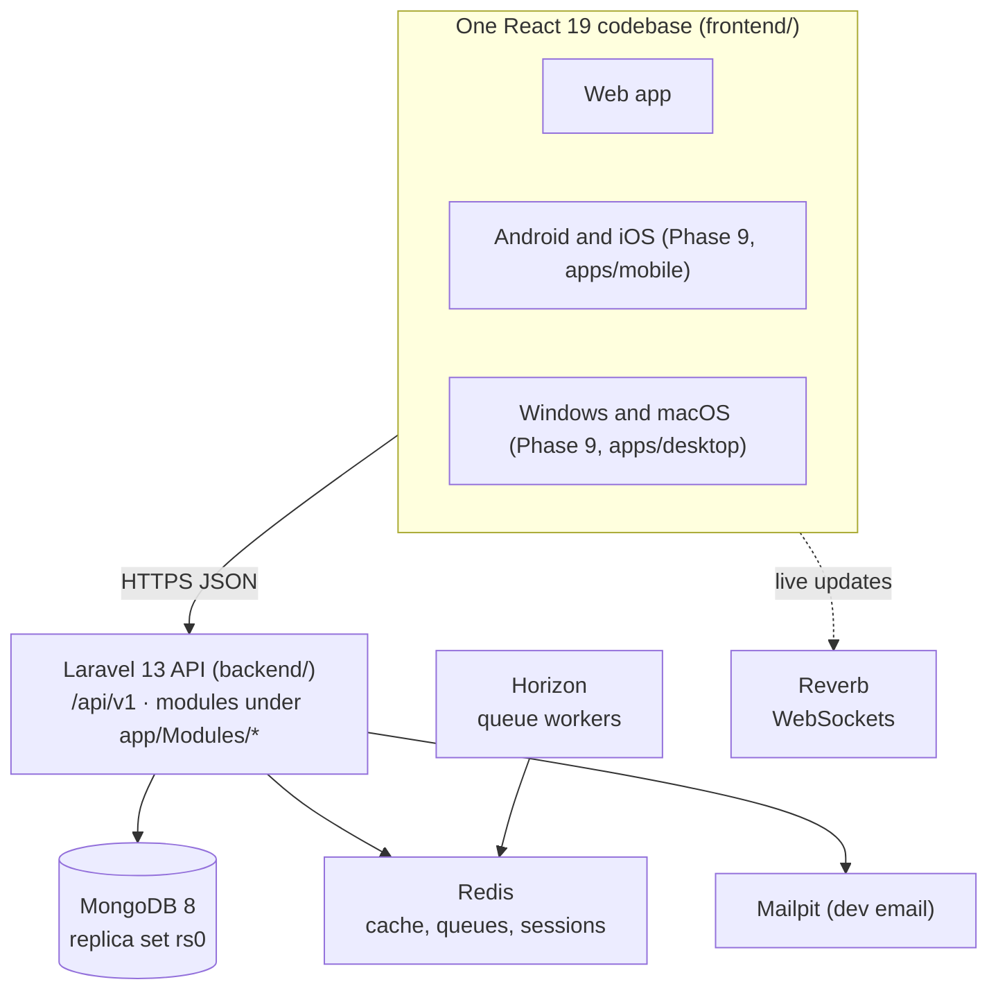

# Overview

## What Campus TAB is

Campus TAB is one school-management platform used by many schools at once. Each school activates it with a licence key and then runs its daily work in it: student and staff records, attendance, leave, tests and marks, report cards, fees, notices and a parent app. Every screen shows the Campus TAB logo and name top-left with the school's own logo and name below.

The full plan is in [`docs/BLUEPRINT.md`](../BLUEPRINT.md); the build order is in [`docs/BUILD-PROMPTS.md`](../BUILD-PROMPTS.md).

## Who uses it

| Level | Role | In one line |
| --- | --- | --- |
| 100 | Platform Admin | Our company: schools, licences, support (never school data without a grant) |
| 90 | Chief Admin | The school's key holder: everything in the school |
| 80 | Principal | Runs the school: staff, final leave decisions, assessment, results, fees approvals |
| 70 | Vice Principal / Coordinator | Principal powers for one wing |
| 60 | Clerk | Office work: admissions, records, leave verification, exam admin, fees |
| 50 | Class Teacher | Own section: attendance, remarks, marks verification |
| 40 | Subject Teacher | Own subject-sections: tests and marks |
| 30 | Staff | Own attendance, leave and profile |
| 20 | Parent | Own children: attendance, marks, report cards, fees, leave |
| 10 | Student | Own published results, attendance and notices |

## Architecture

- **Front end** (`frontend/`): React 19 + TypeScript, built with Vite. Uses the design tokens and logo from `packages/ui/`. From Phase 1 it calls the API through a typed client generated into `packages/api/`.
- **Back end** (`backend/`): one Laravel application (a "modular monolith"). Each business area is a module folder under `backend/app/Modules/` with its own routes, controllers, domain code and tests.
- **Database**: MongoDB, one shared database; every school document carries `tenant_id` (from Phase 1). It runs as a replica set even on a laptop, because transactions need one.
- **Redis**: cache, sessions and the job queue. **Horizon** runs the queue workers; **Reverb** pushes live updates to screens.
- **Local stack**: everything above runs in Docker from [`infra/docker-compose.yml`](../../infra/docker-compose.yml). See [operations.md](operations.md).

## How the parts link

| From | To | How |
| --- | --- | --- |
| Browser | Vite dev server (`127.0.0.1:5173`) | Loads the React app |
| Vite dev server | API (`api:8000` inside Docker) | Proxies `/api` and `/sanctum`, so the browser sees one origin |
| API | MongoDB | `mongodb/laravel-mongodb` driver, connection `mongodb` |
| API | Redis | Cache, sessions, queue (`phpredis`) |
| Horizon | Redis | Takes jobs from the queue |
| Browser | Reverb (`127.0.0.1:8080`) | WebSockets, from Phase 3 |

## What exists today (Phase 0)

The foundations only: the Docker stack, the API with a health check and the shared error shape, an empty app shell with the brand stack, light and dark themes and English/Hindi, the design tokens, CI, and this report. Each later phase adds modules; see [CHANGELOG.md](CHANGELOG.md).
