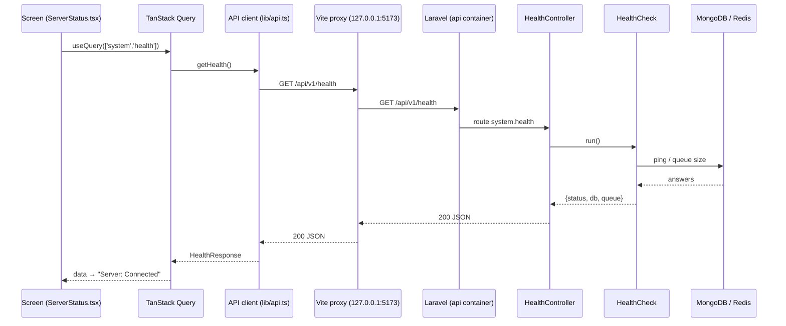

# A request, end to end

This page follows one real request from the screen to the database and back, naming the file at every step. In Phase 0 the only request is the health check; from Phase 1 a signed-in request adds the sign-in, school, licence and permission checks marked "from Phase 1" below.

## The journey

## Step by step

| # | Step | File | What happens |
| --- | --- | --- | --- |
| 1 | Screen | [`frontend/src/features/shell/ServerStatus.tsx`](../../frontend/src/features/shell/ServerStatus.tsx) | Asks TanStack Query for `['system','health']`, refreshed every 30 s |
| 2 | API client | [`frontend/src/lib/api.ts`](../../frontend/src/lib/api.ts) | `getHealth()` → `fetch('/api/v1/health')` with `Accept: application/json` and cookies; turns an error body into an `ApiError` (Phase 1 replaces this with the generated client in `packages/api/`) |
| 3 | Dev proxy | [`frontend/vite.config.ts`](../../frontend/vite.config.ts) | `/api` is forwarded to `http://api:8000`, so the browser only ever talks to `127.0.0.1:5173` |
| 4 | Entry point | `backend/public/index.php` → [`backend/bootstrap/app.php`](../../backend/bootstrap/app.php) | Boots Laravel; API routes live under the `/api/v1` prefix |
| 5 | Routes | [`backend/routes/api.php`](../../backend/routes/api.php) → [`backend/app/Modules/System/routes.php`](../../backend/app/Modules/System/routes.php) | Matches `GET health` → `HealthController` |
| 6 | Checks | `api` middleware group (Sanctum's stateful-API middleware is on) | Phase 0: none needed, the route is public. **From Phase 1:** signed in (Sanctum) → school from the user (`BelongsToTenant`) → licence active and module enabled → Policy allows the action |
| 7 | Controller | [`HealthController.php`](../../backend/app/Modules/System/Http/Controllers/HealthController.php) | Calls the domain service, picks HTTP 200 or 503 |
| 8 | Service | [`HealthCheck.php`](../../backend/app/Modules/System/Domain/HealthCheck.php) | Pings MongoDB and asks the Redis queue for its size; logs failures without returning them |
| 9 | Model / database | `MongoDB\Laravel\Connection` | Phase 0 sends a `ping` command only. From Phase 1 a model (with `BelongsToTenant`) reads or writes a collection |
| 10 | Response | Laravel JSON response | `{"status":"ok","db":"ok","queue":"ok"}`; any exception becomes the error shape via [`ApiExceptionRenderer.php`](../../backend/app/Support/Http/ApiExceptionRenderer.php) |
| 11 | Screen | `ServerStatus.tsx` | Shows a green dot and "Connected", or red and "Not reachable" |

## When it goes wrong

- **API unreachable** (container stopped): the proxy returns 502/504, `getHealth()` throws, the screen shows "Not reachable".
- **MongoDB or Redis down**: the API answers 503 with that part as `"fail"`; the reason is in the API log (`docker compose logs api`).
- **Any other error**: the API answers with `{ "error": { "code", "message", "details" } }`; see [modules/system.md](modules/system.md) section 3 for the codes.
