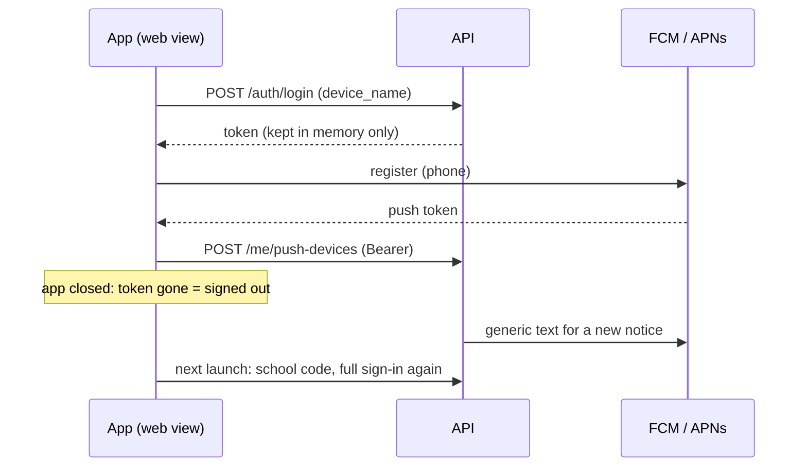

# Apps (Android, iOS, Windows, macOS)

## 1. What it does (plain words, no code)

One React build runs in four app shells: Capacitor 8 for Android and iOS, Tauri 2 for Windows and macOS. They show exactly the screens of the web app. What differs:

- **Sign in every time.** The sign-in token stays in the app's memory only. Closing the app signs you out. There is no fingerprint, face or PIN unlock, and nothing about the sign-in is saved on the device.
- **School code first.** A new install asks for the school code, then loads that school's name and logo (the same screen as the web app). The code is remembered; it is not a secret.
- **Links open in the app.** A report-card QR link (`/verify/…`) or a password link (`/password/…`) opens the app on that screen: `campustab://…` links always, and `https://<web address>/…` links once the domain is set up.
- **Push on phones.** After you sign in, the phone registers for push. The same generic texts as email arrive ("You have a new notice in Campus TAB"). They keep arriving after you close the app, until you sign out on purpose, are signed out remotely, or 30 days pass without a sign-in on that phone.
- **The API address is fixed when the app is built**, so each build talks to one server.
- **Builds run in GitHub Actions**, never on the owner's PC.

## 2. Who uses it and from which screens

Everyone, from the same screens as the web app. App-only code:

| File | What it does |
| --- | --- |
| [`frontend/src/lib/native.ts`](../../frontend/src/lib/native.ts) | Deep links, push registration, the Android back button, signing out on window close (desktop) |
| [`frontend/src/stores/appToken.ts`](../../frontend/src/stores/appToken.ts) | The in-memory token |
| [`frontend/src/lib/api.ts`](../../frontend/src/lib/api.ts), [`packages/api/src/index.ts`](../../packages/api/src/index.ts) | `getToken`: bearer header, no cookies, no CSRF call |
| [`frontend/src/features/auth/api.ts`](../../frontend/src/features/auth/api.ts) | Keeps the token from the sign-in answer; a sign-out on purpose removes push first |
| [`apps/mobile/`](../../apps/mobile/README.md) | Capacitor project (Android, iOS) |
| [`apps/desktop/`](../../apps/desktop/README.md) | Tauri project (Windows, macOS) |
| [`.github/workflows/apps.yml`](../../.github/workflows/apps.yml), [`.github/scripts/app-env.mjs`](../../.github/scripts/app-env.mjs) | The four builds and their build-time settings |

## 3. Requests it handles

No new screens. The apps use:

| Request | Notes |
| --- | --- |
| `POST /auth/login`, `/auth/mfa/verify`, `/auth/otp/verify` with `device_name` | Answer has `mode: token`, `token`, `token_expires_at` |
| `POST /auth/logout {closing?: bool}` | `closing: true` (desktop window closing) ends the sign-in but keeps push |
| `POST /me/push-devices {token, platform}` | After every sign-in; stores the sign-in it belongs to and `last_seen_at` |
| `DELETE /me/push-devices {token}` | On a sign-out on purpose (token in the body, never the address) |

CORS: `AppOriginCors` answers the app origins (`APP_ORIGINS`) without credentials.

## 4. Code map

Back end: [`backend/app/Support/Http/AppOriginCors.php`](../../backend/app/Support/Http/AppOriginCors.php); push drivers in [`backend/app/Support/Push/`](../../backend/app/Support/Push/) (`FcmPushSender`, `ApnsPushSender`, `NativePushSender`, `Jwt`); [`Communication/Listeners/ForgetPushDevices.php`](../../backend/app/Modules/Communication/Listeners/ForgetPushDevices.php); [`Communication/Console/ForgetStalePushDevicesCommand.php`](../../backend/app/Modules/Communication/Console/ForgetStalePushDevicesCommand.php); [`Identity/Events/DeviceSessionEnded.php`](../../backend/app/Modules/Identity/Events/DeviceSessionEnded.php). Front end and apps: see section 2.

## 5. How the code works, step by step

## 6. Data it reads and writes

`push_devices`: `token` (encrypted), `token_hash`, `platform`, `device_session_id`, `last_seen_at`. Nothing new on the device except the school code (already stored by the web app).

## 7. Links to other modules

Identity (`SessionIssuer` fires `DeviceSessionEnded`), Communication (push).

## 8. Settings that change its behaviour

Back end: `PUSH_DRIVER=native`, `FCM_CREDENTIALS`, `APNS_KEY`, `APNS_KEY_ID`, `APNS_TEAM_ID`, `APNS_BUNDLE_ID`, `APNS_SANDBOX`, `APP_ORIGINS`; `communication.push.forget_after_days` (30), `communication.push.forget_on`. Build: `VITE_APP_SHELL`, `VITE_API_BASE_URL`, `VITE_PUBLIC_WEB_URL`, `VITE_PUSH_ENABLED`, `VITE_REVERB_*`, `CAMPUS_DEV_HTTP`, `CAMPUS_DEEP_LINK_HOST`. CI secrets: see `apps.yml`.

## 9. Permissions and the rules behind them

Same permissions as the web app. Owner's rule: token in memory only, no biometric or PIN, closing signs out (CONVENTIONS 3.11, decision 0016).

## 10. How to change it

- Another deep-link screen: add its pattern to `LINKABLE` in `native.ts` (and a test), and the path to the Android intent filter if https.
- A new native plugin: add it to `apps/mobile/package.json` **and** `frontend/package.json` (exact versions), import it only inside `native.ts`.
- Phone test against the PC: [apps/mobile/README.md](../../apps/mobile/README.md#test-the-android-app-on-your-phone-against-this-pc-same-wi-fi).

## 11. Tests that cover it

- `backend/tests/Feature/Communication/AppPushTest.php`: push after closing; removal on purpose, remotely and account-wide; 30-day prune; FCM (RS256 service-account sign-in, no data payload, `UNREGISTERED`); APNs (ES256 provider token, HTTP/2 headers, 410); routing; CORS without credentials.
- `frontend/src/lib/native.test.ts`: deep links; the bearer client sends no cookies and no CSRF call.
- CI: the **Apps** workflow builds the APK, the Windows installer and the unsigned iOS and macOS builds.

## 12. Decisions and limits

- [0016](decisions/0016-apps-sign-in-and-push.md).
- Phones cannot report being closed; the server ends that sign-in after the idle time.
- Excel downloads and PDF links work in the desktop apps; on phones they open the system browser or viewer.
- iOS and macOS builds are unsigned until the Apple Developer account exists (steps in the app READMEs). The Windows installer is not code-signed yet (SmartScreen warns once).
- Auto-update is compiled in only when the update host and key exist.

## 13. Change history

| Date | Phase | What changed | Why |
| --- | --- | --- | --- |
| 2026-11-28 | 9 | Page created: apps, push drivers, CI builds | Phase 9 items 1 and 2 with the owner's rules |
