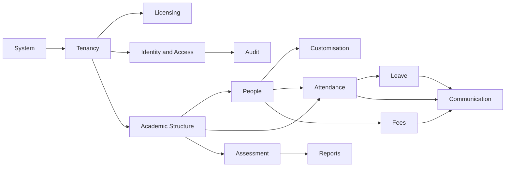

# Links and events

Which module calls which, the events each one sends and who listens.

## Phase 0

There is one module in code, **System**, and it sends no events. Every module will depend on it for the error shape (`ApiException`).

## Planned dependencies

From the blueprint; each phase replaces "planned" with what it actually built.

## Built so far (Phases 3 to 6)

| What | From | To | How |
| --- | --- | --- | --- |
| Student marked absent | Attendance (`AttendanceRegister`) | Communication | a direct call to `Notifier::notify()`, type `attendance.absent`, once per student per register |
| Notice published | Communication (`Notices::send`) | Communication | queued job `PublishNotice`, then `Notifier::notify()` |
| Notification created | Communication (`Notifier`) | the person's open screens | broadcast event `NotificationCreated` (`notification.created`) on `school.{tenant}.user.{user}` |
| Push and email | Communication (`Notifier`) | outside services | queued job `SendOutsideNotifications`, generic text only |
| Dashboard cards | Dashboard | Licensing, People, Communication, Attendance, Leave, Audit | direct reads through each card provider |
| Leave approved or cancelled | Leave (`LeaveWorkflow` → `LeaveEffects`) | Attendance | direct writes in the same transaction: staff LV (source `leave`), a child's LV; reverted for untaken days on cancel |
| Register opened or saved | Attendance (`AttendanceRegister`) | Leave | `StudentLeaveDays::onLeave()` pre-fills LV |
| Leave request moved | Leave | Communication | `Notifier::notify()` after commit, types `leave.updated` / `leave.waiting`, generic titles |
| Approvals inbox | Approvals | Leave, Assessment | `ApprovalSource` (`LeaveApprovals`, `CorrectionApprovals`) |
| Results published | Assessment (`PaperLifecycle::tellResultsOut`) | Communication | `Notifier::notify()` type `results.published`, "Results are out" only |
| Correction raised or decided | Assessment (`Corrections`) | Communication | type `marks.correction`; the Chief told of a self-approval |
| Markbook roll | Assessment (`Markbook`) | Attendance | `AttendanceRegister::roll()` |
| Year-end unpaid dues (Phase 9 fix) | Reports (`Promotion`) | Fees | `YearEndDues::unpaid()`, `settle()` inside the promotion's transaction; apply checks `unresolved()` |
| A sign-in ended (Phase 9) | Identity (`SessionIssuer::revoke`) | Communication | event `DeviceSessionEnded` → listener `ForgetPushDevices` (stops push only for a sign-out on purpose, a remote sign-out or an account reset) |
| Privacy notice published, data request moved, retention report ready (Phase 9) | Privacy | Communication | `Notifier::notify()`, types `privacy.notice`, `privacy.request`, `privacy.retention` (generic texts) |
| Large export (Phase 9) | `ExportGuard` (Fees, Attendance, People, Privacy) | Communication, Audit | `export.made` audit; type `export.large` to the Chief |
| Every upload (Phase 9) | the `school` middleware group | ClamAV | `ScanUploadedFiles` before any controller |

| Event (planned) | Sent by | Listened to by | Phase |
| --- | --- | --- | --- |
| Student marked absent | Attendance | Communication (notify parent) | 4 |
| Marks published | Assessment | Reports | 7 |
| Payment confirmed | Fees | Communication (receipt to parent) | 8 |
| Any write | every module | Audit | 1 |
