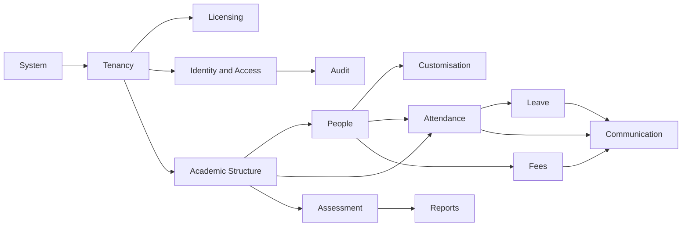

# Links and events

Which module calls which, the events each one sends and who listens.

## Phase 0

There is one module in code, **System**, and it sends no events. Every module will depend on it for the error shape (`ApiException`).

## Planned dependencies

From the blueprint; each phase replaces "planned" with what it actually built.

| Event (planned) | Sent by | Listened to by | Phase |
| --- | --- | --- | --- |
| Leave approved | Leave | Attendance (mark "On leave"), Communication (notify) | 5 |
| Student marked absent | Attendance | Communication (notify parent) | 4 |
| Marks published | Assessment | Communication, Reports | 6 |
| Payment confirmed | Fees | Communication (receipt to parent) | 8 |
| Any write | every module | Audit | 1 |
