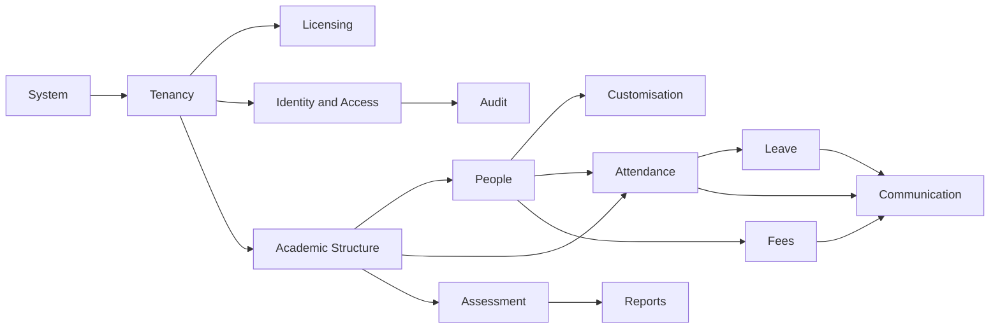

# Links and events

Which module calls which, the events each one sends and who listens.

## Phase 0

There is one module in code, **System**, and it sends no events. Every module will depend on it for the error shape (`ApiException`).

## Planned dependencies

From the blueprint; each phase replaces "planned" with what it actually built.

## Built so far (Phases 3 and 4)

| What | From | To | How |
| --- | --- | --- | --- |
| Student marked absent | Attendance (`AttendanceRegister`) | Communication | a direct call to `Notifier::notify()`, type `attendance.absent`, once per student per register |
| Notice published | Communication (`Notices::send`) | Communication | queued job `PublishNotice`, then `Notifier::notify()` |
| Notification created | Communication (`Notifier`) | the person's open screens | broadcast event `NotificationCreated` (`notification.created`) on `school.{tenant}.user.{user}` |
| Push and email | Communication (`Notifier`) | outside services | queued job `SendOutsideNotifications`, generic text only |
| Dashboard cards | Dashboard | Licensing, People, Communication, Attendance, Audit | direct reads through each card provider |

| Event (planned) | Sent by | Listened to by | Phase |
| --- | --- | --- | --- |
| Leave approved | Leave | Attendance (mark "On leave"), Communication (notify) | 5 |
| Student marked absent | Attendance | Communication (notify parent) | 4 |
| Marks published | Assessment | Communication, Reports | 6 |
| Payment confirmed | Fees | Communication (receipt to parent) | 8 |
| Any write | every module | Audit | 1 |
