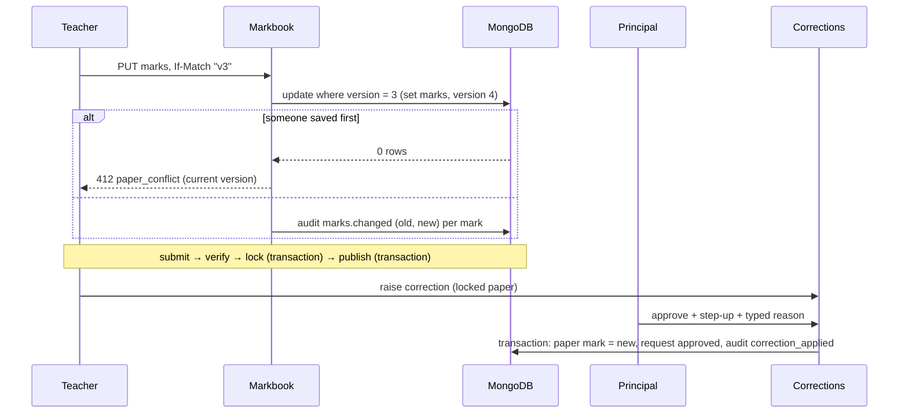

# Assessment

> Status: **built in Phase 6**, back end and screens. Every request below works and is tested. Report cards (grading engine, PDFs) come in Phase 7.

## 1. What it does (plain words, no code)

**Schemes.** The Principal (or the Clerk, who "sets up") builds the school's own assessment scheme for a group of classes: terms, components with maximum marks and weightage (adding up to 100%), a grade scale and rules (pass percentage, rounding, best-of, grace marks). A scheme may start from a **starter preset** (CBSE-style VI–VIII, CBSE-style IX–X, a simple two-term one). Presets are **starting points only** (owner's rule): each carries "Check against your board's latest circular and change anything that differs", shown whenever it is chosen and on the scheme afterwards, and every part can be changed.

**Exams and class tests.**

- A **school exam** (periodic, half-yearly, annual, practical, project, internal) is scheduled by whoever holds `exams.schedule` (Principal, Clerk). Its papers start as drafts and open together.
- A **class test** (weekly or monthly) is set by a teacher for their **own** subject-sections only (a class teacher also for their class); its papers open at once.
- Each **paper** is one section × one subject × one assessment, with the maximum marks and date, and the marks embedded.

**The lifecycle**, each move permission-checked:

| From | Move | To | Who |
| --- | --- | --- | --- |
| draft | open | open | exams: `exams.schedule`; class tests: `tests.create` in scope |
| open | submit (every student has a mark, AB or ML) | submitted | whoever may enter marks on it |
| submitted | verify | verified | the class teacher (`marks.verify`) |
| submitted, verified | send back with a note | open | the class teacher or the office |
| verified | lock (one paper, or every verified paper of an assessment, **in one transaction**) | locked | `marks.lock` (Principal, Clerk, a Vice Principal's wing) |
| locked | publish (one or all, **in one transaction**) | published | `results.publish` |

- **Auto-publish class tests** (`policies.marks.auto_publish_class_tests`): a class test is published at submit. Its marks **stay editable until it is locked** (owner's decision this session), and every change is audited.
- **Who enters marks:** the subject teacher (subject scope), the Clerk (school scope, before lock), a Vice Principal for their wing. The class teacher **only if the school switches on `policies.marks.class_teacher_can_enter`** (the matrix's "Class (if enabled)").

**The markbook** follows `Markbook.dc.html`:

- **Online only** (owner's rule): there is no offline entry, and nothing is queued on the device. Offline, the inputs are disabled and a message says the marks save once the device is back online.
- **Keyboard:** Tab moves across; Enter and the arrow keys move down and up.
- **Paste from Excel:** a pasted column fills down from the cell, and a second column goes into the remarks.
- **Values:** 0 to the maximum in steps of 0.5, or **AB** (absent) / **ML** (medical). Values above the maximum are refused on screen and on the server.
- **Autosave** after a pause, with **`If-Match`** on the paper's version. If someone else saved in between, the server answers **412 `paper_conflict`**: their marks are shown, the cells you changed stay highlighted, and you save again. Nothing is overwritten.
- Live counts (entered, average, highest, absent). On phones, one card per student with a number keypad.

**Corrections after lock** (a fixed rule in code, not a setting):

1. Anyone with `marks.correction_request` over the paper (the Clerk, the teachers, the Chief, **and the Principal**) raises a request: the student, the new mark (or AB or ML) and a reason of at least 10 characters. The old mark is taken from the paper. One pending request per mark.
2. **Only the Principal** (`marks.correction_approve`) decides, **from their own account**:
   - the route needs **step-up MFA** (`marks_correction_approve`, owner's rule)
   - the Principal **types a reason**
   - support access can never do it
3. If **the Principal raised it**, approving is still a **separate step**: the MFA code must have been entered **after** the request was raised. The correction is flagged **self-approved**; the Chief is notified, sees it on the dashboard, and can list them (`/tests/corrections?self_approved=1`).
4. On approval, the mark changes **in one MongoDB transaction** with the request, and only if the paper still holds the old mark.
5. **What is kept:**
   - on the request: old and new mark, both reasons, who asked, who decided and when
   - in the audit log: `marks.correction_applied` with old and new
6. Rejecting keeps the locked mark, with the Principal's reason.

There is **no "unlock marks"** action (owner's decision). `marks.unlock` and the `marks_unlock` step-up action are gone, and `identity:sync-roles --with-new-permissions` takes `marks.unlock` out of stored roles.

**Every changed mark is in the audit log** as its own `marks.changed` entry, with the old and new value (value, code, remark) and the student.

**Who sees marks.** Staff see papers in their scope. **Students and parents see a paper only once it is published** (owner's rule), through `GET /results/students/{id}`, `GET /results/mine` and the Results screens. Publishing notifies them only that **results are out**, never the marks.

**The completion grid**: sections down, subjects across, each cell the paper's state and how many marks are in. The class teacher sees their class; the Principal sees every section.

## 2. Who uses it and from which screens

Screens are in [frontend.md](../frontend.md#phase-6-tests-and-marks-screens).

| Who | Screens |
| --- | --- |
| Subject teacher | `/tests` (my papers), `/tests/new` (class test), `/tests/papers/:id` (markbook), "Ask to correct" on a locked paper |
| Class teacher | the papers of their class to verify or send back, the completion grid; class tests for their class |
| Clerk | `/tests/new` (schedule exams), open all, lock, corrections |
| Principal | lock and publish (one or all), `/tests/schemes`, corrections in `/approvals`, the completion grid |
| Chief | the self-approved corrections card and list |
| Parent, student | `/results`, the Results tab on the student profile |

## 3. Requests it handles

All are in the `school` group behind `module:assessment`. Creates and lifecycle moves accept an `Idempotency-Key`.

| Method and path | Input | Output | Permission |
| --- | --- | --- | --- |
| `GET /assessment-schemes` | — | this year's schemes | `assessment.scheme`, `assessment.setup`, `exams.schedule` or `tests.create` |
| `GET /assessment-schemes/presets` | — | presets with label and note | `assessment.scheme` or `assessment.setup` |
| `POST /assessment-schemes` | name, grades[], preset? | the scheme (201), filled from the preset | same |
| `PUT /assessment-schemes/{id}` | name, grades, terms, components (weights total 100), grade_scale, rules, status | the scheme | same |
| `GET /assessments` | — | this year's assessments with papers I may see, counts by state | any marks ability |
| `POST /assessments` | kind, type, name, term?, component?, from, to, entry_closes_at?, papers[{section_id, subject_id, max_marks, date?}] | the assessment and its papers (201) | `exams.schedule` (exam) or `tests.create` in scope (class test) |
| `GET /assessments/{id}` | — | the assessment and my papers with `can` | sees one of its papers |
| `GET /assessments/{id}/completion` | — | subjects, sections with cells | same |
| `POST /assessments/{id}/open` · `/lock` · `/publish` | section_id? | the assessment | `exams.schedule`/`tests.create` · `marks.lock` · `results.publish` |
| `GET /papers/{id}` | — | the paper, roll with marks, `can`, pending corrections, history; `ETag: "v<n>"` | may view it, else 404 |
| `PUT /papers/{id}/marks` | `If-Match: "v<n>"`, marks{student_id: {value?, code?, remark?}} | the paper | `marks.enter` in scope; 428 without If-Match, 412 `paper_conflict` when stale |
| `POST /papers/{id}/open` · `/submit` · `/verify` · `/send-back` {note} · `/lock` · `/publish` | — | the paper | as in the lifecycle table |
| `GET /corrections` | status?, self_approved? | what I may see: mine, or all for the Principal and the Chief | any marks ability |
| `POST /corrections` | paper_id, student_id, value?, code?, reason | the request (201) | `marks.correction_request` in scope; the paper locked |
| `GET /corrections/{id}` | — | the request | requester, Principal, Chief, or may raise on that paper |
| `POST /corrections/{id}/approve` | reason (10+ characters) | the request, approved, mark applied | `marks.correction_approve` + **step-up `marks_correction_approve`** (+ a code newer than the request if self-raised) |
| `POST /corrections/{id}/reject` | reason | the request | `marks.correction_approve` |
| `GET /results/students/{id}` | — | published marks only | `results.view` on that student (child, own, school) |
| `GET /results/mine` | — | a student's own published marks | `results.view` |

**Errors:**

- 409: `paper_conflict` (412), `marks_locked`, `paper_not_open`, `paper_transition_invalid`, `paper_not_locked`, `correction_pending`, `correction_decided`, `correction_stale`
- 422: `marks_incomplete`, `mark_above_max`, `mark_invalid`, `mark_code_invalid`, `correction_same`, `reason_required`, `weights_total`, `component_duplicate`, `class_test_type`, `paper_duplicate`
- 403: `step_up_required` (with `details.self` for a self-raised correction), `permission_denied`
- 428: `precondition_required`

## 4. Code map

**Back end** (`backend/app/Modules/Assessment/`):

| File | What it does |
| --- | --- |
| `Models/AssessmentScheme.php` | terms, components, grade scale, rules, preset |
| `Models/Assessment.php` | an exam or class test |
| `Models/Paper.php` | section × subject × assessment, marks embedded, `version` (ETag); marks audited one by one, so `marks` is left out of the automatic entry |
| `Models/CorrectionRequest.php` | a correction: old, new, reasons, who, when, self_approved |
| `Domain/PaperAccess.php` | who may view, enter (class teachers only with the setting), verify, lock, publish, correct, open |
| `Domain/Markbook.php` | the roll with marks; conditional save on the version; validation; a `marks.changed` audit entry per mark |
| `Domain/PaperLifecycle.php` | open, submit (auto-publish), send back, verify, lock and publish in transactions; "results are out" |
| `Domain/Corrections.php` | raise, approve (separate MFA step when self-raised, transaction, audit), reject |
| `Domain/Assessments.php` | create exams and class tests with their papers, my papers, `can`, completion grid, published results |
| `Domain/CorrectionApprovals.php` | pending corrections in the Principal's approvals inbox |
| `Http/Controllers/{AssessmentController,PaperController,CorrectionController,SchemeController}.php` | the requests above |
| `Policies/AssessmentPolicy.php` | paper view (404), correction view, scheme management |
| `routes.php` · `AssessmentServiceProvider.php` | routes; policies |

Also: `backend/config/assessment.php` (codes, step, reason length, types, **presets**), `backend/database/migrations/2026_11_30_000002_create_assessment_collections.php`, `backend/app/Modules/Dashboard/Domain/Cards/AssessmentCards.php`, `backend/database/seeders/DemoMarksSeeder.php`.

**Front end** (`frontend/src/features/assessment/`): `api.ts`, `TestsPages.tsx` (list, new, assessment with completion grid, corrections, results), `MarkbookPage.tsx`, `CorrectionPanel.tsx` (the inbox panel), `SchemesPage.tsx`, `StudentResultsTab.tsx`, `assessment.test.tsx`.

## 5. How the code works, step by step

1. **Conflicts** come from a conditional update: `Paper::where(version = expected)->update(...)`. Zero rows changed means someone saved first, so the server answers 412 with the current version.
2. **Locking and publishing** read and change every chosen paper inside one MongoDB transaction (5 attempts); a paper in the wrong state or out of scope aborts all of them.
3. **A correction** re-reads the request and the paper inside the transaction and refuses (`correction_stale`) if the mark is no longer the old one.
4. **Self-approval:** `step_up_at` on the device session must be later than the request's `created_at`.

## 6. Data it reads and writes

| Collection | Holds | Indexes |
| --- | --- | --- |
| `assessment_schemes` | year_id, name, grades[], terms[], components[], grade_scale[], rules{}, preset, status | tenant + year |
| `assessments` | year_id, kind, type, term, name, component, from, to, entry_closes_at, created_by | tenant + year + from |
| `papers` | assessment_id, year_id, section_id, section_label, subject_id, subject_name, wing, class_test, max_marks, date, status, version, marks[{student_id, value, code, remark}], published_at, locked{}, history[], returned_note | tenant + assessment + section + subject (unique); tenant + year + status; tenant + marks.student_id + published_at |
| `correction_requests` | paper_id, assessment_id, student_id, student_name, section_id, label, old, new, reason, requested_by{}, requested_by_id, status, decided_by, decision_reason, decided_at, self_approved | tenant + status + created_at; tenant + paper + student + status |

It reads `sections`, `subjects`, `teaching_assignments`, `enrolments`, `students` and `guardians`, and the roll through `Attendance\Domain\AttendanceRegister::roll`.

## 7. Links to other modules

- **Communication:** `results.published` ("Results are out"), `marks.correction` (generic texts; the Chief told of a self-approval).
- **Approvals:** `CorrectionApprovals`.
- **Dashboard:** `AssessmentCards`.
- **Identity:** permissions, scopes (subject_key, section, wing), step-up.
- **Audit:** `marks.changed`, `marks.correction_applied`.
- **Phase 7 (Reports)** will read published papers and schemes.

## 8. Settings that change its behaviour

- School config `policies.marks`: `auto_publish_class_tests` (true) and `class_teacher_can_enter` (false, new).
- `config/assessment.php`: codes, `mark_step` (0.5), `remark_max` (200), `reason_min` (10), types, class-test types, presets.
- `config/identity.php` step-up action `marks_correction_approve`.

See [configuration.md](../configuration.md).

## 9. Permissions and the rules behind them

| Ability | Chief | Principal | Vice Principal | Clerk | Class T. | Subject T. | Parent | Student |
| --- | --- | --- | --- | --- | --- | --- | --- | --- |
| `assessment.scheme` / `assessment.setup` | School | School | — | Setup | — | — | — | — |
| `exams.schedule` | School | School | — | School | — | — | — | — |
| `tests.create` | School | School | Wing | School | Class | Subject | — | — |
| `marks.enter` | School | School | Wing | School (before lock) | Class (if enabled) | Subject | — | — |
| `marks.verify` | School | School | Wing | — | Class | — | — | — |
| `marks.lock` | School | School | Wing | School | — | — | — | — |
| `marks.correction_request` | School | **School (new)** | — | School | Class | Subject | — | — |
| `marks.correction_approve` | — | School | — | — | — | — | — | — |
| `results.publish` | School | School | Wing | — | — | — | — | — |
| `results.view` | School | School | — | — | — | — | Child | Own |

Fixed rules in code:

- a locked mark changes only through a correction the Principal approves, with MFA and a typed reason
- the Principal's own correction is a separate MFA step, flagged and shown to the Chief
- no unlock
- students and parents see only published marks

## 10. How to change it

- **A new preset:** add it to `config/assessment.php` `presets`, with the same note.
- **A new code** (for example EX exempt): `config/assessment.php` `codes`, `parseCell` in `features/assessment/api.ts`, the translations.
- **Weightage or grading maths** belongs in Phase 7's grading engine; schemes only store it.
- Run `php artisan test tests/Feature/Assessment` and `npm test -w @campus-tab/frontend -- assessment`.

## 11. Tests that cover it

- `backend/tests/Feature/Assessment/MarksTest.php`:
  - **the four "done when" items:** a conflict (412) instead of an overwrite; a locked paper refusing edits by everyone; a post-lock change refused without the Principal (Clerk, teacher and Chief refused, step-up and typed reason required); old and new in the audit log
  - mark validation; the lifecycle order and who may do each move
  - class tests only in scope; auto-publish editable until lock
  - the class-teacher setting; presets and scheme edits; weights total
  - self-approval needing a fresh code, flagged, on the Chief's dashboard, and the Chief notified
  - published-only results, with a notification that holds no marks
  - bulk lock and the completion grid
  - `marks.unlock` retired, including from stored roles by sync-roles
  - corrections in the inbox
- `frontend/src/features/assessment/assessment.test.tsx`: above-max refused before sending; `If-Match` and the conflict banner keeping my cells; a locked paper read-only with "Ask to correct"; the Principal's code and reason before approving; the board-circular note on presets.

## 12. Decisions and limits

- [Decision 0014](../decisions/0014-marks-lifecycle-and-corrections.md).
- The grading engine, best-of and grace are stored in schemes but applied in Phase 7.
- A student who joins after a paper is made appears with an empty mark (the roll is read live).
- Online only by the owner's rule; Dexie is not used for marks.

## 13. Change history

| Date | Phase | What changed | Why |
| --- | --- | --- | --- |
| 2026-11-27 | 0 | Page created from the template | Phase 0 starts the Application Report |
| 2026-11-27 | 6 | Assessment module built: schemes with presets, exams and class tests, papers, the markbook with ETag conflicts, the lifecycle with transactional lock and publish, Principal-only corrections with step-up, results for parents and students, screens | Phase 6 of `docs/BUILD-PROMPTS.md` with the owner's six rules |
