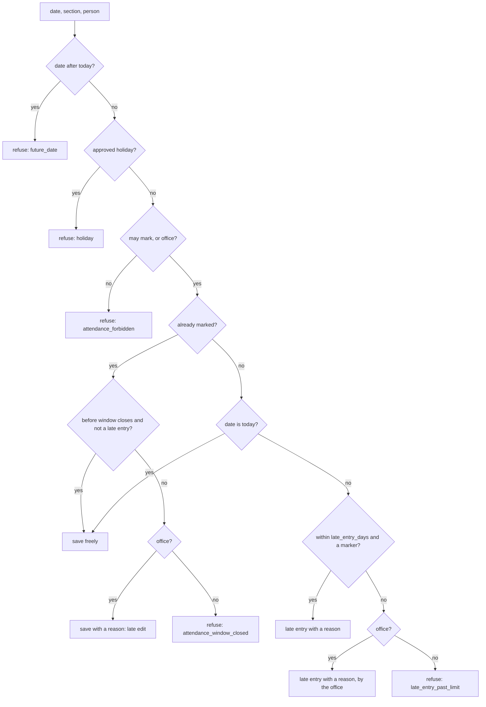

# Attendance

> Status: **built in Phase 4**, back end and screens. Every request below works and is tested; the screens are listed in [frontend.md](../frontend.md#phase-4-attendance-screens).

## 1. What it does (plain words, no code)

**The student register.**

- **Everyone is present by default.** The teacher marks only the exceptions and saves the whole class in one go.
- **Codes:** P present, A absent, L late, HD half-day. LV (on leave) and H (holiday) are not typed: H comes from the approved holiday calendar, and LV will come from approved leave in Phase 5.
- **Daily or per period**, as the school chooses. In daily mode the class teacher marks (or anyone with class, wing or school scope over the section). In period mode subject teachers mark their periods too.
- **Online only.** There is no offline marking; a missed day is entered later from the paper register (below).

**Changing a day.**

- The teacher may change today's register freely **until the edit window closes**: the school's start time plus the edit window hours (08:00 + 4 hours by default).
- After that, only the **Clerk or the Principal** (anyone with `attendance.edit_after_window`) may change it, and they must give a reason.

**The paper-register late entry.** When the internet was down, the teacher keeps the paper register and enters the day later.

- It only fills a day that was **never marked**; it never overwrites a marked day.
- It needs a **reason** (at least 5 characters) and may carry a **photo** of the paper page. The photo is stored privately and shown only through a short-lived signed link.
- It is shown as a **late entry** on the register, in the daily summary and in the monthly register, and it is **audited** with the reason.
- The teacher may do this within **`late_entry_days`** of the date (7 by default). After that only the Clerk or the Principal may, with a reason.
- A day that was entered late cannot be changed again by the teacher; a later change goes to the office with a reason.

**Upload instead of ticking.** The teacher can download an Excel template of the class (roll number, admission number, name, status P), fill it from paper, and upload it as Excel or CSV. A dry run shows every row as ok or error; the commit saves the register through the same rules as the screen.

**Telling parents.** When a student is marked absent, their parents who have a login get one notification per day, even in period mode when the child misses several periods. A late entry names the date ("Aarav Patel was absent on 3 December"); today's says "is marked absent today". Push and email carry only the generic text.

**Staff attendance.**

- **Check-in by the app button.** If the school turns on the geofence, the phone's location is compared with the school's area and then dropped: only `inside_area` (true or false) is kept, never the location. Screens are told only that the geofence is on, never the school's coordinates.
- **Check-in by the office QR code.** The office screen shows a code that changes every few minutes (5 by default); the code just before is still accepted, because the screen may be a minute behind.
- **Biometric devices:** a CSV import (employee_code, date, in, out), with a dry run first.
- **Late:** a check-in after the school's `late_after` time (08:15 by default) is marked L.
- **Manual entry** for someone who could not check in, with the time and a reason. It is made by someone at a **higher level** than the person, and **never by the person themself**, using the same level check as user management. In practice: the Attendance Officer (usually the Clerk) records teachers and staff, the Vice Principal or Principal records the Clerk, the Principal records the Vice Principal, and the Chief records the Principal.

**The holiday calendar.** The Clerk keeps it (holidays and events); the Principal approves or rejects. Only an **approved holiday** closes the register for its dates.

**Reports.** The daily summary (per section: marked or not, counts, % present; staff present, late and not in), the printable monthly register (students by days, with each student's %), each student's % for the year, and the students below the school's threshold (75% by default). Parents and students get one child's or their own days only.

## 2. Who uses it and from which screens

The screens are listed in [frontend.md](../frontend.md#phase-4-attendance-screens). Who uses them:

- **Class teachers** (and subject teachers in period mode): today's register at `/attendance/:sectionId`, late entries, upload.
- **Clerk and Principal:** late edits and old late entries, the calendar, the staff day, the office QR screen, the biometric import, reports.
- **Vice Principal:** their wing's registers and reports; manual staff entries for the Clerk.
- **Every staff member:** their own check-in and month.
- **Parents and students:** one child's or their own days.

The dashboard already shows attendance cards (see [dashboard.md](dashboard.md)).

## 3. Requests it handles

All are in the `school` group.

**Student register:**

| Method and path | Input | Output | Permission |
| --- | --- | --- | --- |
| `GET /attendance/settings` | — | the school's attendance settings with `today` and `timezone`; the geofence only as `{enabled}` | `attendance.view`, `attendance.mark`, `staff_attendance.mark` or `staff_attendance.manage` |
| `GET /attendance/sections/{id}/days/{date}` | period? | the roll with each status, holiday, marked by and when, late_entry, source, day_id, and `rules` (what you may do now) | `attendance.view` or `attendance.mark` + section scope |
| `PUT /attendance/sections/{id}/days/{date}` | period?, statuses{student_id: P, A, L, HD}, reason? | the register again | as above, then `AttendanceRegister::rules` |
| `GET /attendance/sections/{id}/template` | date? | .xlsx to fill from paper | as above |
| `POST /attendance/sections/{id}/days/{date}/import` | file (.xlsx or .csv, up to 2 MB), reason?, period?, commit? | rows, ok, errors, absent, rules, committed | as above |
| `POST /attendance/days/{id}/photo` | photo (PNG, JPEG, WebP, up to 5 MB) | has_photo (201) | a late entry only; the person who entered it, or the office |
| `POST /attendance/days/{id}/photo/link` | — | a relative signed `url`, valid 5 minutes | may view the day |
| `GET /files/attendance/{tenant}/{day}` | — | the photo, `no-store` | the signed link only |

**Reports:**

| Method and path | Input | Output | Permission |
| --- | --- | --- | --- |
| `GET /attendance/summary` | date? | per section: marked, late_entry, counts, percent; totals; staff (for those who may see staff attendance) | holds `attendance.view` |
| `GET /attendance/register` | section_id, month (YYYY-MM) | dates, students with marks and percent, late-entry dates | section scope |
| `GET /attendance/students/{id}` | month? | the student's days in the month, % this year, threshold | `attendance.view` on that student (parents: their child) |
| `GET /attendance/below-threshold` | section_id? | threshold, students under it with % and days | holds `attendance.view` |

**Staff attendance:**

| Method and path | Input | Output | Permission |
| --- | --- | --- | --- |
| `POST /attendance/staff/check-in` | method (app, qr), lat?, lng?, qr? | the day's record (201) | `staff_attendance.mark` |
| `POST /attendance/staff/check-out` | as above | the record | `staff_attendance.mark` |
| `GET /attendance/staff/me` | month? | is_staff, today, late_after, geofence (on or off), days | any staff-attendance ability |
| `GET /attendance/staff` | date? | every active staff member with roles, the day's record and `can_enter` (whether this person may enter that row by hand: never their own, only people below them) | `staff_attendance.view`, `.manage` or `.enter` |
| `POST /attendance/staff/{staffId}/manual` | date, status (P, A, L, HD, LV), in?, out?, reason (5–300) | the record (201) | `staff_attendance.enter`, then the level check |
| `GET /attendance/staff/qr` | — | token, expires_at | `staff_attendance.manage` |
| `POST /attendance/staff/import` | file (CSV or .xlsx, up to 2 MB), commit? | rows, ok, errors, written | `staff_attendance.manage` |

**Calendar:**

| Method and path | Input | Output | Permission |
| --- | --- | --- | --- |
| `GET /calendar` | from?, to? | entries (pending ones only for those who keep or approve it), `can{manage, approve}` | `calendar.view` |
| `POST /calendar` | date, end_date?, type (holiday, event), title | the entry, pending (201) | `calendar.manage` |
| `PATCH /calendar/{id}` · `DELETE /calendar/{id}` | as above | a pending entry only | `calendar.manage` |
| `POST /calendar/{id}/approve` · `/reject` | note? | the entry | `calendar.approve` |

**Errors:**

- **Register:** `future_date`, `holiday` (422); `attendance_forbidden`, `attendance_window_closed`, `late_entry_past_limit` (403); `reason_required`, `student_not_in_section`, `attendance_status_invalid`, `period_invalid`, `date_invalid` (422); `not_found` for a section or student the person may not see; `not_late_entry` for a photo on an ordinary day.
- **Staff:** `already_checked_in`, `not_checked_in` (409); `qr_invalid`, `location_required`, `staff_has_no_account` (422); `own_attendance`, `level_too_low`, `not_staff`, `permission_denied` (403).
- **Calendar:** `calendar_not_pending` (409).

## 4. Code map

| File | What it does |
| --- | --- |
| [`Attendance/routes.php`](../../../backend/app/Modules/Attendance/routes.php) | Routes |
| [`AttendanceServiceProvider.php`](../../../backend/app/Modules/Attendance/AttendanceServiceProvider.php) | Registers the policy for the three models |
| [`Http/Controllers/AttendanceController.php`](../../../backend/app/Modules/Attendance/Http/Controllers/AttendanceController.php) | Register, template, upload, photo, reports, settings |
| [`Http/Controllers/StaffAttendanceController.php`](../../../backend/app/Modules/Attendance/Http/Controllers/StaffAttendanceController.php) | Check-in and out, my days, the staff day, manual entry, QR, biometric import |
| [`Http/Controllers/CalendarController.php`](../../../backend/app/Modules/Attendance/Http/Controllers/CalendarController.php) | The calendar and its approval |
| [`Domain/AttendanceSettings.php`](../../../backend/app/Modules/Attendance/Domain/AttendanceSettings.php) | The school's settings with defaults, the school clock, when the edit window closes |
| [`Domain/AttendanceRegister.php`](../../../backend/app/Modules/Attendance/Domain/AttendanceRegister.php) | Who may mark which day and when (`rules`), saving, absence notifications |
| [`Domain/StaffAttendanceService.php`](../../../backend/app/Modules/Attendance/Domain/StaffAttendanceService.php) | Check-in, geofence, QR, manual entry with the level check, biometric import |
| [`Domain/AttendanceReports.php`](../../../backend/app/Modules/Attendance/Domain/AttendanceReports.php) | Visible sections, daily summary, monthly register, per student, below threshold, the % rule |
| [`Policies/AttendancePolicy.php`](../../../backend/app/Modules/Attendance/Policies/AttendancePolicy.php) | Record checks for registers, photos, reports, staff and calendar |
| [`Models/*`](../../../backend/app/Modules/Attendance/Models/) | AttendanceDay, StaffAttendance, CalendarEvent |
| [`config/attendance.php`](../../../backend/config/attendance.php) | `qr_minutes` |

## 5. How the code works, step by step

**What may this person do with this register? (`AttendanceRegister::rules`)**

- **Marker:** holds `attendance.mark` on the section. In daily mode the scope must be school, the wing that covers the section, or class (the class teacher); subject scope is not enough. In period mode subject scope is enough.
- **Office:** holds `attendance.edit_after_window` on the section (Clerk and Principal at school scope, Vice Principal in their wing).
- **The window:** `school_starts_at` on the date, in the school's time zone, plus `edit_window_hours`.

**Saving (`AttendanceRegister::save`):**

1. Checks `rules`, then the reason when needed.
2. Checks every student is on the section's roll this year and every code is P, A, L or HD. Students not sent stay P.
3. Writes the day inside `AuditRecorder::withMeta()`, so the audit entry carries the reason, `late_entry` or `after_window`, and the source (screen or excel).
4. A new late entry stores `late_entry{reason, entered_by, entered_at, photo_path, by_office}`.
5. **Absences:** students newly absent (not already in `notified_absent` on any of that section's registers for the date, so period mode also tells parents once a day) get their parents told through `Notifier::notify()` with type `attendance.absent`. The ids are then added to `notified_absent` without an audit entry, so a second save never tells parents twice.

**Staff check-in:**

1. The person must have an active staff record (`not_staff` otherwise).
2. By QR: the token must equal the HMAC (app key, school id and window number) of the current window or the one before. By app: with the geofence on, a location is required, and the distance to the school's point is compared with `radius_m` (200 by default). The result is the only thing kept.
3. A second check-in the same day is refused. A check-in after `late_after` gets status L.

**Manual staff entry:**

1. `staff_attendance.enter` is needed.
2. The staff member must have an account, so their level is known.
3. It is refused for your own record (`own_attendance`), even for the Chief and the Attendance Officer.
4. `Authority::outranks($actor, $target)` must be true: a higher level, the same check as managing users (a Chief may record another Chief, never themself).
5. The entry is audited with the reason and `manual: true`.

**Percentages:** present = P + L + half of HD, over the marked days that were not holidays. A day with no register does not count.

## 6. Data it reads and writes

| Collection | Fields | Index |
| --- | --- | --- |
| `attendance_days` | section_id, year_id, date, period (0 = daily), wing, entries[{student_id, status}], marked_by, marked_at, source (screen, excel), late_entry{reason, entered_by, entered_at, photo_path, by_office}, notified_absent[] | tenant_id + section_id + date + period (unique); tenant_id + date; tenant_id + year_id + section_id |
| `staff_attendance` | staff_id, date, status, in, out (HH:MM, school time), source (app, qr, biometric, manual), inside_area (true, false or null), late, entered_by, reason | tenant_id + date + staff_id (unique); tenant_id + staff_id + date |
| `calendar_events` | date, end_date, type (holiday, event), title, status (pending, approved, rejected), created_by, decided_by, decision_note | tenant_id + date; tenant_id + status |

Migration: [`2026_11_29_000002_create_attendance_collections.php`](../../../backend/database/migrations/2026_11_29_000002_create_attendance_collections.php). Photos: `storage/app/private/tenants/<tenant_id>/attendance/<day_id>/`. All three models soft-delete and are audited.

## 7. Links to other modules

- **Calls:**
  - Academic Structure: sections, the current year
  - People: enrolments, students, guardians, staff; `Spreadsheet` for templates and uploads; `StudentRecords::withEnrolment()`
  - Identity: `AccessControl`, the class and wing scopes, `Authority::outranks`
  - Communication: `Notifier::notify()` (type `attendance.absent`)
  - Audit: `AuditRecorder::withMeta()` and `muted()`
  - Tenancy: `SchoolConfigService` for `policies.attendance` and `locale.timezone`
  - Support: `Aadhaar::findIn()` on every uploaded row
- **Called by:** Dashboard (`AttendanceCards`).
- **Planned:** Leave (Phase 5) fills LV.

## 8. Settings that change its behaviour

School config `policies.attendance`:

| Key | Default | Effect |
| --- | --- | --- |
| `student_mode` | daily | daily, or period (periods 1 to `periods_per_day`) |
| `edit_window_hours` | 4 | Hours after `school_starts_at` the teacher may still change the day |
| `school_starts_at` | 08:00 | Start of the window |
| `late_entry_days` | 7 | Days the teacher may enter a missed day from paper |
| `periods_per_day` | 8 | Periods in period mode |
| `min_percent_alert` | 75 | The below-threshold line |
| `staff.late_after` | 08:15 | A staff check-in after this is late |
| `staff.geofence` | `{enabled: false}` | With `enabled`, `lat`, `lng` and `radius_m` (50–5,000), app check-ins must be inside |

Plus `locale.timezone` (the school clock) and `ATTENDANCE_QR_MINUTES` (5). See [configuration.md](../configuration.md).

## 9. Permissions and the rules behind them

**New abilities (Phase 4):** `calendar.view`, `calendar.manage`, `calendar.approve` (all school scope). The roles also gained `staff_attendance.enter` (Chief, Principal, Vice Principal), `staff_attendance.view` (Chief, Principal, Clerk) and `staff_attendance.mark:own` (Chief, Principal, Vice Principal, Clerk). The Attendance Officer duty holds `staff_attendance.enter` and `staff_attendance.view`. See [permissions.md](../permissions.md); existing schools get them with `php artisan identity:sync-roles --with-new-permissions`.

**Fixed rules in code (not settings):**

- nobody enters their own staff attendance by hand
- a manual staff entry only for someone below your level
- a late entry never overwrites a marked day, and always has a reason
- after the window, only the office changes a day, with a reason
- only approved holidays close the register
- the geofence keeps only inside or outside, never the location

## 10. How to change it

- **A new status code:** add it to `AttendanceDay::STATUSES` (and `MARKABLE` if teachers type it), to `AttendanceReports::percentOf()` and to the daily counts.
- **A new setting:** add it to the schema and `DefaultConfig` in Tenancy, then read it in `AttendanceSettings::all()` with a default.
- **A new check-in method:** add it to the controller's `method` rule and `StaffAttendanceService::checkIn()`, and to `StaffAttendance::SOURCES`.

## 11. Tests that cover it

- [`AttendanceRegisterTest.php`](../../../backend/tests/Feature/Attendance/AttendanceRegisterTest.php):
  - everyone present to start; a class of 45 marked in one save
  - free changes until the window closes, then only the office, with a reason
  - a missed day from the paper register, with a reason, as a late entry
  - the absence notice for a day only once
  - past the late-entry limit only the Clerk or Principal, with a reason
  - a future date, a section the teacher does not have, and a subject teacher in daily mode refused
  - an approved holiday closes the register; the Clerk keeps the calendar, the Principal approves
  - the Excel or CSV upload: template, dry run, commit
  - daily summary, monthly register and below threshold for the sections you may see
  - a parent reads their own child's days, never the class register or another child
- [`StaffAttendanceTest.php`](../../../backend/tests/Feature/Attendance/StaffAttendanceTest.php):
  - **one test per level pair:** seven allowed pairs (Attendance Officer for class teacher, subject teacher and staff; Vice Principal and Principal for the Clerk; Principal for the Vice Principal; Chief for the Principal) and seven refused pairs (Attendance Officer for the Vice Principal, the Principal and another Clerk; Vice Principal for the Principal; Principal for the Chief; a Clerk without the duty; a class teacher)
  - nobody records their own attendance, not even the Attendance Officer or the Chief
  - a manual entry needs a reason
  - the app button: late after the school's time, once a day
  - a geofenced check-in keeps only inside or outside
  - the office QR code expires; the token for a window and the one before

## 12. Decisions and limits

**Limits:**

- Leave (LV) is not filled until Phase 5.
- The attendance list screen gets its sections from `GET attendance/summary`, so someone with `attendance.mark` but no `attendance.view` would see an empty list. No role has that combination today.
- `attendance.request_edit` (a teacher asking the office for a change) is in the catalogue but not built.
- The biometric import reads one format (employee_code, date, in, out).

## 13. Change history

| Date | Phase | What changed | Why |
| --- | --- | --- | --- |
| 2026-11-27 | 0 | Page created from the template | Phase 0 starts the Application Report |
| 2026-11-27 | 4 | Back end built: register with edit window and paper late entries, upload, absence notices, staff check-in (app, geofence, QR, biometric, manual by a higher level), holiday calendar, reports, dashboard cards. Screens not built yet | Phase 4 of `docs/BUILD-PROMPTS.md`, owner's version |
| 2026-11-27 | 4 | Screens built (taking attendance, late entry and upload, summary, monthly register, check-in, office staff view and QR, calendar, student Attendance tab); parents told once a day in period mode too | Phase 4, owner's version |
