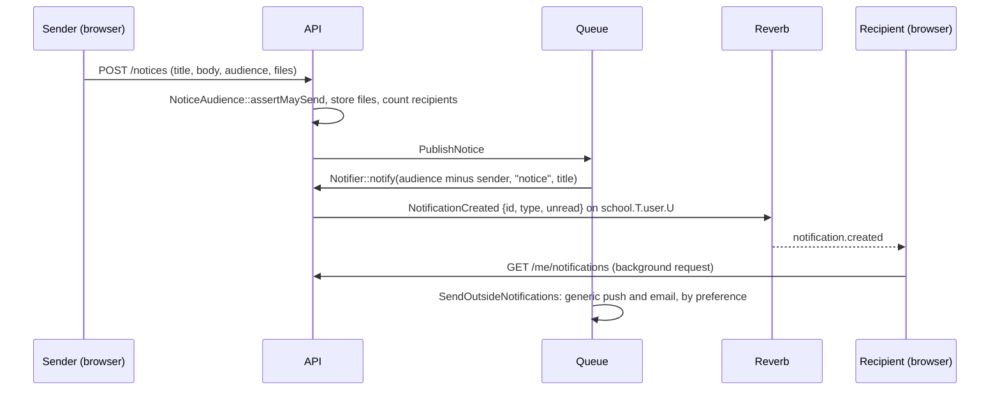

# Communication

> Status: **built in Phase 3.** Notices, in-app notifications with a live bell, email, and push (the push sender is ready; real push arrives with the apps in Phase 9).

## 1. What it does (plain words, no code)

**Notices.** Someone writes a notice for an audience: the whole school, some roles, some classes, or some sections. The server decides who may send to whom and who may read what; the screen never filters.

- **Who may send to whom:**
  - school scope (Chief, Principal, Clerk): any audience
  - wing scope (Vice Principal): classes and sections in their own wings
  - class scope (class teacher): their own sections only
  - subject scope (subject teacher): the sections they teach only
  - only school scope may send to the whole school or to roles
- **Who a section notice reaches:** the section's students and their parents, its class teacher, and the subject teachers who teach there. A class notice is the same for every section of the class.
- **Read receipts.** Opening a notice marks it read for that person. The sender and the school office (school-wide readers) see how many read it and who.
- **Attachments.** Up to 5 files per notice, each up to 5 MB, of type PDF, PNG, JPEG, WebP, DOCX or XLSX. They are kept privately in the school's own folder and handed out only as a download link that works for 5 minutes, after the server checks the person may read the notice.

**Notifications.** Each person has an inbox with a bell and an unread count.

- **In the app** a notification may name things (a notice title, a child's name), because it is read only after sign-in.
- **Push and email carry generic text only**, such as "New notice from Sunrise Public School. Open Campus TAB to read it." No names, no marks, no notice content: phone lock screens and inboxes are not private.
- **Preferences per person:** push on by default, email off by default, and any type (notice, attendance absence) can be muted.
- **The bell updates live** over Reverb on the person's own private channel; without the socket it polls every 60 seconds.

## 2. Who uses it and from which screens

- **Everyone with `notices.view`:** the notice list (`/notices`) and a notice (`/notices/:id`), with attachment downloads.
- **Senders (`notices.send`):** the composer (`/notices/new`) with audience choice and attachments; receipts on their own notices.
- **Everyone signed in:** the bell and inbox (`/notifications`), and notification settings (`/account/notifications`).
- **Dashboard:** the "Notices" card (see [dashboard.md](dashboard.md)).

Front-end files: `frontend/src/features/notices/` and `frontend/src/features/notifications/` (the socket is `socket.ts`). See [frontend.md](../frontend.md).

## 3. Requests it handles

**Notices** (group `school`):

| Method and path | Input | Output | Permission |
| --- | --- | --- | --- |
| `GET /notices` | — | notices you may read from the last 120 days, newest first, each with `read` | `notices.view` |
| `POST /notices` (multipart) | title (3–150), body (up to 5,000), audience{type: school, role, class, section; refs[]}, attachments[] | the notice (201); notifications go out on the queue | `notices.send`, then the audience check |
| `GET /notices/{id}` | — | the notice; marks it read for you | `notices.view` + audience |
| `GET /notices/{id}/receipts` | — | recipient_count, read_count, readers (name, read_at) | `notices.view`; only the sender or `notices.view:school` |
| `POST /notices/{id}/attachments/{aid}/link` | — | `url` (a relative signed link), `expires_in` (seconds) | `notices.view` + audience |
| `GET /files/notices/{tenant}/{notice}/{aid}` | — | the file, `Cache-Control: private, no-store` | the signed link only (`signed:relative`, `throttle:public`) |

**Own notifications** (group `account`, self-service):

| Method and path | What it does |
| --- | --- |
| `GET /me/notifications` `?unread=1` | The last 50, newest first, plus the `unread` count |
| `POST /me/notifications/{id}/read` · `POST /me/notifications/read-all` | Mark one or all read |
| `GET /me/notification-preferences` · `PUT /me/notification-preferences` | `{push, email, muted[]}` and the `types` that can be muted |
| `POST /me/push-devices` `{token, platform}` · `DELETE /me/push-devices` `{token}` | Register or forget a device for push (android, ios, web, desktop) |
| `POST /broadcasting/auth` | Lets the socket join the person's own private channel, nobody else's |

**Errors:**

- `notice_audience_forbidden` (403): the audience is outside the sender's scope.
- `not_found` (404): a notice or attachment the person may not read is reported as not existing.
- `permission_denied` (403): receipts asked for by someone who is neither the sender nor the office.
- `validation_failed`: too many files, a file too big, or a type not on the list.

## 4. Code map

| File | What it does |
| --- | --- |
| [`Communication/routes.php`](../../../backend/app/Modules/Communication/routes.php) | Routes |
| [`CommunicationServiceProvider.php`](../../../backend/app/Modules/Communication/CommunicationServiceProvider.php) | Picks the push driver; the Reverb auth route; the private channel rule |
| [`Http/Controllers/NoticeController.php`](../../../backend/app/Modules/Communication/Http/Controllers/NoticeController.php) | Notices, receipts, attachment links and the signed download |
| [`Http/Controllers/NotificationController.php`](../../../backend/app/Modules/Communication/Http/Controllers/NotificationController.php) | Inbox, read, preferences, push devices |
| [`Domain/NoticeAudience.php`](../../../backend/app/Modules/Communication/Domain/NoticeAudience.php) | Who may send to whom, who a notice reaches, who may read it |
| [`Domain/Notices.php`](../../../backend/app/Modules/Communication/Domain/Notices.php) | Send (with attachments), list, open, attachment link, receipts |
| [`Domain/Notifier.php`](../../../backend/app/Modules/Communication/Domain/Notifier.php) | The notification service used by every module; generic texts; preferences |
| [`Jobs/PublishNotice.php`](../../../backend/app/Modules/Communication/Jobs/PublishNotice.php) | Queued: notifies a notice's audience (not the sender) |
| [`Jobs/SendOutsideNotifications.php`](../../../backend/app/Modules/Communication/Jobs/SendOutsideNotifications.php) | Queued: push and email with the generic text, by preference |
| [`Events/NotificationCreated.php`](../../../backend/app/Modules/Communication/Events/NotificationCreated.php) | Broadcast `notification.created` on `school.{tenant}.user.{user}` |
| [`Mail/NotificationMail.php`](../../../backend/app/Modules/Communication/Mail/NotificationMail.php) | The generic email |
| [`Models/*`](../../../backend/app/Modules/Communication/Models/) | Notice, NoticeRead, Notification, PushDevice |
| [`Support/Push/`](../../../backend/app/Support/Push/) | `PushSender` and its drivers: `LogPushSender`, `ArrayPushSender`, `NullPushSender` |
| [`config/communication.php`](../../../backend/config/communication.php) | Limits, push driver, default preferences, generic texts, mutable types |

## 5. How the code works, step by step

1. **Sending.** `NoticeAudience::assertMaySend()` returns the scope the sender used, or refuses. With school scope anything goes. Otherwise the audience must be classes or sections (never school or roles), and every section it covers must be inside the sender's wings, class sections or taught sections. Class and subject teachers may name sections only, not whole classes.
2. **Storing files.** Each attachment gets a ULID and is stored on the private `local` disk at `tenants/<tenant_id>/notices/<notice_id>/<ulid>.<ext>`. The name shown to people is cleaned and cut to 120 characters.
3. **Publishing.** `PublishNotice` runs inside the school (`TenantContext::run`), works out the active recipients and calls `Notifier::notify()` with type `notice` and the notice title. The sender is left out.
4. **Notifying.** `Notifier::notify()` stores one `notifications` record per active user and fires `NotificationCreated`. The event carries only the notification id, the type and the unread count; the screen then fetches the inbox as a background request, so nothing readable travels over the socket.
5. **Outside the app.** `SendOutsideNotifications` loads each person's preferences. A muted type is skipped. With push on, it sends `Notifier::genericText()` to their registered devices; with email on and an address present, it sends `NotificationMail` with the same text.
6. **Reading.** `Notices::listFor()` takes the last 120 days (at most 500 notices), keeps those `NoticeAudience::reaches()` allows, and adds the read flag. `reaches()` is true for the sender, for school-wide readers, for everyone on a school notice, for holders of a named role, and for anyone whose own sections (taught, class-taught, their children's or their own) meet the notice's sections.
7. **Downloading.** `attachmentLink()` checks `reaches()` again, then makes a temporary signed route (5 minutes) that is **relative**, so it works behind any host name. The download route checks the signature, sets the school from the link and serves the file with `no-store`.

## 6. Data it reads and writes

| Collection | Fields | Index |
| --- | --- | --- |
| `notices` | title, body, audience{type, refs}, attachments[{id, name, mime, size, path}], sent_by{id, name}, sent_scope, recipient_count, published_at, deleted_at | tenant_id + audience.type + published_at; tenant_id + published_at |
| `notice_reads` | notice_id, user_id, read_at (not audited: bookkeeping) | tenant_id + notice_id + user_id (unique); tenant_id + user_id |
| `notifications` | user_id, type, title, body, link, data, read_at, created_at | tenant_id + user_id + created_at; tenant_id + user_id + read_at |
| `push_devices` | user_id, token (encrypted), token_hash (HMAC with the app key), platform | tenant_id + token_hash (unique); tenant_id + user_id |
| `users` (new field) | notification_prefs{push, email, muted[]} | — |

Migration: [`2026_11_29_000001_create_communication_collections.php`](../../../backend/database/migrations/2026_11_29_000001_create_communication_collections.php). Files: `storage/app/private/tenants/<tenant_id>/notices/<notice_id>/`.

## 7. Links to other modules

- **Calls:**
  - Identity: `AccessControl` (scopes for `notices.send`, `notices.view:school`), `User::accessScope()`
  - Academic Structure: sections, classes, teaching assignments, the current year
  - People: enrolments, guardians, staff and students, to find the people of a section
- **Called by:**
  - Attendance: `Notifier::notify()` with type `attendance.absent` for parents of absent students
  - Dashboard: `Notices::listFor()` for the notices card
- **Events:** `NotificationCreated` (broadcast now, not queued) on `school.{tenant}.user.{user}`.

## 8. Settings that change its behaviour

- **`config/communication.php`:**
  - `notices.attachment_types` (pdf, png, jpg, jpeg, webp, docx, xlsx), `attachment_max_kb` (5120), `attachments_per_notice` (5)
  - `notices.link_minutes` (5): how long a download link works
  - `notices.list_days` (120): older notices drop out of the list
  - `push_driver` (env `PUSH_DRIVER`)
  - `default_preferences` (push on, email off)
  - `generic_texts` (`notice`, `attendance.absent`, `default`; `:school` is the school's name)
  - `types` (notice, attendance.absent): what a person can mute
- **`PUSH_DRIVER`:** `log` or `array` only in local and testing (the app refuses to start with them elsewhere); with nothing set it is `log` in local and testing and `none` everywhere else.

See [configuration.md](../configuration.md).

## 9. Permissions and the rules behind them

- `notices.send` at school, wing, class or subject scope; `notices.view` at school or own. These were in the catalogue from Phase 1 (see [permissions.md](../permissions.md)).
- The notification routes are self-service (`account` group) and act only on the signed-in person's own records.

**Fixed rules in code:**

- the audience check is on the server, for sending and for reading
- push and email never carry a name or content, only the generic text
- attachments are served only through a short-lived signed link issued after a permission check
- a person's socket may join only their own channel

Decision: [0012](../decisions/0012-notices-and-notifications-privacy.md).

## 10. How to change it

- **A new notification type:** call `Notifier::notify($tenant, $users, '<type>', $title, …)` from the module, add a generic text under `generic_texts.<type>` and add the type to `types` so people can mute it. Never put private detail in the generic text.
- **A new attachment type:** add the extension to `notices.attachment_types`. Avoid types that can carry script (SVG, HTML).
- **A real push service (Phase 9):** add a `PushSender` driver and a `match` arm in `CommunicationServiceProvider::register()`.

## 11. Tests that cover it

[`tests/Feature/Communication/NoticesTest.php`](../../../backend/tests/Feature/Communication/NoticesTest.php):

- a class teacher sends only to their own section, and the notice reaches only that section
- a school notice reaches everyone; a role notice reaches the named roles
- read receipts, visible to the sender and the office only
- attachments limited by type and size, kept in the school's folder, served only by a short-lived signed link
- in-app notification with the title, while push and email say nothing private
- the Reverb channel is authorised only for the user's own channel

## 12. Decisions and limits

[decisions/0012-notices-and-notifications-privacy.md](../decisions/0012-notices-and-notifications-privacy.md).

**Limits:**

- Push is not delivered yet: there is no FCM project until the apps (Phase 9). In-app and email work now.
- SMS notifications are not built.
- The notice list reads at most 500 recent notices and then filters; a very busy school may need a stored recipient list later.
- Notices cannot be edited or withdrawn yet.

## 13. Change history

| Date | Phase | What changed | Why |
| --- | --- | --- | --- |
| 2026-11-27 | 0 | Page created from the template | Phase 0 starts the Application Report |
| 2026-11-27 | 3 | Module built: notices with server-side audiences, receipts and signed attachment links; notifications in the app, by email and push with generic text; preferences; the live bell over Reverb | Phase 3 of `docs/BUILD-PROMPTS.md` |
| 2026-11-27 | 4 | Type `attendance.absent` for parents of absent students | Phase 4 attendance |
