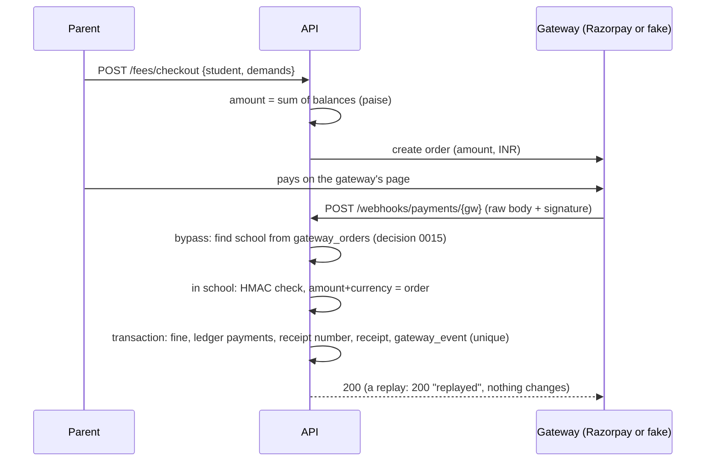

# Fees

> Status: **built in Phase 8**, back end and screens. Fee heads, categories and plans; dues raised from plans; an append-only ledger in whole paise; counter payments with receipts; cheques; day-end closing; adjustments and receipt cancellations approved by someone else; online payments (Razorpay test mode and a local fake gateway); reconciliation; reports.

## 1. What it does (plain words, no code)

**Money is whole paise** (owner's rule 1). Amounts are integers in the database, in every calculation and in the API (fields end in `_paise`). A rupee amount typed on a screen ("1,250.50") is sent as text and the server splits it into rupee and paise digits; percentages are basis points applied with integer arithmetic, rounded half up once.

**Building blocks** (Principal, Clerk, Chief): fee heads (tuition, transport…), categories (regular, staff ward…), plans for a group of classes with instalments (each with a due date and an amount per head), a late-fine rule (flat or per day, after grace days, with a cap) and discounts (a sibling discount, or "always"). Per-student set-up: category, an explicit plan, joining date and overrides (for example transport not charged until August).

**Raising dues.** Each night (and at year start, or from "Raise dues now") every instalment due within 30 days is raised for each student from their plan, **once** (a unique index stops double charging). Mid-year joiners are charged from their joining month. Changing a plan changes only instalments not raised yet.

**The ledger** is append-only: demand, fine, payment, adjustment and reversal entries, with who, when and why. Entries can never be edited or deleted (the model refuses); a mistake is undone by a reversal. Every balance is worked out from the entries.

**The counter** (Fee Collector duty, Clerk, Principal, Chief): find the student, tick the dues, record the mode (cash, cheque, DD, bank transfer, counter UPI) and reference, collect. In **one transaction**: any accrued late fine is posted, the amount is spread over the dues (fine first, then head by head), the **receipt number is taken from an atomic counter** (`findOneAndUpdate` inside the transaction: in sequence per school per year, never reused; a failed payment rolls its number back), and the payment and receipt are written (owner's rule 2). Nobody can pay more than is owed. Cheques and DDs stay *pending clearance*; a bounced cheque reverses the payment (and adds the school's bounce fine if it has one), and its receipt keeps its number marked *bounced*.

**Day-end closing.** Each collector closes their own day (totals by mode). Someone else confirms the cash: never the collector, and a Clerk's own closing only the Principal or the Chief (owner's rule 5).

**Adjustments** (rebate, waiver, fine waiver, refund, scholarship credit, carry-forward): the Clerk (or the Chief) proposes, the Principal approves (or only the Chief when `policies.fees.waiver_by = chief`), **never the proposer**. Approving is a **step-up action** (`fees_adjust_approve`). Nothing reaches the ledger until approved, and the amount is checked again then. A waiver, rebate, fine waiver or scholarship above `policies.fees.chief_alert_paise` (₹5,000 by default) alerts the Chief.

**Receipt cancellations**: a Fee Collector requests, the Clerk proposes or forwards, the Principal approves with step-up (`receipt_cancel_approve`); nobody approves one they requested or proposed. Approving reverses the payment's ledger entries; the receipt keeps its number marked *cancelled*.

**Online payments** (owner's rules 3 and 4):

- Each school connects its own gateway account. The **Chief** enters the keys in the app; the key secret and webhook secret are stored **encrypted** (Laravel's encrypter) and never sent back; the Principal sees the masked key id. During the build only Razorpay **test-mode** keys (`rzp_test_…`) are accepted.
- The parent ticks dues and presses *Pay now*. The **server** works out the amount from those dues and creates the order at the gateway; nothing about the amount comes from the browser. The gateway's own page takes the card or UPI details.
- The **webhook** (`POST /webhooks/payments/{gateway}`) has no signed-in user. The school is found from **our own order record** — the second documented tenant-scope exception ([decision 0015](../decisions/0015-payment-webhook-tenant-exception.md)). Then, inside that school only: the signature is checked on the **raw body** with the school's webhook secret; the amount and currency must equal the order's; the payment is taken in one transaction together with a `gateway_events` record whose unique index (school, provider, gateway payment id, outcome) makes a replay change nothing.
- The **fake driver** (`APP_ENV` local or testing only) shows a test checkout dialog; "Pay" queues a job that sends a correctly signed webhook over HTTP to the same route, so the whole flow works with no internet and no tunnel.
- **Nightly reconciliation** matches the gateway's settlement report for yesterday against our online payments; mismatches go to the Clerk.

**Who sees what** (owner's rule 7): the office sees amounts; a parent sees their own children's dues, ledger (without staff names) and receipts; a **class teacher sees only paid or pending** for their own section. Fee notifications carry no amounts or names ("A payment was received at Sunrise Public School. Open Campus TAB for the receipt.").

**Reports:** daily collection by collector and mode, dues and defaulters by class, collection by head, adjustments given, cheque status. A Fee Collector sees only their own daily collections. The **Excel export** asks for step-up (`export`) and is audited (`fees.report_exported`).

## 2. Who uses it and from which screens

| Who | Screen | File |
| --- | --- | --- |
| Office | Fees home | [`FeesHomePage.tsx`](../../../frontend/src/features/fees/FeesHomePage.tsx) |
| Fee Collector, Clerk, Principal | Fee counter (follows `FeeCounter.dc.html`) | [`CounterPage.tsx`](../../../frontend/src/features/fees/CounterPage.tsx) |
| Office | Student fee history | [`StudentFeesPage.tsx`](../../../frontend/src/features/fees/StudentFeesPage.tsx) |
| Office, families | Receipt (prints only the receipt) | [`ReceiptPage.tsx`](../../../frontend/src/features/fees/ReceiptPage.tsx) |
| Collectors, confirmers | Day-end closing | [`ClosingsPage.tsx`](../../../frontend/src/features/fees/ClosingsPage.tsx) |
| Clerk, Principal, Chief | Adjustments list; approvals inbox panels | [`AdjustmentsPage.tsx`](../../../frontend/src/features/fees/AdjustmentsPage.tsx), [`FeeApprovalPanel.tsx`](../../../frontend/src/features/fees/FeeApprovalPanel.tsx) |
| Office | Reports and Excel export | [`ReportsPage.tsx`](../../../frontend/src/features/fees/ReportsPage.tsx) |
| Principal, Clerk, Chief | Fee set-up | [`SetupPage.tsx`](../../../frontend/src/features/fees/SetupPage.tsx) |
| Chief (edit), Principal (view) | Online payments and nightly checks | [`OnlinePage.tsx`](../../../frontend/src/features/fees/OnlinePage.tsx) |
| Parents | Dues with Pay now, receipts | [`MyFeesPage.tsx`](../../../frontend/src/features/fees/MyFeesPage.tsx) |
| Class teachers | Paid or pending for their class (on Fees home) | `FeesHomePage.tsx` |

## 3. Requests it handles

| Method and path | What | Permission |
| --- | --- | --- |
| `GET/POST /fees/heads`, `PATCH /fees/heads/{id}`, `GET/POST /fees/categories` | Heads and categories | `fees.setup` |
| `GET/POST /fees/plans`, `PUT /fees/plans/{id}` | Plans (amounts as rupee strings) | `fees.setup` |
| `GET/PUT /fees/students/{id}/setup` | A student's category, plan, joining date, overrides | `fees.setup` |
| `POST /fees/demands/raise` | Raise what is due now | `fees.setup` |
| `GET /fees/students?q=` | The counter's student search | `fees.dues_view:school` |
| `GET /students/{id}/fees` | Dues, coming instalments, ledger, receipts | office, the parent, the student if allowed |
| `GET /fees/sections/{id}/status` | Paid or pending only | class teacher of the section, office |
| `GET /receipts/{id}` | One receipt | as the student's fees |
| `POST /fees/payments {student_id, mode, amount, reference?, bank?, demand_ids?}` | Counter payment | `fees.collect` |
| `POST /fees/payments/{id}/clear` · `/bounce {reason}` | Cheque cleared or bounced | `fees.collect` |
| `GET/POST /fees/closings`, `GET /fees/closings/{id}`, `POST …/confirm {counted_cash}` | Day-end closing | `fees.collect`; confirm `fees.closing_confirm` (not own) |
| `GET/POST /fees/adjustments`, `GET …/{id}`, `POST …/approve` (step-up), `POST …/reject` | Adjustments | propose `fees.adjust_propose`/`fees.adjust`; approve `fees.adjust_approve`/`fees.adjust` |
| `POST /receipts/{id}/cancel`, `GET /fees/cancellations/{id}`, `POST …/forward`, `…/approve` (step-up), `…/reject` | Receipt cancellations | request/propose/approve abilities |
| `GET/PUT /fees/gateway` | The gateway account (secrets never returned) | view `fees.gateway_view`; edit `fees.gateway_edit` |
| `POST /fees/checkout`, `GET /fees/checkout/{id}`, `POST /fees/checkout/{id}/fake` | Start an online payment; its status; the local test checkout | `fees.pay_online` |
| `POST /webhooks/payments/{gateway}` | The gateway's callback (decision 0015) | signature on the raw body |
| `GET /fees/reconciliations` | Nightly checks | office |
| `GET /fees/reports/{type}`, `GET /fees/reports/{type}/export` (step-up `export`) | Reports, Excel | `fees.reports` |

Notable error codes: `amount_invalid`, `amount_above_dues`, `nothing_due`, `own_proposal`, `own_request`, `own_closing`, `step_up_required`, `gateway_test_mode_only`, `gateway_off`, `not_pending`.

## 4. Code map

| File | What it does |
| --- | --- |
| `backend/app/Modules/Fees/Domain/Money.php` | Rupee strings ↔ paise, basis points, no floats |
| `…/Domain/Ledger.php` | Posts entries; per-instalment state (due, fine, paid, adjusted, balance); reversals |
| `…/Domain/FeeCounters.php` | The atomic receipt counter inside the transaction; receipt number format |
| `…/Domain/DemandRaiser.php` | Raises dues from plans (joiners, overrides, sibling discount, once only) |
| `…/Domain/Payments.php` | Takes a payment in one transaction; fines; allocation; generic family notification |
| `…/Domain/Cheques.php`, `Cancellations.php`, `Adjustments.php`, `Closings.php` | The workflows and their separation-of-duty rules |
| `…/Domain/OnlinePayments.php` | Checkout, the webhook (bypass, signature, amount, idempotency), fake simulation, reconciliation |
| `…/Domain/Gateway/*` | `PaymentGateway`, `RazorpayGateway`, `FakeGateway`, `Gateways` |
| `…/Domain/Dues.php`, `FeeReports.php`, `FeeAccess.php`, `FeeApprovals.php` | Read models, reports, who sees what, approvals inbox items |
| `…/Policies/FeesPolicy.php`, `FeesServiceProvider.php` | Gate abilities; the webhook rate limit |
| `…/Console/RaiseDemandsCommand.php`, `ReconcileCommand.php` | `fees:raise-demands` (01:30), `fees:reconcile` (03:00) |
| `…/Jobs/SendFakeWebhook.php` | The fake gateway's signed webhook, from the queue worker |
| `…/Models/*` | 16 collections (below) |
| `backend/config/fees.php` | Modes, kinds, raise window, gateway settings, report types |
| `backend/database/seeders/DemoFeesSeeder.php` | Demo heads, plan, dues, payments, a waiting waiver, the fake gateway |
| `frontend/src/features/fees/*` | The screens above; `api.ts` formats paise without floating point |

## 5. How the code works, step by step

## 6. Data it reads and writes

`fee_heads`, `fee_categories`, `fee_plans`, `student_fees`, `fee_demands` (unique per student plan instalment), `fee_ledger` (append-only), `payments`, `receipts` (unique `tenant_id, year_id, seq` and `tenant_id, number`), `fee_counters`, `fee_adjustments`, `receipt_cancellations`, `cash_closings`, `gateway_accounts` (one per school, secrets encrypted), `gateway_orders`, `gateway_events` (unique per payment and outcome), `fee_reconciliations`. Every index starts with `tenant_id`. The collector's id is stored at the top level (`collector_id`) because MongoDB ids nested in an object cannot be queried by the driver's id conversion.

## 7. Links to other modules

- **People:** students, guardians (sibling discount, family notifications), enrolments.
- **Approvals:** `FeeApprovals` adds adjustments, cancellations and closings to the inbox.
- **Communication:** `fees.payment_received`, `fees.waiver_alert`, `fees.reconciliation` (generic texts only).
- **Identity:** step-up actions `fees_adjust_approve`, `receipt_cancel_approve`, `export`.
- **Reports:** a closed year is read-only, fees included; carry forward before closing.

## 8. Settings that change its behaviour

`policies.fees` in the school config: `gateway`, `waiver_by` (principal | chief), `receipt_prefix`, `chief_alert_paise` (new, default 500000). `config/fees.php`: modes, clearance modes, adjustment kinds, `raise_days_before` (30), `bounce_fine_paise`, reason length, gateway (drivers, fake environments, Razorpay URL, `fake_webhook_url`), report types.

## 9. Permissions and the rules behind them

From the blueprint's "Who can do what": Chief `fees.adjust`, `fees.receipt_cancel`, `fees.gateway_edit`; Principal `fees.adjust_approve`, `fees.receipt_cancel_approve`, `fees.gateway_view`; Clerk `fees.adjust_propose`, `fees.receipt_cancel_propose`; Fee Collector duty `fees.collect`, `fees.receipt_cancel_request`, `fees.reports:own`; class teacher `fees.dues_view:class`; parent `fees.dues_view:child`, `fees.pay_online:child`. **New this phase:** `fees.closing_confirm` (Chief, Principal, Clerk) — the matrix had no right for confirming a closing.

## 10. How to change it

- A new gateway: implement `PaymentGateway`, add it to `Gateways` and `fees.gateway.drivers`, and test signature, amount and replay.
- A new report: a method in `FeeReports`, the type in `fees.reports.types`, columns in `fees.reports.columns.*` strings.

## 11. Tests that cover it

- `backend/tests/Feature/Fees/FeesTest.php` — raising dues (paise, overrides, sibling, joiners, plan changes); counter payment and its reversal with who and why; append-only ledger and no lost receipt numbers; late fine; waiver needs the Principal and never the proposer, Chief alert, `waiver_by`; closings; cheques; the fake webhook marks the due paid and a replay changes nothing; amount mismatch; decision 0015 (another school's secret, unknown order); Razorpay test-mode only and no fake driver in production; class teacher paid/pending only; reports and the audited step-up export; reconciliation; licence.
- `backend/tests/Unit/Fees/MoneyTest.php` — parsing, formatting, percentages, receipt numbers.
- `frontend/src/features/fees/fees.test.tsx` — money formatting, a parent's test checkout, class teacher view without amounts.

## 12. Decisions and limits

- [0015](../decisions/0015-payment-webhook-tenant-exception.md): the webhook finds the school from our order record.
- The late fine accrues by the plan's rule until it is posted (at the first payment on the instalment, or a fine waiver), then stays fixed.
- Students imported mid-year are charged from their joining month unless the office sets their joining date.
- A closed year's fee records are read-only like everything else in it.

## 13. Change history

| Date | Phase | What changed | Why |
| --- | --- | --- | --- |
| 2026-11-27 | 0 | Page created from the template | Phase 0 starts the Application Report |
| 2026-11-28 | 8 | Module built | Phase 8 of BUILD-PROMPTS with the owner's seven rules |
| 2026-11-28 | 8 (review) | Receipts say `cancellation_pending`; closings with no cash need no count; the fee history names the head on each line; scrollable tables are focusable regions; step-up asks for a code without a red error | Browser review with axe-core |
