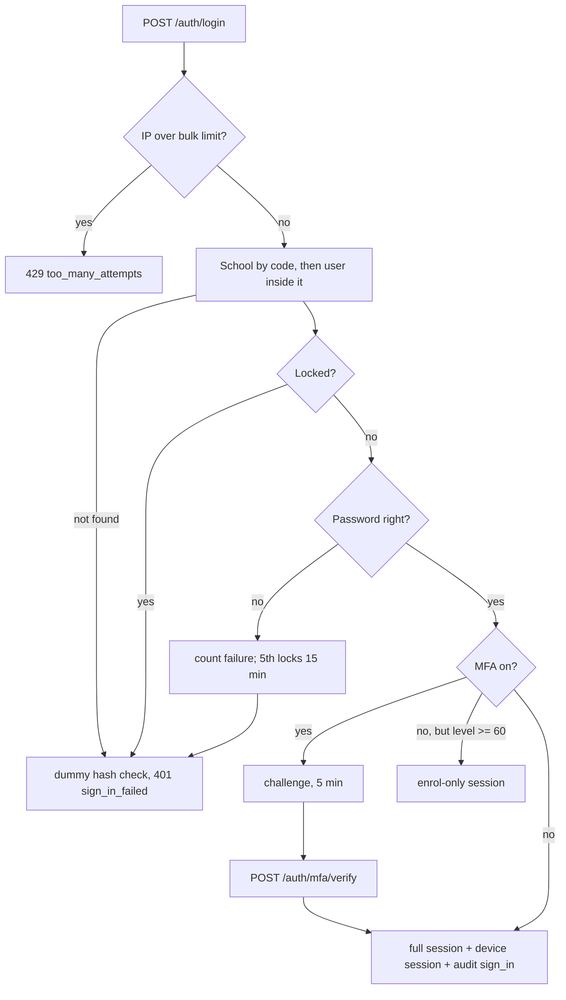

# Identity and Access

> Status: **Phase 1 part B: built.** Back end complete: sign-in, MFA, parent OTP, passwords, device sessions, roles and permissions, support access. The screens come in part C.

## 1. What it does (plain words, no code)

**Who people are, how they sign in, and what they may do.** School users belong to exactly one school. Our own platform team has separate accounts and can see a school only when its Chief grants support access.

**Signing in.**
- **Who uses what:** staff sign in with a password, plus a code from an authenticator app (MFA) at level 60 and up. Parents sign in with a code sent by SMS.
- **Every time:** people sign in each time they start. There is no "remember me". Closing the browser signs you out, and so does 15 minutes without use (30 for teachers, staff and parents), or 8 hours in total.

**Passwords.**
- **Nobody else ever types or sees them:** a new account gets a one-time link (or, without email or phone, a setup code for the Principal to hand over), and the person chooses their own.
- **Forgot password** sends a reset link.
- **Any password change** signs the person out everywhere and tells them.

**Roles and permissions.**
- **Permissions** are strings like `marks.enter:subject`, and roles bundle them.
- **Every school starts with:**
  - nine levels, Chief Admin down to Student;
  - two duties, Fee Collector and Attendance Officer, which the Principal gives and which add a few rights and nothing else.
- **Fixed rules:** nobody can give more than they hold, act on someone at their own level or above (except Chief on Chief), or remove the last Chief.

**Sensitive actions** ask for a fresh MFA code (step-up): exports, permanent delete, role changes, unlocking marks, support access and MFA resets.

## 2. Who uses it and from which screens

_Screens arrive in Phase 1 part C: school-code entry, sign-in (password + MFA, OTP for parents), MFA enrolment, set and reset password, device sessions. Rules for those screens: warn one minute before an idle sign-out, and keep unsaved form input so nothing typed is lost. Apps (Phase 9) keep the token in memory only, never saved on the device._

**Screens (Phase 1 part C):**

- **School code** ([`SchoolCodePage.tsx`](../../../frontend/src/features/auth/SchoolCodePage.tsx)), showing the school's public branding.
- **Sign-in** with password, then an MFA code or a recovery code ([`SignInPage.tsx`](../../../frontend/src/features/auth/SignInPage.tsx), [`SignInForm.tsx`](../../../frontend/src/features/auth/SignInForm.tsx)).
- **Parent SMS-code sign-in** ([`ParentOtpPage.tsx`](../../../frontend/src/features/auth/ParentOtpPage.tsx)).
- **MFA enrolment** ([`MfaEnrolPage.tsx`](../../../frontend/src/features/auth/MfaEnrolPage.tsx), [`MfaEnrolPanel.tsx`](../../../frontend/src/features/auth/MfaEnrolPanel.tsx)):
  - the QR code is drawn in the browser, so the secret never goes to another service
  - the key is shown for typing in
  - the recovery codes are shown once, with download and print
- **Licence activation** ([`ActivatePage.tsx`](../../../frontend/src/features/auth/ActivatePage.tsx)).
- **Password pages:** set password and reset password (`/password/set` and `/password/reset`, from the emailed links), and forgot password ([`PasswordPages.tsx`](../../../frontend/src/features/auth/PasswordPages.tsx)).
- **Signed-in devices** with remote sign-out ([`DeviceSessionsPage.tsx`](../../../frontend/src/features/auth/DeviceSessionsPage.tsx)).
- **Session guard** [`RequireSession.tsx`](../../../frontend/src/features/auth/RequireSession.tsx):
  - warns one minute before the idle sign-out, counting from the last real request
  - when the session ends, shows sign-in again over the page; the page stays mounted, so unsaved input is kept

## 3. Requests it handles

**Signing in (no account yet):**

| Method and path | Input | Output | Errors |
| --- | --- | --- | --- |
| `POST /auth/login` | `school_code`, `login` (email, phone or login name), `password`, `device_name?` | `{mfa_required, challenge}` or a session (see below) | `401 sign_in_failed` for every failure, `429 too_many_attempts` (per IP) |
| `POST /auth/mfa/verify` | `challenge`, `code` (TOTP or recovery code) | a session | `422 mfa_code_invalid` (attempts left), `401 mfa_challenge_expired`, `401 sign_in_failed` once locked |
| `POST /auth/otp/request` | `school_code`, `phone` | `202`, the same message for every number | `429 otp_rate_limited` |
| `POST /auth/otp/verify` | `school_code`, `phone`, `code` | a session | `422 otp_invalid` (one answer for every failure), `401 sign_in_failed` after too many |
| `POST /auth/password/forgot` | `school_code`, `login` | `202`, the same message whether or not it matches | `429` per IP |
| `POST /auth/password/set` | `school_code`, `token` (link secret or setup code), `password`, `password_confirmation`, `language?` | `200` | `422 password_link_invalid`, `422 validation_failed` |

**What a session looks like:**
- **From the web app** (a request from `FRONTEND_URL`): `{mode: "browser", device_session_id}` plus the session cookie.
- **From anything else:** `{mode: "token", token, token_type: "Bearer", token_abilities, token_expires_at, device_session_id}`.
- **Either way:** `mfa_enrolment_required` is true when the session may only enrol MFA.

**Own account** (signed in; works on a read-only licence):

| Method and path | What it does |
| --- | --- |
| `POST /auth/logout` | Ends this device |
| `POST /auth/step-up` `{code}` | Marks this device stepped-up for 10 minutes |
| `GET /me` | Profile (with `tenant_id`), roles, level, permissions (for hiding only), language, theme, MFA state, `session.idle_minutes`, `session.ends_at` |
| `PATCH /me/preferences` | `language` (any the app ships), `theme` (`light`, `dark`, `system`) |
| `PUT /me/password` | Needs `current_password`; ends every session including this one |
| `GET /me/sessions`, `DELETE /me/sessions/{id}`, `POST /me/sessions/revoke-others` | Devices, remote sign-out |
| `POST /me/mfa/enrol`, `POST /me/mfa/enrol/confirm` | Secret and `otpauth://` link, then confirm with a code → 10 recovery codes (shown once) and a full session |
| `POST /me/mfa/recovery-codes` `{code}`, `DELETE /me/mfa` `{code}` | New recovery codes; switch off (only when the role does not require MFA) |

**School administration** (group `school`; each names its permission):

| Method and path | Permission | Step-up | Notes |
| --- | --- | --- | --- |
| `GET /users` | `users.view` | | Status (`invited`, `active`), `locked`, `locked_until`, MFA, last sign-in |
| `POST /users` | `users.create` | | `name`, `email?`, `phone?`, `username?`, `roles[]`. Starts `invited`; returns `password_setup` (`email`, `sms`, or a `code` shown once) |
| `PUT /users/{id}/roles` | `users.edit_roles` | `role_edit` | Level rule per role; last Chief; Chief changes are security events |
| `POST /users/{id}/deactivate` | `users.deactivate` | | "Delete staff": inactive, recycle bin, every device signed out |
| `POST /users/{id}/unlock` | `users.unlock` | | Also on a read-only licence |
| `POST /users/{id}/password-link` | `users.send_password_link` | | Invited: resend the set link or a new code. Active: a reset link. The old one stops working |
| `POST /users/{id}/mfa-reset` | `users.reset_mfa` | `mfa_reset` | Lost authenticator; not your own; a Chief needs another Chief |
| `GET /roles`, `GET /permissions` | `roles.view` | | Roles with permissions; the catalogue |
| `POST /roles`, `PUT /roles/{name}` | `roles.edit` | `role_edit` | Custom role below your level; edit a role below your level; Chief role fixed |
| `GET /support-grants`, `GET /support-grants/{id}/activity` | `support.view` | | Every grant; everything done under one |
| `POST /support-grants` | `support.grant` | `support_grant` | `agent_email`, `scope[]`, `read_only` (default true), `reason`, `ends_at` (15 min to 72 h) |
| `POST /support-grants/{id}/revoke` | `support.grant` | | Ends it now |

**Platform:** `POST /platform/support/sessions` `{school_code}` (platform token with ability `platform`, admin with MFA) gives a support token for that school while a grant is active; otherwise `403 support_grant_required`.

**Background requests (part C).** A request with `X-Background-Request: 1` is checked like any other, but `TrackDeviceSession` never counts it as use. That covers TanStack Query refetches, polling and, later, the notification socket. The web app sets the header on any refetch of data already on screen and on polling.

**Phase 2.**

- **Scope facts** come from the school's records through `Domain/Scopes/AccessScopeSource`, bound by the People module. The stored `users.access` field is gone.
- **`GET /me`** now returns `scope` (children, class_sections, subject_sections, wings), so screens can offer only what applies.
- **`SubjectScope`** also covers a student record when the teacher teaches any subject in the student's section.
- **Student sign-in** is refused while the school setting `student_login` is off, with the same answer as a wrong password.
- **`PasswordLinks::send()`** takes an optional validity, so student setup codes last 48 hours.
- **`identity:sync-roles --with-new-permissions`** adds new phases' permissions to existing schools.

**Session 2.**

- **`GET /me`** also returns `tenant_id`, so the web app can name its own private notification channel, `school.<tenant_id>.user.<id>` (see [communication.md](communication.md)). The server still checks the channel against the signed-in user.
- **`POST /auth/password/set`** and **licence activation** (`chief.language` in the activation body) accept an optional `language`, one of the languages the app ships. The language chosen on that page becomes the person's own preference.
- **Policy "not found".** When a Policy answers `Response::denyAsNotFound()`, the API error renderer ([`Support/Http/ApiExceptionRenderer.php`](../../../backend/app/Support/Http/ApiExceptionRenderer.php)) now returns `404 not_found` ("The record was not found.") instead of a 403, so a record the person may not see is not admitted to exist. Attendance uses this for registers outside the person's scope.
- **Phase 4 permissions:** `calendar.view`, `calendar.manage`, `calendar.approve`; `staff_attendance.enter` for the Chief, Principal and Vice Principal as well as the Attendance Officer duty (see [permissions.md](../permissions.md)).

## 4. Code map

`backend/app/Modules/Identity/`:

| File | What it does |
| --- | --- |
| [`Models/User.php`](../../../backend/app/Modules/Identity/Models/User.php) | School user: tenant-scoped, soft deletes, audited; status `invited`/`active`/`inactive`; `level()`, `permissions()`, `isParentOnly()`, `mfaRequired()`, `isLocked()`, `personalWords()`, `accessScope()` |
| [`Models/SchoolRole.php`](../../../backend/app/Modules/Identity/Models/SchoolRole.php) | A role in one school (collection `roles`) |
| [`Models/DeviceSession.php`](../../../backend/app/Modules/Identity/Models/DeviceSession.php) | One signed-in device: token record id or session-id hash, never the raw value |
| [`Models/PasswordToken.php`](../../../backend/app/Modules/Identity/Models/PasswordToken.php) | Set or reset link / setup code, stored as a hash |
| [`Models/SupportGrant.php`](../../../backend/app/Modules/Identity/Models/SupportGrant.php) | A Chief's time-boxed support grant |
| [`Models/PersonalAccessToken.php`](../../../backend/app/Modules/Identity/Models/PersonalAccessToken.php), [`Models/PlatformAdmin.php`](../../../backend/app/Modules/Identity/Models/PlatformAdmin.php) | Sanctum tokens on MongoDB; our platform team |
| [`Domain/SignInService.php`](../../../backend/app/Modules/Identity/Domain/SignInService.php) | Password sign-in, the MFA step, lockout, step-up |
| [`Domain/ParentOtpSignIn.php`](../../../backend/app/Modules/Identity/Domain/ParentOtpSignIn.php) | Parent SMS sign-in |
| [`Domain/Mfa.php`](../../../backend/app/Modules/Identity/Domain/Mfa.php) | TOTP enrolment, checks, recovery codes |
| [`Domain/SessionIssuer.php`](../../../backend/app/Modules/Identity/Domain/SessionIssuer.php) | Starts and ends browser sessions and tokens with their device sessions |
| [`Domain/PasswordLinks.php`](../../../backend/app/Modules/Identity/Domain/PasswordLinks.php) | Set links, setup codes, reset links, forgot password, "password changed" notice |
| [`Domain/PasswordPolicy.php`](../../../backend/app/Modules/Identity/Domain/PasswordPolicy.php) | 10+ characters, not the login or name, not common ([`resources/security/common-passwords.txt`](../../../backend/resources/security/common-passwords.txt)) |
| [`Domain/UserAdmin.php`](../../../backend/app/Modules/Identity/Domain/UserAdmin.php) | Create, roles, deactivate, unlock, password link, MFA reset; last-Chief and level rules |
| [`Domain/RoleAdmin.php`](../../../backend/app/Modules/Identity/Domain/RoleAdmin.php) | Edit roles and add custom ones; no escalation; duty allow-lists |
| [`Domain/AccessControl.php`](../../../backend/app/Modules/Identity/Domain/AccessControl.php), [`Domain/Scopes/`](../../../backend/app/Modules/Identity/Domain/Scopes/) | Permission checks and the six scope resolvers |
| [`Domain/PermissionCatalogue.php`](../../../backend/app/Modules/Identity/Domain/PermissionCatalogue.php), [`Domain/RoleRegistry.php`](../../../backend/app/Modules/Identity/Domain/RoleRegistry.php), [`Domain/SystemRoles.php`](../../../backend/app/Modules/Identity/Domain/SystemRoles.php), [`Domain/Authority.php`](../../../backend/app/Modules/Identity/Domain/Authority.php), [`Domain/Role.php`](../../../backend/app/Modules/Identity/Domain/Role.php) | Catalogue, per-request role cache, seeding, level rules, the ten levels |
| [`Domain/SupportGrants.php`](../../../backend/app/Modules/Identity/Domain/SupportGrants.php), [`Domain/SupportAccess.php`](../../../backend/app/Modules/Identity/Domain/SupportAccess.php), [`Domain/SupportAgentUser.php`](../../../backend/app/Modules/Identity/Domain/SupportAgentUser.php) | Support grants, their permissions, the temporary support user |
| [`Domain/SchoolUserLocator.php`](../../../backend/app/Modules/Identity/Domain/SchoolUserLocator.php), [`Auth/SchoolUserProvider.php`](../../../backend/app/Modules/Identity/Auth/SchoolUserProvider.php) | Sign-in lookup (school by code first), session user loading |
| [`Http/Middleware/`](../../../backend/app/Modules/Identity/Http/Middleware/) | `permission`, `step-up`, `device`, `mfa.enrolled` |
| [`Http/Controllers/`](../../../backend/app/Modules/Identity/Http/Controllers/) | Auth, Me, Mfa, User, Role, SupportGrant, PlatformSupport |
| [`Policies/`](../../../backend/app/Modules/Identity/Policies/) | `UserPolicy`, `RolePolicy`, `SupportGrantPolicy` |
| [`Mail/`](../../../backend/app/Modules/Identity/Mail/) | Password link, password changed |
| [`Console/SyncRolesCommand.php`](../../../backend/app/Modules/Identity/Console/SyncRolesCommand.php) | `identity:sync-roles` |
| [`routes.php`](../../../backend/app/Modules/Identity/routes.php) | The routes above |

Middleware groups (`bootstrap/app.php`):
- **`enrol`:** auth, tenant, device.
- **`account`:** auth, tenant, device, mfa.enrolled.
- **`school`:** auth (school users or support tokens), tenant, device, mfa.enrolled, licence.

## 5. How the code works, step by step

**Every signed-in request:**
1. `auth` finds the token or cookie.
2. `tenant` sets the school from the user (or from a support token's grant, checked again).
3. `device` finds the device session. A revoked one gets 401. A session idle for 15 or 30 minutes, or more than 8 hours old, gets 401 `session_expired`.
4. `mfa.enrolled` refuses an enrol-only session.
5. `licence` refuses writes when read-only.
6. `permission:<ability>` checks the route.
7. The Policy checks the record.
8. `step-up:<action>` checks for a fresh code when the action is sensitive.

**New account:**
1. `POST /users` creates the account with status `invited` and no password.
2. `PasswordLinks::send` sends a set link (48 h) by email or SMS, or returns a setup code once.
3. `POST /auth/password/set` sets the password (rules checked) and makes the account `active`.
4. Every session ends and the user is told.
5. At level 60 and up, the next sign-in gives an enrol-only session.

## 6. Data it reads and writes

| Collection | Fields | Indexes |
| --- | --- | --- |
| `users` (school) | `tenant_id`, `name`, `email`, `phone`, `username`, `password` (hashed or null), `roles[]`, `status`, `mfa {enabled, enrolled_at, last_timestep}`, `mfa_secret` (encrypted), `mfa_pending_secret` (encrypted), `mfa_recovery_codes` (HMACs), `failed_sign_ins`, `locked_until`, `last_sign_in_at`, `access {children, class_sections, subject_sections, wings}`, `language`, `theme`, `notification_prefs {push, email, muted[]}` (Phase 3), timestamps, `deleted_at` | `tenant_id + email` / `+ phone` / `+ username` unique (partial), `tenant_id + roles` |
| `roles` (school) | `tenant_id`, `name`, `label`, `level`, `duty`, `permissions[]`, `is_system`, `deleted_at` | `tenant_id + name` unique |
| `device_sessions` (school) | `tenant_id`, `user_id`, `kind`, `token_id` or `session_hash`, `name`, `user_agent`, `ip`, `method`, `limited`, `last_seen_at`, `step_up_at`, `revoked_at`, `revoked_reason` | `tenant_id + user_id + revoked_at`, `tenant_id + token_id`, `tenant_id + session_hash` |
| `password_tokens` (school) | `tenant_id`, `user_id`, `purpose`, `token_hash`, `expires_at`, `used_at`, `created_by` | `tenant_id + token_hash` unique, `tenant_id + user_id + used_at` |
| `support_grants` (school) | `tenant_id`, `granted_by`, `agent_id`, `agent_email`, `agent_name`, `scope[]`, `read_only`, `reason`, `starts_at`, `expires_at`, `revoked_at`, `revoked_by`, `deleted_at` | `tenant_id + agent_id + expires_at`, `tenant_id + expires_at` |
| `personal_access_tokens`, `platform_admins` (platform) | as in part A | as in part A |

## 7. Links to other modules

- **Tenancy:** sets the school from the user and seeds the system roles when a school is created; `SchoolConfigPolicy` uses the permission strings.
- **Licensing:** creates the first Chief and an enrol-only session.
- **Audit:** records every sign-in, security event and change.
- **Later modules** add abilities to `config/permissions.php` and implement `Scopes\AccessSubject` on their records.

## 8. Settings that change its behaviour

- **`config/identity.php`:**
  - MFA level, step-up actions and minutes;
  - lockout and per-IP limits, parent OTP limits;
  - session idle and total limits;
  - password link times and rules;
  - support areas and the never-list.
- **`config/permissions.php`:** abilities, scopes, default roles, duty allow-lists.
- **Environment:** `SMS_DRIVER`, `SIGN_IN_IP_MAX_FAILURES`, `PARENT_OTP_IP_MAX_SENDS`, `PARENT_OTP_IP_MAX_FAILURES`, `PASSWORD_RESET_IP_MAX`.

See [configuration.md](../configuration.md).

## 9. Permissions and the rules behind them

The matrix as coded and the fixed rules are in [permissions.md](../permissions.md). Decisions: [0006](../decisions/0006-sign-in-mfa-and-sessions.md), [0007](../decisions/0007-permissions-roles-and-scopes.md), [0009](../decisions/0009-support-access.md).

## 10. How to change it

- **A new permission:** add the ability (and its scopes) to `config/permissions.php` `abilities`, add it to default roles, name it on the route with `permission:<ability>`, and check it in the Policy with `AccessControl::allows($user, $ability, $record)`. Then run `php artisan identity:sync-roles`; it adds missing roles only, so new strings on existing roles reach a school when its Chief edits the role.
- **A new sensitive action:** add its name to `identity.step_up.actions` and put `step-up:<name>` on the route. Later phases add fee rebates, waivers and locked-mark approvals.
- **A new duty:** add the role under `roles` with `level: null` and `duty: <name>`, and its allow-list under `duties`.
- **A record with scopes:** implement `Domain\Scopes\AccessSubject::accessFacts()`.
- **Tests:** `tests/Feature/Identity/*`.

## 11. Tests that cover it

- [`SignInTest.php`](../../../backend/tests/Feature/Identity/SignInTest.php):
  - password and MFA sign-in, and no replay of a code;
  - the same answer for every failure, and lockout without a password check while locked;
  - unlock, wrong MFA codes counting towards lockout, the per-IP limit;
  - the enrol-only session, and the browser cookie stored only as a hash;
  - idle 15 and 30 minutes, 8 hours in total, no "remember me";
  - login by name, any language, the audit entry.
- [`ParentOtpTest.php`](../../../backend/tests/Feature/Identity/ParentOtpTest.php): parent only; never with a staff role or with MFA on; hash only; 5 minutes; the same replies; limits per phone and per IP; the SMS driver refused in production.
- [`MfaTest.php`](../../../backend/tests/Feature/Identity/MfaTest.php): required from level 60; enrolment upgrades the session; an enrol-only token never passes; secret encrypted; recovery codes hashed and single-use; switching off.
- [`StepUpTest.php`](../../../backend/tests/Feature/Identity/StepUpTest.php): the list, 10 minutes, per device, user role changes, unknown names fail loudly.
- [`PasswordsAndSessionsTest.php`](../../../backend/tests/Feature/Identity/PasswordsAndSessionsTest.php):
  - invited accounts and set links (48 h, once, by SMS);
  - the setup code, resending cancels the old link, MFA enrolment after the password is set;
  - password rules; forgot password with the same reply, 30 minutes and per-account limits;
  - sessions end and the user is told; reset by the Principal; changing your own;
  - audit with no secrets; MFA reset; device sessions.
- [`RolesAndPermissionsTest.php`](../../../backend/tests/Feature/Identity/RolesAndPermissionsTest.php):
  - the seeded roles, a valid catalogue, no locked-mark ability;
  - the Fee Collector and Attendance Officer duties;
  - scopes, escalation blocked, the last Chief, deactivation, duplicate accounts.
- [`RoutePermissionTest.php`](../../../backend/tests/Feature/Identity/RoutePermissionTest.php): every route has a permission check or is on the short open list.
- [`SupportGrantTest.php`](../../../backend/tests/Feature/Identity/SupportGrantTest.php):
  - no grant means no access; read-only by default; the time window;
  - writes refused under read-only, and support never touches grants or roles;
  - expiry and revoke; the audit entries show the agent and the grant id.
- [`PartBIsolationAndLicenceTest.php`](../../../backend/tests/Feature/Identity/PartBIsolationAndLicenceTest.php): cross-tenant reads and writes are blocked on every new endpoint, and an expired licence is read-only.
- [`SignInLookupTest.php`](../../../backend/tests/Feature/Identity/SignInLookupTest.php): the part A sign-in exception.

## 12. Decisions and limits

**Decisions:** [0005](../decisions/0005-tenant-scope-and-sign-in-exception.md), [0006](../decisions/0006-sign-in-mfa-and-sessions.md), [0007](../decisions/0007-permissions-roles-and-scopes.md), [0009](../decisions/0009-support-access.md).

**Limits:**
- There is no real SMS gateway yet; production needs one, and the app refuses to start without it.
- The `child`, `class`, `subject` and `wing` scopes need Phase 2 records.
- The Clerk's "draft for principal" staff flow comes with the Phase 2 staff records.
- A sole Chief who loses their authenticator and recovery codes recovers through the part C console.
- `Idempotency-Key` handling is not built yet.

## 13. Change history

| Date | Phase | What changed | Why |
| --- | --- | --- | --- |
| 2026-11-27 | 0 | Page created from the template | Phase 0 starts the Application Report |
| 2026-11-27 | 1A | User and platform-admin models, MongoDB tokens, sign-in lookup exception, MFA gate | Phase 1 items 1, 2 and 5, and the owner's request to make sign-in lookup a documented exception |
| 2026-11-27 | 1B | Sign-in, MFA, step-up, parent OTP, passwords (invited accounts, links, setup codes, resets), device sessions with idle and total limits, roles and permissions with scopes and guard rules, two duties, support grants | Phase 1 items 6, 7 and 9, with the owner's changes for part B |
| 2026-11-27 | 1C | Sign-in, OTP, MFA enrolment, activation, password and device screens; background requests do not extend the idle time; idle warning and sign-in over the page; MFA code shared with platform admins; test that a passwordless account never signs in | Phase 1 items 11 and 12 with the owner's rules for part C |
| 2026-11-27 | 2 | Scope facts from records; `scope` in `GET /me`; student sign-in setting; setup-code validity; `--with-new-permissions` | Phase 2 rule 1 and rule 4 |
| 2026-11-27 | 1C | A new staff account, or a parent becoming staff, is refused past the licence's staff seats | The owner's seat rule |
| 2026-11-27 | Session 2 | `GET /me` returns `tenant_id`; set-password and activation take an optional `language`; `denyAsNotFound` answers 404 `not_found`; `notification_prefs` on users; calendar and staff-attendance permissions | Phase 3 notifications, the sign-in pages' language picker, Phase 4 |
