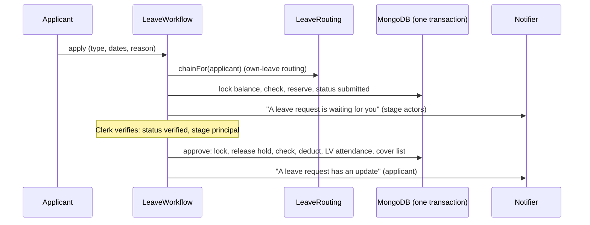

# Leave

> Status: **built in Phase 5**, back end and screens. Every request below works and is tested.

## 1. What it does (plain words, no code)

**Staff leave.** A staff member applies with a leave type, dates (or a half day) and a reason, and may attach a document such as a medical certificate. The request goes through the school's chain and the person sees every step live.

- **The usual chain** (school setting `policies.leave.chain`): the **Clerk** checks it (balance, dates, documents, cover) and verifies and forwards it, or returns it for correction. An optional **Vice Principal** stage passes on requests from their wing. The **Principal** gives the final decision: approve, approve with other dates, or reject with a reason.
- **Nobody decides their own leave** (owner's rule), at any stage:
  - a **Clerk's** or a **Vice Principal's** leave goes straight to the Principal;
  - the **Principal's** leave goes to the **Chief Admin**;
  - the **Chief Admin's** leave goes to the **Principal**, the school's leave authority (owner's decision in this session).
- **Fast-track:** for a same-day emergency the Principal may decide at the Clerk's stage; the Clerk is told.
- **Rejecting** is the Principal's call. The Clerk may reject only when the Chief switches on `clerk_can_reject`; the Principal cannot switch it on.
- **Delegation:** the Principal hands the final decision to a Vice Principal for set dates. It ends by itself after the last date, or when the Principal ends it. A delegate never decides leave for anyone **at or above their own level**, nor their own.
- **Withdraw** before a decision. **Cancel** an approved leave: the applicant asks and the decider confirms (or keeps the leave, with a reason), or the decider cancels with a reason.

**The balance is a ledger, not a counter.** Each staff member has a balance per leave type per academic year: the type's yearly quota minus the days held and taken.

| Moment | Ledger entry | Effect |
| --- | --- | --- |
| Submit (or resubmit with new dates) | `reserve` (old hold `release`d first) | days held |
| Approve | `release` the hold, `deduct` the approved days | days taken |
| Reject, withdraw | `release` | days back |
| Cancel an approved leave | `restore` the days not taken yet | days back |

Entries are never changed or deleted. Leave without pay and duty leave have no quota.

**The sandwich rule, per leave type** (owner's rule): when it is on, holidays and Sundays **inside** a leave (between its first and last working day) count as leave days. Days off at either end never count. A range with no working day is refused.

**Approval writes attendance.** In the **same MongoDB transaction** as the approval and the ledger:

- each working day of the leave gets an **On leave** (LV) staff attendance entry with source `leave`. This is a system entry from the approved request, not a manual one, so the "nobody enters their own attendance" rule is not touched (owner's rule). A day the person already checked in is left alone.
- the **needs-cover list** is built from the person's teaching assignments, plus the register of a class they class-teach, for each working day.

**Cancelling restores together** (owner's rule): in one transaction, the days not yet taken go back to the balance and their attendance entries are removed (or the record they replaced is put back). "Not taken yet" means after today, or today too if school has not started.

**Privacy** (owner's rule):

- The **reason, every remark and the documents** are seen only by the applicant and the people in **that request's chain**: anyone who could act at one of its stages, or who already did. For anyone else the request does not exist (404).
- The reason and remarks are **encrypted at rest**. Documents are **stored encrypted** (with a sealed file name) and served only through **5-minute signed links**. The audit log records `[private]` instead of the text.
- The **leave calendar** shows other staff only **who is away**, never the type or reason.
- **Notifications** say only that a request changed ("A leave request has an update", "A leave request is waiting for you"), never who, what or why.

**Reminders and escalation:** a request waiting at one stage gets a reminder to its approvers after `remind_after_hours` (24), and the level above is told after `escalate_after_hours` (48). Escalation only informs; it never changes who decides.

**Student leave.** A parent applies for their child with dates and a reason. The **class teacher** decides (or anyone holding `student_leave.approve` over the section). On approval the child's register shows **LV** for those days, including registers already saved. Leave longer than `student_principal_after_days` (3) is also shown to the Principal. The parent is told that the request changed.

## 2. Who uses it and from which screens

Screens are in [frontend.md](../frontend.md#phase-5-leave-screens).

| Who | Screen |
| --- | --- |
| Every staff member | `/leave` (balance, my requests), `/leave/apply` (live days and balance), `/leave/requests/:id` (live timeline) |
| Clerk | `/approvals` (the checks waiting), `/leave/calendar` with the cover list |
| Principal | `/approvals` (decisions, fast-track, with "Away this week"), `/leave/calendar`, `/leave/settings` (types, delegation) |
| Chief Admin | `/approvals` (the Principal's own leave) |
| Vice Principal | `/approvals` (their wing's stage, or as delegate) |
| Class teacher | `/approvals` (student leave for their class) |
| Parent | `/leave/child` (apply), `/leave` (their children's requests) |

The dashboard has **Leave waiting for you**, **Staff away today** and **My leave balance** ([dashboard.md](dashboard.md)).

## 3. Requests it handles

All are in the `school` group behind `module:leave`. Creates and workflow moves accept an `Idempotency-Key` header (see [api.md](../api.md)).

| Method and path | Input | Output | Permission (route) |
| --- | --- | --- | --- |
| `GET /leave-types` | — | types (archived ones too for the Principal), `can.manage` | any leave ability |
| `POST /leave-types` | code, name, quota?, sandwich, half_day, document_after_days? | the type (201) | `leave.manage_types` |
| `POST /leave-types/starter` | — | the starter types added (201) | `leave.manage_types` |
| `PATCH /leave-types/{id}` | name, quota, sandwich, half_day, document_after_days, status | the type (the code never changes) | `leave.manage_types` |
| `GET /leave/balances/me` | — | my balance per active type this year | `leave.apply` |
| `GET /leave/calendar` | from?, to? (3 months at most) | who is away: name, dates, `request_id` only if I may open it | `leave.view` |
| `GET /leave/cover` | from?, to? | rows: date, section, subject or register, teacher away | `leave.verify`, `leave.decide` or `leave.decide_principal` |
| `GET /leave/delegations` | — | delegations, active Vice Principals | `leave.delegate` |
| `POST /leave/delegations` | delegate_user_id, from, to (90 days at most) | the delegation (201) | `leave.delegate` |
| `POST /leave/delegations/{id}/end` | — | the delegation, ended | `leave.delegate` |
| `GET /leave-requests` | box = mine, queue or history | request summaries I may see | any leave ability |
| `GET /leave-requests/preview` | type_code, from, to, half_day? | days, counted dates, days off, balance and balance after, document_required, chain | `leave.apply` |
| `POST /leave-requests` | type_code, from, to, half_day?, reason, submit? | the request (201) | `leave.apply` |
| `POST /leave-requests` | student_id, from, to, reason | the student leave (201) | `student_leave.apply` (child scope) |
| `GET /leave-requests/{id}` | — | the request, timeline, balance, cover, `can` | applicant or chain, else 404 |
| `PATCH /leave-requests/{id}` | type_code?, from?, to?, half_day?, reason? | a draft or returned request | applicant |
| `POST /leave-requests/{id}/submit` · `/withdraw` · `/cancel-request` | reason (cancel-request) | the request | applicant |
| `POST /leave-requests/{id}/verify` · `/return` | remark (required to return) | the request | stage actor |
| `POST /leave-requests/{id}/approve` | remark?, from? and to? (other dates) | the request | decider, or fast-track |
| `POST /leave-requests/{id}/reject` | remark (required) | the request | decider, Clerk only with `clerk_can_reject` |
| `POST /leave-requests/{id}/cancel` · `/keep` | remark (required to keep, or to cancel without a request) | the request | decider of the final stage |
| `POST /leave-requests/{id}/documents` | file (PDF, PNG, JPEG, WebP, up to 5 MB, 3 per request) | the request (201) | applicant, before the decision |
| `POST /leave-requests/{id}/documents/{doc}/link` | — | a relative signed `url`, valid 5 minutes | applicant or chain |
| `GET /files/leave/{tenant}/{request}/{doc}` | — | the decrypted file, `no-store` | the signed link only |

**Errors** (`error.code`): `leave_transition_invalid` (409, an illegal move from this state), `own_leave` (403), `not_your_stage` (403), `clerk_cannot_reject` (403), `leave_wrong_stage` (409), `insufficient_balance` (422), `document_required` (422), `no_working_days` (422), `half_day_not_allowed`, `half_day_single_date`, `leave_too_long`, `leave_dates_invalid`, `remark_required`, `cancel_already_requested`, `leave_already_taken`, `no_cancel_request`, `delegate_invalid`, `delegation_too_long`, `not_staff`, `no_current_year`, `leave_type_unknown`, `leave_type_exists`, `too_many_documents`, `idempotency_key_reused`, `idempotency_in_progress`.

## 4. Code map

**Back end** (`backend/app/Modules/Leave/`):

| File | What it does |
| --- | --- |
| `Models/LeaveType.php` | a type: quota, sandwich, half_day, document_after_days, status |
| `Models/LeaveRequest.php` | a request: states, chain, steps, private fields, audit masking (`auditSnapshot`) |
| `Models/LeaveLedgerEntry.php` | one append-only balance movement (updating or deleting throws) |
| `Models/LeaveBalanceLock.php` | one document per balance that every ledger write bumps, so concurrent transactions collide |
| `Models/LeaveDelegation.php` | the Principal's dated hand-over to a Vice Principal |
| `Domain/LeaveWorkflow.php` | the state machine: every move, its checks and its transaction; notifications after commit |
| `Domain/LeaveRouting.php` | chains (own-leave routing), who may act at each stage, who may see a request, escalation targets |
| `Domain/LeaveDays.php` | counts days: working days, weekly off, approved holidays, the sandwich rule, half days |
| `Domain/LeaveBalances.php` | balances from the ledger, the lock, the availability check, ledger writes |
| `Domain/LeaveEffects.php` | approval and cancellation effects on staff and student attendance; the needs-cover list |
| `Domain/LeaveViews.php` | what screens get: detail, summary, `can`, timeline, the calendar (names only) |
| `Domain/LeaveDocuments.php` | stores documents encrypted and reads them back |
| `Domain/LeaveReminders.php` | 24 h reminders and 48 h escalation |
| `Domain/LeaveApprovals.php` | leave in the shared approvals inbox |
| `Domain/StudentLeaveDays.php` | which students are on approved leave on a date (for the register) |
| `Domain/LeaveSettings.php` | `policies.leave` with defaults; the school's clock |
| `Http/Controllers/LeaveRequestController.php` | requests, moves, documents |
| `Http/Controllers/LeaveSetupController.php` | types, balances, calendar, cover, delegation |
| `Policies/LeavePolicy.php` | view (404 outside the chain), manage types, delegate, cover |
| `Console/SendLeaveRemindersCommand.php` | `leave:remind` (hourly in `routes/console.php`) |
| `Console/SeedLeaveTypesCommand.php` | `leave:seed-types --school=CODE` |
| `routes.php` · `LeaveServiceProvider.php` | routes; policy registration |

Also: `backend/app/Support/Http/Idempotency.php` (the `idempotent` middleware), `backend/config/leave.php`, `backend/database/migrations/2026_11_30_000001_create_leave_collections.php`, `backend/app/Modules/Dashboard/Domain/Cards/LeaveCards.php`.

**Front end** (`frontend/src/features/leave/`): `api.ts` (types, moves with an `Idempotency-Key`), `LeaveRequestView.tsx` (facts, reason, documents, timeline, cover, actions), `LeavePages.tsx` (home, apply, child, request, calendar), `LeaveSettingsPage.tsx` (types, delegation), `dates.ts`, `leave.test.tsx`; the inbox is in `frontend/src/features/approvals/ApprovalsPage.tsx`.

## 5. How the code works, step by step

1. **Who may act** is never stored: `LeaveRouting::couldAct` works it out each time from the stage, the person's permissions and level, the applicant's level and any active delegation. The applicant (and the parent who applied) is always refused.
2. **Every move** first checks the state table `LeaveWorkflow::MOVES` (illegal moves answer 409), then the actor, then runs `transaction()`. That re-reads the request inside a MongoDB transaction (5 attempts), so a move made meanwhile by someone else is seen.
3. **Balances under concurrency:** `LeaveBalances::lock` bumps the balance's lock document **before** reading the ledger. Two transactions on the same balance therefore write the same document; MongoDB aborts one with a write conflict and the driver runs it again, now seeing the other's entries. A test makes another transaction commit mid-way and checks the second one is refused on the new balance, and that a request approved twice is deducted once.
4. **Notifications** go out only after the commit, with generic titles.
5. **The timeline** is the stored steps (remarks decrypted only for those who may see them) followed by the stages still to come. The screen refetches when a `leave.*` notification arrives over the socket, so the applicant sees each step live.

## 6. Data it reads and writes

| Collection | Holds | Indexes |
| --- | --- | --- |
| `leave_types` | code, name, quota, sandwich, half_day, document_after_days, status | tenant + code (unique) |
| `leave_ledger` | staff_id, year_id, type_code, kind (reserve, release, deduct, restore), days, request_id, by | tenant + staff + year + type; tenant + request |
| `leave_balance_locks` | staff_id, year_id, type_code, version | tenant + staff + year + type (unique) |
| `leave_requests` | kind, applicant{…}, applicant_user_id, applicant_staff_id, applicant_student_id, applied_by, applied_by_id, section_id, wing, type, year, from, to, half_day, days, reason (sealed), documents[] (sealed names, encrypted files), status, stage, chain[], steps[] (remarks sealed), reserved_days, approved{from, to, days, dates, working}, cancel_request, stage_since, reminded_for, escalated_for, cover_needed[], principal_sees, fast_tracked | tenant + status + stage; tenant + applicant_user_id; tenant + applied_by_id; tenant + applicant_student_id + status + from; tenant + kind + status + from + to |
| `leave_delegations` | delegate{…}, delegate_id, by, from, to, ended_at, ended_by | tenant + delegate + from + to |

It also writes `staff_attendance` (LV, source `leave`, `leave_request_id`, `replaced`) and `attendance_days` (LV for a child), and reads `calendar_events`, `staff`, `sections`, `teaching_assignments`, `enrolments` and `academic_years`.

## 7. Links to other modules

- **Attendance:** approval writes staff LV and a child's LV; `AttendanceRegister` asks `StudentLeaveDays` to pre-fill LV; holidays come from the approved calendar.
- **Communication:** notifications `leave.updated` and `leave.waiting` (generic texts in `config/communication.php`; people can mute them).
- **Approvals:** `LeaveApprovals` is an inbox source.
- **Dashboard:** `LeaveCards`.
- **Identity:** permissions, levels (`User::level`), scope resolvers (wing, class, child).

## 8. Settings that change its behaviour

School config `policies.leave`: `chain` (clerk, vice_principal, principal; must include principal), `clerk_can_reject` (**Chief only**), `remind_after_hours` (24), `escalate_after_hours` (48), `student_principal_after_days` (3). Leave types are records the Principal keeps. App config `config/leave.php`: document types, size and count, link minutes, `max_span_days` (180), `weekly_off` ([7] = Sunday), starter types. See [configuration.md](../configuration.md).

## 9. Permissions and the rules behind them

| Ability | Who (default) | Allows |
| --- | --- | --- |
| `leave.apply:own` | every staff level and the Chief | apply for own leave |
| `leave.view:school` | every staff level and the Chief | the leave calendar (names only) |
| `leave.manage_types:school` | Principal | leave types and rules |
| `leave.delegate:school` | Principal | hand decisions to a Vice Principal |
| `leave.verify:school` | Clerk | stage 1 |
| `leave.fast_track:school/wing` | Principal / Vice Principal | decide at stage 1 |
| `leave.decide:school` | Principal | the final decision, including the Chief's own leave |
| `leave.decide:wing` | Vice Principal | the Vice Principal stage for their wing |
| `leave.decide_principal:school` | Chief | the Principal's own leave |
| `student_leave.apply:child` | Parent | apply for their child |
| `student_leave.approve:class/wing/school` | Class teacher / Vice Principal / Principal and Chief | decide student leave |

Fixed rules, not settings: nobody decides their own leave; a delegate never decides for anyone at or above their level; privacy of reasons and documents.

## 10. How to change it

- **A new stage:** add it to the schema enum and `LeaveRouting::chainFor` / `couldAct` / `actorsAt`, then a test in `LeaveWorkflowTest`.
- **A new leave rule (for example carry-forward):** a field on `LeaveType`, its validation in `LeaveSetupController::typeInput`, the maths in `LeaveBalances`.
- **Another day off (for example second Saturdays):** `config/leave.php` `weekly_off`, or a calendar entry.
- Run `php artisan test tests/Feature/Leave` and `npm test -w @campus-tab/frontend -- leave`.

## 11. Tests that cover it

- `backend/tests/Feature/Leave/LeaveWorkflowTest.php`:
  - every legal move and 11 illegal ones
  - own-leave routing for all four cases; nobody decides their own
  - delegation limits and its end date
  - the sandwich rule; balance refusal
  - a concurrent transaction committing mid-way, and a double approval deducting once
  - cancel restoring balance and attendance
  - privacy (404, encryption, audit, calendar, notifications)
  - documents (encrypted, required, signed link)
  - reminders and escalation; idempotency; the inbox
- `backend/tests/Feature/Leave/StudentLeaveTest.php`: parent applies, class teacher decides, LV in new and saved registers, another parent's child refused, long leave shown to the Principal, reject with a reason.
- `frontend/src/features/leave/leave.test.tsx`: live preview and `Idempotency-Key`; Principal sees steps, reason and cover; reject needs a reason; the applicant has no decision buttons; the calendar shows names only; the inbox.

## 12. Decisions and limits

- [Decision 0013](../decisions/0013-leave-routing-privacy-and-ledger.md): routing, privacy, the ledger lock.
- No timetable yet: the cover list is per day and class or subject, not per period (v1.5 turns it into substitutions).
- Changing a type's quota changes every balance for the year (balances are worked out from the quota and the ledger).
- Student leave has no balance.

## 13. Change history

| Date | Phase | What changed | Why |
| --- | --- | --- | --- |
| 2026-11-27 | 0 | Page created from the template | Phase 0 starts the Application Report |
| 2026-11-27 | 5 | Leave module built: staff and student leave, ledger, routing, privacy, reminders, cover, screens | Phase 5 of `docs/BUILD-PROMPTS.md` with the owner's rules |
| 2026-11-28 | 7 | Vice Principal routing reads user ids with `getKey()` instead of `pluck('_id')` | ObjectId values compared as strings |
