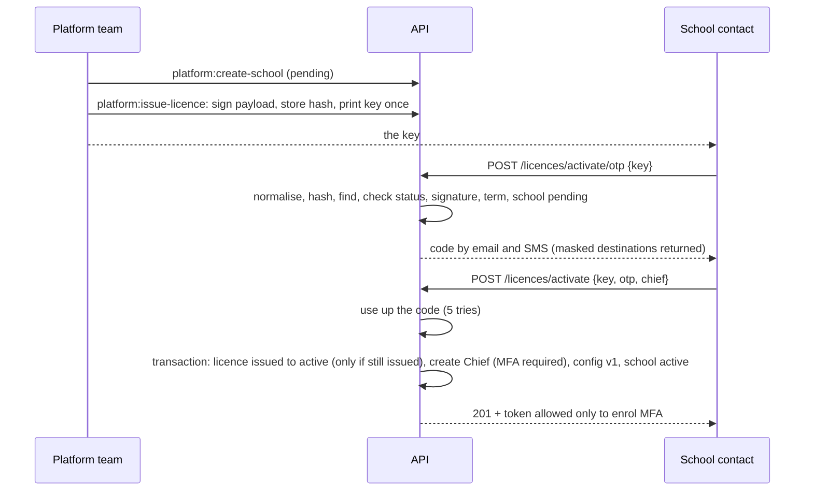

# Licensing

> Status: **Phase 1 part A built** (keys, signing, activation, expiry and module checks). Revoking keys and the web console arrive in part C.

## 1. What it does (plain words, no code)

A school gets one licence key such as `CTAB-7F3K-92QD-LX4M-8ZTA`. The school's contact types it into the app, confirms a code sent to the school's registered email and phone, and creates the Chief Admin account. After that the key is spent: the Chief signs in with their own password and two-step sign-in.

Behind the key is a server record with the plan, the modules the school paid for, seat limits and the valid dates. That record is signed, so nobody can extend a licence by editing the database. When the term ends the school gets 15 days of grace with a banner, then becomes read-only: everything can still be viewed and exported, and nothing is deleted. A module that is not in the licence (or that the school switched off) answers `403 module_disabled`.

## 2. Who uses it and from which screens

| Who | What | Screen |
| --- | --- | --- |
| Our platform team | Issues a key | `php artisan platform:issue-licence` (web console in part C) |
| The school's contact | Activates the school | Licence activation (part C) |
| Everyone in the school | Sees the grace banner; meets read-only mode | Every screen (banner from Phase 3) |

## 3. Requests it handles

| Method and path | Input | Output | Who | Errors |
| --- | --- | --- | --- | --- |
| `POST /licences/activate/otp` | `{key}` (case, spaces and dashes ignored) | `{data: {school {code, name}, sent_to {email, phone} (masked), expires_in}}` | Anyone (10 a minute per IP; 3 codes per key per 10 minutes) | `422 licence_key_invalid`, `404 licence_not_found`, `409 licence_already_activated`, `403 licence_revoked`, `403 licence_invalid`, `403 licence_expired`, `409 tenant_not_activatable`, `429 otp_rate_limited` |
| `POST /licences/activate` | `{key, otp, chief {name, email, phone, password, password_confirmation}, device_name?}`. The password follows the account rules: 10+ characters, not the Chief's login or name, not common | `201 {data: {school, user, mode, mfa_enrolment_required: true, device_session_id, …}}`: from the web app a session cookie, otherwise `token`, `token_type`, `token_abilities: ["mfa:enrol"]`, `token_expires_at`. Either way the session may only enrol MFA | Anyone holding the key and the code | as above, plus `422 validation_failed`, `422 otp_invalid` (with `attempts_left`), `422 otp_locked`, `422 otp_expired` |

Middleware used by every school route:

| Alias | Effect |
| --- | --- |
| `licence` | Adds `X-Licence-State` (`active`, `grace`, `read_only`). Read-only: writes get `403 licence_read_only` except exports (`->defaults('licence_export', true)`) and account-safety routes (`->defaults('licence_always', true)`: unlock, password link, MFA reset, support grants). Sign-in and the `/me` routes do not use this middleware, so people can always sign in and look after their own account. No usable licence: `403 licence_inactive` |
| `module:<name>` | `403 module_disabled` (details `{module}`) unless the licence includes the module **and** the school config switches it on |

**Part C.** `LicenceIssuer` now has three operations:

- `amend()` changes the plan, seats, modules and end date. It signs the payload again under the same licence id; the key does not change.
- `revoke()` makes every school request answer `403 licence_inactive`. The data stays.
- `summary()` gives the licence fields that are safe to show and audit (never the key hash or the signature).

A licence issued to a school that is already active (after a revoke) is active at once. The console and `platform:revoke-licence` use these operations through `Platform\SchoolConsole`, which audits them. See [platform.md](platform.md).

**Two seat limits** ([`Domain/Seats.php`](../../../backend/app/Modules/Licensing/Domain/Seats.php)):

- **Students:** active students (not left, not in the recycle bin).
- **Staff:** every school account that is not inactive, except accounts whose roles are only Parent and/or Student. Parents never count; a teacher who is also a parent counts once, as staff; a Clerk's draft has no account, so it does not count.
- **What is refused** past either limit, with one message naming the limit, the number in use and the number left (`422 seat_limit_reached`, `details.kind` students or staff):
  - creating or importing students
  - creating staff accounts (users, staff, approved drafts, staff imports)
  - turning a parent or student account into staff
  - restoring from the recycle bin
  - re-activating an account
- **Imports:** the dry-run report shows the seat check first.
- **Warning:** shown from 90%.
- **Renewal:** `POST /platform/schools/{code}/licence/renew` signs the payload again with the later end date and takes effect at once.

## 4. Code map

`backend/app/Modules/Licensing/`:

| File | What it does |
| --- | --- |
| [`Models/Licence.php`](../../../backend/app/Modules/Licensing/Models/Licence.php) | A licence (platform level). `verifiedPayload()` checks the signature and that the plain fields match it; `state()` works out active, grace, read-only or inactive |
| [`Domain/LicenceKey.php`](../../../backend/app/Modules/Licensing/Domain/LicenceKey.php) | Generates, normalises and hashes keys |
| [`Domain/LicenceSigner.php`](../../../backend/app/Modules/Licensing/Domain/LicenceSigner.php) | Ed25519 signing and checking (sodium); canonical JSON; key-pair generation |
| [`Domain/LicenceState.php`](../../../backend/app/Modules/Licensing/Domain/LicenceState.php) | The four states |
| [`Domain/LicenceIssuer.php`](../../../backend/app/Modules/Licensing/Domain/LicenceIssuer.php) | Platform side: issues a signed licence and returns the key once |
| [`Domain/ActivationService.php`](../../../backend/app/Modules/Licensing/Domain/ActivationService.php) | Checks the key, sends the code, and activates in one transaction |
| [`Http/Controllers/ActivationController.php`](../../../backend/app/Modules/Licensing/Http/Controllers/ActivationController.php) | The two activation routes and their validation |
| [`Http/Middleware/EnsureLicenceAllows.php`](../../../backend/app/Modules/Licensing/Http/Middleware/EnsureLicenceAllows.php) | Middleware `licence` |
| [`Http/Middleware/EnsureModuleEnabled.php`](../../../backend/app/Modules/Licensing/Http/Middleware/EnsureModuleEnabled.php) | Middleware `module:<name>` |
| [`Mail/ActivationOtpMail.php`](../../../backend/app/Modules/Licensing/Mail/ActivationOtpMail.php) | The activation-code email |
| [`Console/IssueLicenceCommand.php`](../../../backend/app/Modules/Licensing/Console/IssueLicenceCommand.php) | `php artisan platform:issue-licence` |
| [`Console/LicenceKeygenCommand.php`](../../../backend/app/Modules/Licensing/Console/LicenceKeygenCommand.php) | `php artisan licence:keygen [--write]` |
| [`routes.php`](../../../backend/app/Modules/Licensing/routes.php) | The activation routes |

Shared: [`app/Support/Otp/OtpService.php`](../../../backend/app/Support/Otp/OtpService.php) (codes) and [`app/Support/Sms/`](../../../backend/app/Support/Sms/) (the SMS driver interface; `log` and `array` drivers).

## 5. How the code works, step by step

**State of a licence** (time zone Asia/Kolkata): before `valid_from` or not activated or revoked or signature broken → inactive; up to the end of `valid_to` → active; then `LICENCE_GRACE_DAYS` (15) days → grace; after that → read-only.

## 6. Data it reads and writes

| Collection | Fields | Indexes | Notes |
| --- | --- | --- | --- |
| `licences` (platform) | `tenant_id`, `key_hash`, `key_last4`, `plan`, `modules[]`, `seats {students, staff}`, `valid_from`, `valid_to`, `status` (issued, active, revoked), `payload` (canonical JSON), `signature` (base64), `activated_at`, `revoked_at`, timestamps | `key_hash` unique; `tenant_id + status` | The plain key is never stored. The payload is the source of truth; the plain fields copy it for queries and must match it |

Activation also writes `users` (the Chief), `school_configs` (version 1), `tenants.status` and `personal_access_tokens`.

## 7. Links to other modules

- Calls **Tenancy** (`SchoolConfigService::initialise`, `Tenant`) and **Identity** (`User`, Sanctum tokens).
- **Tenancy** asks Licensing which modules are licensed before saving the config.
- Every later module protects its routes with `licence` and `module:<name>`.

## 8. Settings that change its behaviour

`LICENCE_KEY_PEPPER`, `LICENCE_SIGNING_SECRET_KEY`, `LICENCE_SIGNING_PUBLIC_KEY`, `LICENCE_GRACE_DAYS`, `SMS_DRIVER`, and `config/licensing.php` (plans, modules, OTP time and tries, enrolment-token minutes). See [configuration.md](../configuration.md).

## 9. Permissions and the rules behind them

- Activation needs no account: holding the key and the code sent to the school's registered contact is the proof.
- Issuing keys is platform-only (artisan now; console behind MFA in part C).
- Expired licences never delete data and never block exports.

## 10. How to change it

- **New module:** add it to `licensing.modules` in `config/licensing.php`, to `modules` in the config schema and its default, and protect its routes with `module:<name>`.
- **Different grace period:** `LICENCE_GRACE_DAYS`.
- **Rotate signing keys:** every licence must be re-signed with the new key first, or it becomes inactive. Plan this as a command before doing it (part C).
- Tests: `docker compose exec api composer test`.

## 11. Tests that cover it

- [`tests/Feature/Licensing/LicenceKeyTest.php`](../../../backend/tests/Feature/Licensing/LicenceKeyTest.php): format, forgiving input, look-alike characters rejected, hash-only storage, signature checks, edited records become invalid.
- [`tests/Feature/Licensing/ActivationTest.php`](../../../backend/tests/Feature/Licensing/ActivationTest.php): code sent by email and SMS, activation creates the Chief with MFA required and an enrolment-only token, the key can't be reused, wrong code, lock-out, send limit, validation, malformed, unknown, revoked and expired keys.
- [`tests/Feature/Licensing/LicenceStateTest.php`](../../../backend/tests/Feature/Licensing/LicenceStateTest.php): active, grace header, read-only (reads and exports allowed, writes refused, config too), revoked, tampered, `module_disabled` for unlicensed and switched-off modules.

## 12. Decisions and limits

See [0004](../decisions/0004-licence-keys.md). Limits now: seat limits are stored but enforced in Phase 2 (admissions); revoking and renewing are part C; the grace banner's UI comes with the shell in Phase 3.

## 13. Change history

| Date | Phase | What changed | Why |
| --- | --- | --- | --- |
| 2026-11-27 | 0 | Page created from the template | Phase 0 starts the Application Report |
| 2026-11-27 | 1A | Keys, signing, activation with OTP, expiry and module middleware, `platform:issue-licence`, `licence:keygen` | Phase 1 item 2 |
| 2026-11-27 | 1B | Activation starts a recorded enrol-only session (cookie or token) and audits `licence.activated` and `chief.added`; Chief password follows the account rules; `licence_always` exemption for account safety | Phase 1 part B |
| 2026-11-27 | 1C | Change and revoke licences; `platform:issue-licence` audited through the console service | Phase 1 item 10 |
| 2026-11-27 | 1C/2 | Two seat limits (students, staff) checked everywhere an account or student is added; renewal from the console | The owner's seat rule |
