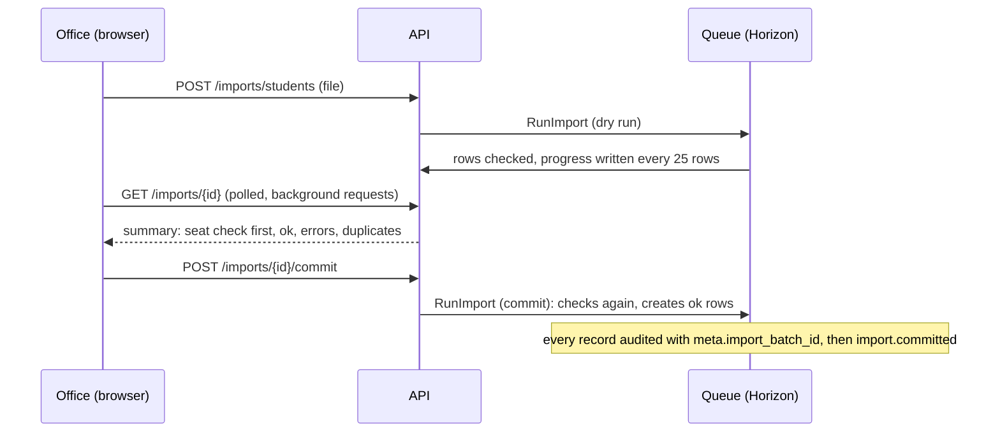

# People

> Status: **built in Phase 2.**

## 1. What it does (plain words, no code)

Students, guardians, enrolments, staff and consents, plus Excel import.

- **Admission** checks the licence's student seats (and staff accounts check the staff seats; parents never count) and refuses past them with a clear message. It also blocks a likely duplicate (same name, date of birth and guardian phone) unless the person confirms it is a different child.
- **Siblings share a guardian.** A guardian with the same phone is reused. Turning on that guardian's **parent login** gives one Parent account for all their children; parents sign in with an SMS code.
- **PEN and APAAR** are optional and kept only with a recorded guardian consent.
- **Full Aadhaar numbers are never stored.** Any request whose body holds one, in any field, is refused; only the last four digits may be kept.
- **Clerk drafts.** A Clerk can draft a new staff member for the Principal. The account is made only when the Principal approves.
- **Student sign-in** is a school setting, off by default. When it is on, the class teacher prints one-time setup codes (48 hours) and each student signs in with a login name.
- **Excel import** runs on the queue:
  1. download the template
  2. a dry run with a progress bar and a row-by-row report, with the seat check first
  3. download the report
  4. commit, audited under one import batch id

## 2. Who uses it and from which screens

- **Office (Clerk), Principal and Chief:**
  - student list (`/students`), profile with tabs (`/students/:id`), admit (`/students/new`)
  - staff list and profile (`/staff`, `/staff/:id`)
  - imports (`/imports/students`, `/imports/staff`)
- **Class teachers:** their class's list, the roll number and their own columns, and setup codes (`/sections/:id/setup-codes`).
- **Subject teachers:** students of the sections they teach.
- **Parents:** their children.

The front-end files are in `frontend/src/features/{students,staff,imports}/`; see [frontend.md](../frontend.md).

## 3. Requests it handles

| Method and path | Input | Output | Permission |
| --- | --- | --- | --- |
| `GET /students` | section_id?, q?, page?, per_page? | rows the person may see + `columns` (their custom columns) + `meta` | `students.view` (scope-filtered) |
| `GET /students/seats` | — | limit, used, available, warning (90%) | `students.view` |
| `POST /students` | admission_no, name, dob, gender, section_id, roll_no?, guardians[], ids{pen, apaar, aadhaar_last4}, consents{pen, apaar}, custom{}, confirm_not_duplicate? | profile | `students.admit` |
| `GET /students/{id}` | — | profile: enrolment, guardians, consents, IDs (only for those who may edit), custom values, `can` | `students.view` + record scope |
| `PATCH /students/{id}` | name, dob, gender, status, roll_no, ids, consents, custom | profile | `students.edit` + record scope (class scope: roll_no and custom only) |
| `DELETE /students/{id}` | — | to the recycle bin | `students.admit` |
| `POST /students/{id}/guardians` · `PATCH /guardians/{id}` | name, relation, phone, email | — | `guardians.manage` |
| `POST /guardians/{id}/parent-login` · `DELETE /guardians/{id}/parent-login` | — | parent account | `guardians.manage` |
| `POST /sections/{id}/student-setup-codes` | — | login names and codes, **shown once** | `students.login_codes` + section scope |
| `GET /staff` · `POST /staff` · `GET /staff/{id}` · `PATCH /staff/{id}` | employee_code?, name, designation, type, email, phone, joined_on, roles[], wings[] | staff (+ password_setup once) | `staff.view` / `staff.create` or `staff.draft` / `staff.edit` |
| `POST /staff/{id}/approve` · `POST /staff/{id}/reject` · `POST /staff/{id}/deactivate` | reason (reject) | staff | `staff.approve` / `staff.deactivate` |
| `GET /imports/{entity}/template` | entity: students or staff | .xlsx | `imports.<entity>` |
| `POST /imports/{entity}` | file (.xlsx or .csv, up to 10 MB, 5,000 rows) | batch (202; dry run queued) | `imports.<entity>` |
| `GET /imports/{id}` · `GET /imports/{id}/report` · `POST /imports/{id}/commit` | — | status, progress, summary, rows / .xlsx / 202 | `imports.<entity>` |

Errors:

- **Admission:**
  - `seat_limit_reached` (details: limit, used, available, adding), `possible_duplicate` (409, details: student_id, admission_no)
  - `consent_required`, `aadhaar_not_allowed` (details: fields), `aadhaar_last4_only`
  - `admission_no_taken`, `section_not_found`
- **Editing:** `field_not_editable`, `custom_field_forbidden`, `custom_value_invalid`
- **Parent login:** `phone_required`, `parent_login_exists`
- **Student sign-in:** `student_login_off`
- **Staff:** `staff_not_draft`, `employee_code_taken`
- **Import:** `import_not_ready`, `import_not_checked`

## 4. Code map

| File | What it does |
| --- | --- |
| [`People/routes.php`](../../../backend/app/Modules/People/routes.php) | Routes |
| [`Http/Controllers/StudentController.php`](../../../backend/app/Modules/People/Http/Controllers/StudentController.php) | Students, guardians, parent login, setup codes |
| [`Http/Controllers/StaffController.php`](../../../backend/app/Modules/People/Http/Controllers/StaffController.php) | Staff, drafts, approval |
| [`Http/Controllers/ImportController.php`](../../../backend/app/Modules/People/Http/Controllers/ImportController.php) | Template, upload, status, report, commit |
| [`Domain/StudentRecords.php`](../../../backend/app/Modules/People/Domain/StudentRecords.php) | Admission, duplicates, consents, IDs, edits, custom values, the scope-filtered list |
| [`Domain/Seats.php`](../../../backend/app/Modules/People/Domain/Seats.php) | Licence seats, the 90% warning, the refusal message |
| [`Domain/ParentLogins.php`](../../../backend/app/Modules/People/Domain/ParentLogins.php) | Parent login on and off |
| [`Domain/StaffRecords.php`](../../../backend/app/Modules/People/Domain/StaffRecords.php) | Create, draft, approve, reject, deactivate |
| [`Domain/StudentLogins.php`](../../../backend/app/Modules/People/Domain/StudentLogins.php) | The school setting, login names, setup codes |
| [`Domain/RecordAccessScopes.php`](../../../backend/app/Modules/People/Domain/RecordAccessScopes.php) | The real child, class, subject and wing scope facts |
| [`Domain/Import/Importer.php`](../../../backend/app/Modules/People/Domain/Import/Importer.php), [`Spreadsheet.php`](../../../backend/app/Modules/People/Domain/Import/Spreadsheet.php) | Template, row checks, summary, commit; OpenSpout reading and writing |
| [`Jobs/RunImport.php`](../../../backend/app/Modules/People/Jobs/RunImport.php) | The queued dry run or commit, inside the school, as the importer |
| [`Policies/PeoplePolicy.php`](../../../backend/app/Modules/People/Policies/PeoplePolicy.php) | Every check, with record scope |
| [`PeopleServiceProvider.php`](../../../backend/app/Modules/People/PeopleServiceProvider.php) | Policies, the scope source binding, cache flush |
| [`Models/*`](../../../backend/app/Modules/People/Models/) | Student, Guardian, Enrolment, Staff, Consent, ImportBatch |
| [`Support/Privacy/Aadhaar.php`](../../../backend/app/Support/Privacy/Aadhaar.php), [`RefuseFullAadhaar.php`](../../../backend/app/Support/Privacy/RefuseFullAadhaar.php) | The Verhoeff check; middleware `no-aadhaar` in the `school` group |
| [`database/seeders/DemoSchoolSeeder.php`](../../../backend/database/seeders/DemoSchoolSeeder.php) | The demo school |

## 5. How the code works, step by step

- **Scope-filtered list.** `StudentRecords::list()` works out the sections the person may see:
  - **school** scope: all sections
  - **wing** scope: the sections of their wings
  - **class** scope: their class sections
  - **subject** scope: the sections they teach
  - **child** and **own** scope: their children, or their own record

  It then lists the current-year enrolments of those sections. A profile request checks the same scope against the record, so a teacher gets 403 for another class.
- **Parent login.** An existing account with the same phone (a teacher who is also a parent) gets the Parent role added; otherwise a Parent-only account is made, active, with no password. The child scope is the union of the `student_ids` of every guardian record linked to the account.
- **Setup codes.** The student account has role Student, a login name made from the admission number (`SPS/2026/0412` → `sps20260412`), no email and no phone. The code is a 12-character setup code from `PasswordLinks`, valid 48 hours, used at `POST /auth/password/set`. With the school setting off, both the codes and student sign-in are refused (the same `sign_in_failed` answer as a wrong password).

## 6. Data it reads and writes

| Collection | Fields | Index |
| --- | --- | --- |
| `students` | admission_no (unique), name, dob, gender, guardian_ids, ids{pen, apaar, aadhaar_last4}, custom{}, user_id, login_name, status, import_batch_id | tenant_id + admission_no (unique); tenant_id + name + dob; tenant_id + status; tenant_id + user_id |
| `enrolments` | student_id, year_id, section_id, roll_no, result, custom{} | tenant_id + section_id + roll_no; tenant_id + student_id + year_id |
| `guardians` | name, relation, phone, email, student_ids, user_id | tenant_id + phone; tenant_id + user_id; tenant_id + student_ids |
| `staff` | employee_code (unique), name, designation, type, email, phone, joined_on, user_id, wings, status (draft, active, inactive), requested_roles, drafted_by, custom{} | tenant_id + employee_code (unique); tenant_id + user_id; tenant_id + status |
| `consents` | student_id, guardian_id, purpose (pen, apaar, photo_public, third_party_sharing), notice_version, given, at, recorded_by | tenant_id + student_id + purpose |
| `import_batches` | entity, status, file_path, file_name, progress, summary, rows, created_by, result, error | tenant_id + created_at |
| `users` (new index) | username | tenant_id + username (unique when set) |

Uploaded files are kept privately under `storage/app/private/tenants/<tenant_id>/imports/`.

## 7. Links to other modules

- **Calls:**
  - Identity: `UserAdmin` to create and deactivate accounts (no escalation), `PasswordLinks` for setup codes
  - Licensing: the seats
  - Customisation: `FieldRules`
  - Academic Structure
  - Audit: `AuditRecorder::withMeta`
- **Called by:** Identity, through the `AccessScopeSource` binding (`User::accessScope()`).

## 8. Settings that change its behaviour

- **School config `sign_in.methods`** containing `student_login` turns on student sign-in (off by default).
- **The licence's `seats.students`** sets the seat limit.
- **`identity.passwords.set_link_hours`** (48) sets how long a setup code is valid.

See [configuration.md](../configuration.md).

## 9. Permissions and the rules behind them

**New abilities:**

- `academic.view`, `academic.manage`
- `students.admit`, `students.login_codes`, `guardians.manage`
- `staff.view`, `staff.create`, `staff.draft`, `staff.approve`, `staff.edit`, `staff.deactivate`
- `imports.students`, `imports.staff`

The full matrix is in [permissions.md](../permissions.md). For schools created earlier, run `php artisan identity:sync-roles --with-new-permissions`.

**Fixed rules in code:**

- the seat limit
- no full Aadhaar number in any field
- PEN and APAAR only with consent
- a draft never has an account before approval
- approval is checked against the approver's own level

## 10. How to change it

- **Add a student field:** add it to `Student::$fillable`, the validation in `StudentController`, `StudentRecords::admit()`/`row()`, and the import columns in `Importer`. Then regenerate the client.
- **Add a consent purpose:** add it to `Consent::PURPOSES`.

## 11. Tests that cover it

- [`StudentsTest.php`](../../../backend/tests/Feature/People/StudentsTest.php):
  - admission, siblings sharing a guardian, duplicates
  - seats with the exact message, consent, Aadhaar last 4
  - the Verhoeff check and the refusal in any field (students, staff, nested guardian and custom values)
  - a phone number with +91 is accepted
  - Aadhaar and bank custom fields refused
  - a class teacher's limited edit; the office edits and deletes
- [`AccountsTest.php`](../../../backend/tests/Feature/People/AccountsTest.php):
  - parent login for siblings, then sign-in by SMS code seeing exactly those children
  - phone required; a teacher who is also a parent
  - a Clerk's draft has no account until the Principal approves; reject; escalation checked
  - student sign-in off by default, then codes valid 48 hours and sign-in with a login name, and refused again when switched off
  - academic structure
- [`ImportTest.php`](../../../backend/tests/Feature/People/ImportTest.php):
  - the template
  - **500 students** through the queued dry run, report and commit, each audited under the batch id
  - errors and duplicates; the seat check first and the commit refused; Aadhaar in a cell
  - a staff import with role checks; who may import
- [`ScopeResolverTest.php`](../../../backend/tests/Feature/People/ScopeResolverTest.php): one test per resolver, from records.
- [`DemoSchoolSeederTest.php`](../../../backend/tests/Feature/People/DemoSchoolSeederTest.php): loads; every role signs in; refuses outside local and testing.

## 12. Decisions and limits

[decisions/0011-people-privacy-and-imports.md](../decisions/0011-people-privacy-and-imports.md).

**Limits:**

- One sheet per file, 5,000 rows.
- Staff without email or phone get a setup code that the importer does not see; send one again from the user list.
- The Principal's merge tool for duplicates is a later phase.

## 13. Change history

| Date | Phase | What changed | Why |
| --- | --- | --- | --- |
| 2026-11-27 | 0 | Page created from the template | Phase 0 starts the Application Report |
| 2026-11-27 | 2 | Module built | Phase 2 items 2, 3 and 7 with the owner's rules 1–8 |
| 2026-11-27 | 2 | Seats moved to `Licensing\Domain\Seats` with a staff limit; the staff import report shows the staff seat check first | The owner's seat rule |
