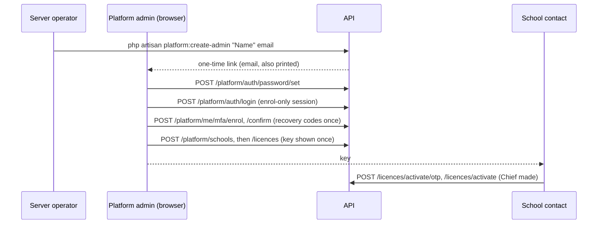

# Platform console

> Status: **built in Phase 1 part C.**

## 1. What it does (plain words, no code)

The console is where the Campus TAB team runs the service. It creates schools, issues licence keys, changes a school's plan, seats and modules, and revokes a licence. In one narrow case it also restores a school's only Chief Admin.

- **Accounts.** Platform admins are made only on the server with `php artisan platform:create-admin`. Nobody can sign up. The new admin gets a one-time link to choose their own password.
- **Sign-in.** It needs the password and an authenticator code every time; the first sign-in sets up the authenticator.
- **Session rules.** These are the same as for school users: browser session cookie only, 15 minutes idle (background requests don't count), 8 hours in total, and remote sign-out.
- **Audit.** Every action goes in the **platform audit log**. Every action on a school also goes in that school's own audit log, so the school sees what we did.
- **No school data.** The console never shows a school's records, only counts. Reading school data still needs the Chief's time-boxed support grant (see [identity-and-access.md](identity-and-access.md)).

### Client records, numbers and alerts (part C additions)

- **Client record per school:**
  - contact person, phone, email, address
  - package name, price (rupees), billing period (monthly, quarterly, half-yearly, yearly), paid-until date, notes
  - a **payment history** entered by hand, append-only: a mistake is put right with a negative correction that must carry a note
  - every change goes in the platform audit log (`client.updated` with before and after, `payment.recorded`)
- **Schools list and school page:**
  - plan, licence state and end date, modules
  - students used / student seats, staff used / staff seats
  - active users in the last 7 and 30 days, last activity, storage used
  - our client fields
  - licence history (issued, renewed, changed, revoked, from the platform audit log)
  - support grants: our agent, scope, times and status, never the Chief's reason
- **Security overview per school, as counts only, with no names or content:**
  - failed sign-ins, lockouts, password resets (links sent and resets done), MFA resets (including sole-Chief recovery), Chief added or removed
  - counted for the last hour, 24 hours, 7 days and 30 days
  - the details stay in the school's own audit log
- **Alerts:**
  - when a metric's count in the last hour reaches its minimum and is at least 5 times its usual hourly rate over the week before, an alert is raised (once per school and metric every 6 hours)
  - every active platform admin gets an email with the counts only
  - alerts are listed and acknowledged in the console
- **Where the numbers come from:**
  - the scheduled job `CollectSchoolStats` (every 15 minutes, the `scheduler` container) works them out **inside each school with `TenantContext::run`** and stores only the numbers in `school_stats`
  - the console reads only those numbers and platform records; it never reads a school's students, marks, fees, users or audit log
  - that still needs an active support grant from the Chief (a test checks that a console session opens none of them)
  - "Refresh numbers" or `php artisan platform:collect-stats [CODE]` runs the job now
- **Renewing** (a later last valid day), or changing seats, plan or modules, takes effect at once, because every request reads the current licence. It is recorded in both the platform audit log and the school's own (`platform.licence.renewed` / `platform.licence.changed`).
- **Modules:** removing one stops it at once. An added module is available at once, and the Chief switches it on in the school settings; the console never writes the school's settings.

| Method and path | What it does |
| --- | --- |
| `POST /platform/schools/{code}/licence/renew` { valid_to } | Renew (must be later) |
| `PUT /platform/schools/{code}/client` | Client record |
| `POST /platform/schools/{code}/payments` { amount, paid_on, method, reference?, period_from?, period_to?, note? } | Record a payment or a correction |
| `POST /platform/schools/{code}/stats/refresh` | Work out the numbers now |
| `GET /platform/alerts` ?all · `POST /platform/alerts/{id}/acknowledge` | Alerts |

New collections (platform level, no `tenant_id`):

| Collection | Fields | Index |
| --- | --- | --- |
| `school_clients` | school_id, contact_person, phone, email, address, package_name, price, billing_period, paid_until, notes | school_id (unique) |
| `school_payments` | school_id, amount, paid_on, method, reference, period_from, period_to, note, recorded_by, at | school_id + paid_on |
| `school_stats` | school_id, computed_at, usage{students, staff, active_7d, active_30d, last_activity_at, storage_bytes}, security{window: {metric: count}}, grants[] | school_id (unique) |
| `platform_alerts` | school_id, school_code, metric, count, baseline, message, raised_at, acknowledged_at, acknowledged_by | school_id + metric + raised_at; acknowledged_at + raised_at |

Code:

- [`Domain/SchoolStatsCollector.php`](../../../backend/app/Modules/Platform/Domain/SchoolStatsCollector.php)
- [`Domain/SecurityAlerts.php`](../../../backend/app/Modules/Platform/Domain/SecurityAlerts.php)
- [`Jobs/CollectSchoolStats.php`](../../../backend/app/Modules/Platform/Jobs/CollectSchoolStats.php)
- [`Console/CollectStatsCommand.php`](../../../backend/app/Modules/Platform/Console/CollectStatsCommand.php)
- [`Models/{SchoolClient,SchoolPayment,SchoolStats,PlatformAlert}.php`](../../../backend/app/Modules/Platform/Models/)
- [`Http/Controllers/ConsoleAlertController.php`](../../../backend/app/Modules/Platform/Http/Controllers/ConsoleAlertController.php)
- [`routes/console.php`](../../../backend/routes/console.php) (the schedule)

Tests: [`tests/Feature/Platform/ConsoleClientsAndStatsTest.php`](../../../backend/tests/Feature/Platform/ConsoleClientsAndStatsTest.php).

## 2. Who uses it and from which screens

Our platform team only, at `/console` in the web app:

| Screen | File |
| --- | --- |
| Sign-in (password, then code or recovery code) | [`ConsoleAuthPages.tsx`](../../../frontend/src/features/console/ConsoleAuthPages.tsx) `ConsoleSignInPage` |
| Authenticator set-up (QR code, typed key, recovery codes once) | same file, `ConsoleEnrolPage` (uses [`MfaEnrolPanel.tsx`](../../../frontend/src/features/auth/MfaEnrolPanel.tsx)) |
| Set password from the link | same file, `ConsoleSetPasswordPage` |
| Frame, idle warning, sign-in over the page | [`ConsoleLayout.tsx`](../../../frontend/src/features/console/ConsoleLayout.tsx) |
| Schools list, new school, school page (licence, revoke, recovery), audit log, my devices | [`ConsoleSchoolsPages.tsx`](../../../frontend/src/features/console/ConsoleSchoolsPages.tsx) |

## 3. Requests it handles

All of them are under `/api/v1/platform`. Sign-in works only from the web app (session cookie). Any other client gets `403 console_browser_only`.

| Method and path | Input | Output | Guard |
| --- | --- | --- | --- |
| `POST /platform/auth/login` | email, password | `{mfa_required, challenge}`, or an enrol-only session | open, `throttle:console` |
| `POST /platform/auth/mfa/verify` | challenge, code (TOTP or recovery) | signed in | open, throttled |
| `POST /platform/auth/password/set` | token, password, password_confirmation | message | open, throttled |
| `POST /platform/auth/logout` · `GET /platform/me` · `POST /platform/me/mfa/enrol` · `POST /platform/me/mfa/enrol/confirm` | — / code | — | `console` (enrol-only allowed) |
| `POST /platform/auth/step-up` | code | `stepped_up_until` | `console` |
| `GET /platform/me/sessions` · `DELETE /platform/me/sessions/{id}` | — | browsers | `console` |
| `GET /platform/options` | — | plans, modules | `console` |
| `GET /platform/schools` · `POST /platform/schools` · `GET /platform/schools/{code}` | code, name, email, phone | school with licence summary and counts | `console` |
| `POST /platform/schools/{code}/licences` | plan, modules[], students, staff, valid_from?, valid_to? | **key, shown once**, licence | `console` |
| `PATCH /platform/schools/{code}/licence` | plan?, modules?, students?, staff?, valid_to? | licence (newly signed) | `console` |
| `POST /platform/schools/{code}/licence/revoke` | confirm_code (the school code typed again), reason | licence | `console`, `console.step-up:licence_revoke` |
| `POST /platform/schools/{code}/chief-recovery` | — | chief name, masked destinations | `console`, `console.step-up:chief_recovery` |
| `POST /platform/schools/{code}/chief-recovery/complete` | code, reason (20+ characters) | `mfa_reset: true` | `console`, `console.step-up:chief_recovery` |
| `GET /platform/audit-logs` | school?, before? | the newest 100 entries | `console` |

Errors:

- `console_sign_in_failed` (one answer for every failure)
- `mfa_enrolment_required`, `session_expired`, `session_revoked`, `step_up_required`
- `confirmation_mismatch`, `licence_exists`, `licence_not_found`
- `not_sole_chief`, `no_registered_contact`, `reason_required`
- `otp_invalid`, `otp_expired`, `otp_locked`

## 4. Code map

| File | What it does |
| --- | --- |
| [`Platform/routes.php`](../../../backend/app/Modules/Platform/routes.php) | The console routes |
| [`Platform/Domain/ConsoleSignIn.php`](../../../backend/app/Modules/Platform/Domain/ConsoleSignIn.php) | Password + TOTP every time, lockout, IP limit, step-up |
| [`Platform/Domain/ConsoleSessions.php`](../../../backend/app/Modules/Platform/Domain/ConsoleSessions.php) | Starts and ends console sessions (guard `console`); signs the browser out of any school account |
| [`Platform/Domain/PlatformAdmins.php`](../../../backend/app/Modules/Platform/Domain/PlatformAdmins.php) | Creates admins (invited, no password) and their one-time set-password link |
| [`Platform/Domain/SchoolConsole.php`](../../../backend/app/Modules/Platform/Domain/SchoolConsole.php) | Create school, issue, change and revoke licence, each written to both audit logs |
| [`Platform/Domain/ChiefRecovery.php`](../../../backend/app/Modules/Platform/Domain/ChiefRecovery.php) | Sole-Chief recovery |
| [`Platform/Http/Middleware/ConsoleAuthenticate.php`](../../../backend/app/Modules/Platform/Http/Middleware/ConsoleAuthenticate.php) | `console`: session, idle and max age, enrol-only, background header |
| [`Platform/Http/Middleware/ConsoleStepUp.php`](../../../backend/app/Modules/Platform/Http/Middleware/ConsoleStepUp.php) | `console.step-up:<action>` |
| [`Platform/Http/Controllers/*`](../../../backend/app/Modules/Platform/Http/Controllers/) | Sign-in, sessions, schools, audit |
| [`Platform/Models/PlatformSession.php`](../../../backend/app/Modules/Platform/Models/PlatformSession.php) | One signed-in console browser (only a hash of the session id) |
| [`Platform/Console/CreateAdminCommand.php`](../../../backend/app/Modules/Platform/Console/CreateAdminCommand.php) | `platform:create-admin` |
| [`Platform/Console/RevokeLicenceCommand.php`](../../../backend/app/Modules/Platform/Console/RevokeLicenceCommand.php) | `platform:revoke-licence` |
| [`Audit/Domain/PlatformAuditRecorder.php`](../../../backend/app/Modules/Audit/Domain/PlatformAuditRecorder.php), [`Audit/Models/PlatformAuditLog.php`](../../../backend/app/Modules/Audit/Models/PlatformAuditLog.php) | The platform audit log (append-only) and its copy into a school's log |
| [`frontend/src/features/console/`](../../../frontend/src/features/console/) | The console screens |

`platform:create-school` (Tenancy) and `platform:issue-licence` (Licensing) now go through `SchoolConsole`, so they are audited the same way.

## 5. How the code works, step by step

- **Sole-Chief recovery.** The admin steps up. The code goes to the school's registered email and phone (set when the school was created, where the activation code went). The school reads the code to the admin, who types it with a written reason. The Chief's MFA is reset (kept "required") and every Chief session ends. The password is never touched. Entry `platform.chief_recovery.mfa_reset` (category security) appears in the school's audit log.
- **Revoke.** The admin steps up and types the school code again. The licence becomes `revoked`, and every school request then gets `403 licence_inactive`. Data stays, and a new licence can be issued. For a school that is already active, the new licence is active at once.

## 6. Data it reads and writes

| Collection | Fields | Index |
| --- | --- | --- |
| `platform_admins` | name, email, password (hash), mfa, mfa_secret (encrypted), mfa_recovery_codes (HMAC), failed_sign_ins, locked_until, password_link_hash (HMAC), password_link_expires_at, status | email (unique) |
| `platform_sessions` | admin_id, session_hash, user_agent, ip, method, limited, last_seen_at, step_up_at, revoked_at, revoked_reason | session_hash (unique); admin_id + revoked_at |
| `platform_audit_logs` | actor, actor_id, action, school_id, school_code, entity, entity_id, before, after, redacted, meta, ip, device, at | at; school_id + at; actor_id + at |

All three are platform collections (no `tenant_id`), listed in `config/tenancy.php`. It also writes `tenants`, `licences` and the school's own `audit_logs`, and changes a school's `users` (sole-Chief recovery).

## 7. Links to other modules

- **Calls:**
  - Tenancy (`TenantProvisioner`), Licensing (`LicenceIssuer`)
  - Identity (`Mfa`, `SessionIssuer` to end the Chief's sessions)
  - Audit (`PlatformAuditRecorder` → `AuditRecorder`)
  - `OtpService` and `SmsSender`
- **Called by:** nothing in the schools' side.
- **Events:** none yet.

## 8. Settings that change its behaviour

`config/identity.php` → `platform`:

- `idle_minutes` 15, `max_hours` 8, `set_link_hours` 48
- `step_up.actions` (`licence_revoke`, `chief_recovery`), `step_up.valid_minutes` 10
- `chief_recovery.code_ttl_minutes` 30, `max_attempts` 5, `sends_per_10_minutes` 3, `reason_min_length` 20

Lockout and IP limits reuse `identity.sign_in`. Rate limiter `console`: 20 a minute per IP. The background header name is `identity.background_header`. See [configuration.md](../configuration.md).

## 9. Permissions and the rules behind them

- Platform admins hold no school permissions. The console routes are a separate guard (`console`) and are never in the `school` group, and a route test enforces both.
- A console session never opens a school route, and signing in to a school in the same browser ends the console session (one identity per browser).
- Revoke and sole-Chief recovery need step-up; revoke also needs the school code typed again.
- Recovery runs only with exactly one active Chief. With two, the other Chief resets MFA inside the school (`POST /users/{id}/mfa-reset`).

## 10. How to change it

- **Add a console action:**
  1. Add a method on `SchoolConsole` that records with `PlatformAuditRecorder` (pass the school and a `schoolCategory` when it touches a school).
  2. Add a route behind `console`; if it is sensitive, add its step-up action to `identity.platform.step_up.actions`.
  3. Add a test in `tests/Feature/Platform/ConsoleTest.php`.
- **Regenerate the client** after changing a route: see [operations.md](../operations.md).

## 11. Tests that cover it

- **[`tests/Feature/Platform/ConsoleTest.php`](../../../backend/tests/Feature/Platform/ConsoleTest.php):**
  - accounts come only from the command, the link works once, and a passwordless account never signs in
  - password plus MFA every time, lockout, enrol-first
  - browser only; console and school accounts stay apart
  - idle at 15 minutes, background requests don't count, remote sign-out
  - create, issue, change and revoke, each in both audit logs
  - revoke from the command line
  - sole-Chief recovery: step-up, two Chiefs refused, code and reason, only MFA reset, a security entry visible to the school, and the Chief must enrol again
- **[`RoutePermissionTest.php`](../../../backend/tests/Feature/Identity/RoutePermissionTest.php):** console routes are behind `console` and need step-up where required.
- **Front end:** [`auth.test.tsx`](../../../frontend/src/features/auth/auth.test.tsx) covers the shared sign-in and idle code.

## 12. Decisions and limits

[decisions/0010-platform-console.md](../decisions/0010-platform-console.md).

**Limits:**

- The console shows at most 200 schools and the newest 100 audit entries (with a `before` cursor).
- There is no forgot-password for platform admins: an operator sends a new link with `--resend`.

## 13. Change history

| Date | Phase | What changed | Why |
| --- | --- | --- | --- |
| 2026-11-27 | Phase 1 part C | Module built | Phase 1 items 10 and 11 with the owner's rules for part C |
| 2026-11-27 | 1C | Client records and payments; usage and security numbers from a scheduled job inside each school; alerts; renew; the school page shows licence history and support grants | The owner's additions to part C |
