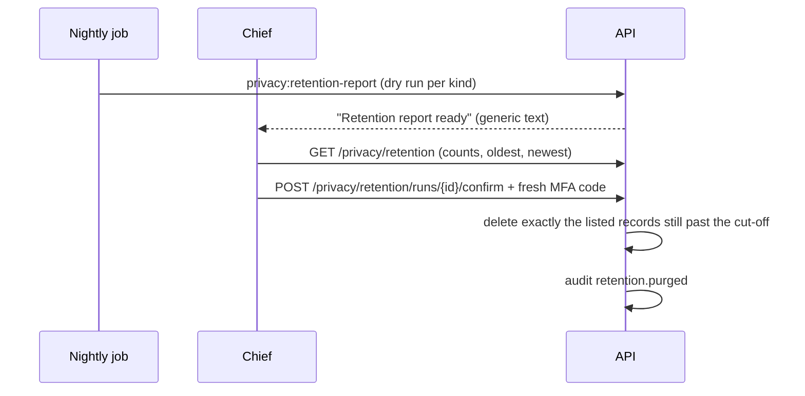

# Privacy (DPDP)

> Status: **built in Phase 9.** Versioned privacy notices, parent consent per purpose, the data-requests inbox, retention with a dry run, the grievance contact, and the incident log. Not a licensed module: every school has it.

## 1. What it does (plain words, no code)

The school is the data fiduciary under the DPDP Act 2023; Campus TAB is its processor. This module gives the school the tools the Act and the 2025 Rules ask for:

- **Privacy notice, in versions.** The Chief writes the notice and publishes it as version 1, 2, 3… A published version never changes; a change is a new version. Everyone is told when it changes.
- **Consent per purpose, from the parent's own account.** Optional uses of a child's data need a parent's yes. Today the purposes are: keep the PEN, keep the APAAR ID, use photos publicly, share with outside partners. The parent answers on their own **Privacy** page, signed in to their own account. That is the verified parental consent. The office cannot record consent for them. Saying no to PEN or APAAR removes the number at once.
- **Data requests.** Anyone signed in can ask for a copy of their data, a correction or an erasure, for themselves or (a parent) for their own child. Each request has a due date (30 days by default). The Chief and the Principal work the inbox, and the person sees the outcome.
- **Erasure** of a child removes the personal details but keeps the school records the law needs. The audit log and the fee ledger are never touched (decision 0017).
- **Retention.** Each kind of data is kept for a set time. Every night a **dry run** lists what is past its time and tells the Chief. Nothing is deleted until the Chief reads that list and confirms it with a fresh authenticator code.
- **Grievance contact.** The school names who answers questions and complaints about personal data. It shows on the school's public profile and on everyone's Privacy page.
- **Incident log.** Every suspected breach is recorded with its timeline. The 72-hour deadline for telling the Data Protection Board shows until it is marked done. The steps are in the [breach runbook](../how-to/breach-runbook.md).
- **No tracking.** The app has no advertising, tracking or outside analytics; CI fails if any is added (`.github/scripts/no-trackers.mjs`).

## 2. Who uses it and from which screens

| Who | Screen | File |
| --- | --- | --- |
| Everyone | **Privacy** (account menu): notice, grievance contact, own requests; parents also give consents | [`PrivacyPage.tsx`](../../../frontend/src/features/privacy/PrivacyPage.tsx) |
| Chief, Principal | **Privacy office**: requests inbox, notice editor, retention, incident log (tabs by permission) | [`PrivacyOfficePage.tsx`](../../../frontend/src/features/privacy/PrivacyOfficePage.tsx) |
| Chief | School settings: the grievance contact (`school.grievance` in the config) | existing settings screen |

## 3. Requests it handles

| Request | What it does | Permission |
| --- | --- | --- |
| `GET /privacy` | Current notice, grievance contact, a parent's consents, own requests, `can` | `privacy.self` |
| `POST /privacy/consents {student_id, purpose, given, notice_version}` | A parent's answer for their own child. Errors `parents_only` (403), `not_your_child` (403), `no_privacy_notice` / `notice_changed` (409) | `privacy.self` |
| `POST /privacy/requests {type, student_id?, details}` | A data request; due in `privacy.request_due_days` | `privacy.self` |
| `GET /privacy/notices`, `PUT /privacy/notices/draft`, `POST /privacy/notices/publish` | Versions; edit the draft; publish as the next version | `privacy.notices` |
| `GET /privacy/requests` | The inbox (`meta.open`, `meta.late`) | `privacy.requests` |
| `POST /privacy/requests/{id}/move {status, outcome?}` | In progress, completed or refused (an outcome of 10+ characters for the last two) | `privacy.requests` |
| `GET /privacy/requests/{id}/copy` | The child's data for an access request, watermarked, audited (`export.made`) | `privacy.requests` + step-up `export` |
| `POST /privacy/requests/{id}/erase {confirm: admission_no}` | Erase the child's details (open erasure requests only) | `privacy.erase` + step-up `permanent_delete` |
| `GET /privacy/retention`, `POST /privacy/retention/{kind}/dry-run` | Rules and runs; a dry run deletes nothing | `privacy.retention` |
| `POST /privacy/retention/runs/{id}/confirm` | Delete exactly what that dry run listed (within 7 days) | `privacy.retention` + step-up `permanent_delete` |
| `GET /privacy/incidents`, `POST /privacy/incidents`, `POST /privacy/incidents/{id}/entries` | The incident log; add steps, mark Board/people told, status | `privacy.incidents` |

## 4. Code map

| File | What it does |
| --- | --- |
| [`Models/PrivacyNotice.php`](../../../backend/app/Modules/Privacy/Models/PrivacyNotice.php) | Draft, published, replaced versions |
| [`Models/DataRequest.php`](../../../backend/app/Modules/Privacy/Models/DataRequest.php) | Access, correction, erasure; due date, outcome, history |
| [`Models/RetentionRun.php`](../../../backend/app/Modules/Privacy/Models/RetentionRun.php) | One dry run and, once confirmed, what it deleted |
| [`Models/Incident.php`](../../../backend/app/Modules/Privacy/Models/Incident.php) | The incident log |
| [`Domain/Notices.php`](../../../backend/app/Modules/Privacy/Domain/Notices.php) | Draft and publish (one transaction), tell everyone |
| [`Domain/Consents.php`](../../../backend/app/Modules/Privacy/Domain/Consents.php) | A parent's consents; withdrawing PEN/APAAR removes the number |
| [`Domain/DataRequests.php`](../../../backend/app/Modules/Privacy/Domain/DataRequests.php) | Create, move, present (the requester never sees who handled it) |
| [`Domain/StudentData.php`](../../../backend/app/Modules/Privacy/Domain/StudentData.php) | The access copy and the erasure |
| [`Domain/Retention.php`](../../../backend/app/Modules/Privacy/Domain/Retention.php) | Dry run and confirm, per kind |
| [`Console/RetentionReportCommand.php`](../../../backend/app/Modules/Privacy/Console/RetentionReportCommand.php) | Nightly `privacy:retention-report` (dry runs only) |
| [`Http/Controllers/*`](../../../backend/app/Modules/Privacy/Http/Controllers/) | Own page and office |
| [`config/privacy.php`](../../../backend/config/privacy.php) | Purposes, due days, retention times, breach hours |
| `People/Models/Consent.php`, `People/Domain/StudentRecords.php`, `People/Domain/Import/Importer.php` | Only a parent's own consent counts; the office cannot record one |
| `frontend/src/features/privacy/*` | The two screens and the client |

## 5. How the code works, step by step

Consent: the parent opens Privacy and picks yes or no per purpose and child. The request carries the notice version the parent saw; a newer notice makes the server refuse (`notice_changed`), so a consent always names the version it answered.

## 6. Data it reads and writes

| Collection | Fields | Indexes |
| --- | --- | --- |
| `privacy_notices` | version, title, body, status, summary_of_changes, published_at, published_by | `tenant_id, status, version` |
| `data_requests` | type, status, requested_by, requester_id, subject_type, student_id, subject_name, details, due_on, handled_by, outcome, completed_at, history | `tenant_id, status, due_on`; `tenant_id, requester_id, created_at` |
| `retention_runs` | kind, status, days, cutoff, count, ids (hidden), oldest, newest, made_by, confirmed_by, confirmed_at, deleted | `tenant_id, kind, status` |
| `privacy_incidents` | title, detected_at, severity, status, description, data_affected, people_affected, board_notified_at, people_notified_at, reported_by, timeline | `tenant_id, detected_at` |
| `consents` (People) | + `user_id`, `method` (`parent_account`) | + `tenant_id, student_id, purpose, method, created_at` |

Retention removes: read notifications, ended device sessions, notice read receipts, import batches (and their files), and the **files** of register photos and leave documents (the records get `late_entry.photo_removed` / `documents_removed`).

## 7. Links to other modules

People (consents, students, guardians), Communication (notifications `privacy.notice`, `privacy.request`, `privacy.retention`), Identity (step-up), Tenancy (the grievance contact in the config and the public profile), Attendance and Leave (files removed under retention answer `410 removed_under_retention`), Support/Exports (the watermark on the access copy).

## 8. Settings that change its behaviour

`config/privacy.php`: `purposes`, `request_due_days` (30, env `PRIVACY_REQUEST_DUE_DAYS`), `retention.<kind>.days`, `breach_report_hours` (72). School config: `school.grievance {name, role, email, phone, address}`.

## 9. Permissions and the rules behind them

`privacy.self` (everyone: own; parents: child), `privacy.notices` (Chief), `privacy.requests` (Chief, Principal), `privacy.erase` (Chief), `privacy.retention` (Chief), `privacy.incidents` (Chief, Principal). Erasing and confirming a retention run ask for step-up `permanent_delete`; the access copy asks for step-up `export`. Existing schools get the new abilities with `php artisan identity:sync-roles --with-new-permissions`.

## 10. How to change it

- **A new consent purpose:** add it to `Consent::PURPOSES` and `config/privacy.php` `purposes`, add `privacy.purposes.<key>` strings.
- **A new retention kind:** add it to `privacy.retention`, a `match` arm in `Retention::candidates` and, if it has files, in `purge`; add `privacy.retention.<kind>` strings and a test.
- **Change a retention time:** `config/privacy.php` (after the legal review).

## 11. Tests that cover it

- `backend/tests/Feature/Privacy/PrivacyTest.php`: notice versions; consent only from the parent's own account, against the current version, PEN only after it, withdrawal removes it, old office ticks need the parent; inbox with due dates and lateness, watermarked step-up copy, outcomes; erasure (Chief, step-up, typed admission number) keeps the audit log; dry run deletes nothing, confirm needs the Chief and step-up and is single-use, the nightly job only reports; grievance contact on the public profile; incidents with the 72-hour deadline.
- `backend/tests/Feature/People/StudentsTest.php`, `tests/Feature/Tenancy/PublicConfigTest.php`.

## 12. Decisions and limits

- [0017](../decisions/0017-dpdp-consent-erasure-retention.md): parent-only consent; erasure and retention keep the audit log and the fee ledger; files only for closed-year records.
- The notice text, the purposes and the retention times are starting points that **need a legal review before launch**.
- Requests about a staff member's own data are answered from their staff record by the office (the copy and erase buttons are for children).

## 13. Change history

| Date | Phase | What changed | Why |
| --- | --- | --- | --- |
| 2026-11-28 | 9 | Module built | Phase 9 item 3 (DPDP) with the owner's rules and choices |
