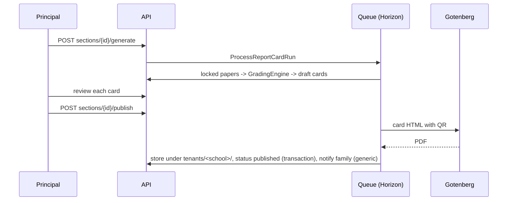

# Reports

> Status: **built in Phase 7**, back end and screens. Report cards from locked marks, templates, background PDF generation with a QR code, public verification, versioned re-issue and the year-end promotion wizard.

## 1. What it does (plain words, no code)

**The grading engine** turns a student's marks into a yearly result using the school's assessment scheme: weightage per component, best-of, grace marks, pass rules and the scheme's rounding rule.

- **Exact arithmetic** (owner's rule 1). Marks become whole half-marks, every step is an exact fraction (`Rational`), and the rounding rule (half up, half even, up, down or none) is applied **once, at the end**, to each subject's percentage and to the overall percentage. There is no floating point anywhere in the calculation.
- **Locked papers only** (owner's rule 2). A paper that is open, submitted or verified never reaches a card, even if it was auto-published.
- AB counts as 0; ML (medical) leaves the paper out of both the marks and the maximum. A component with no papers is left out and the subject is flagged *incomplete*.

**Templates.** The Principal arranges blocks (header with logo and name from the school config, student details, subjects and marks, co-scholastic grades, attendance, descriptive progress for HPC-style cards, remarks, result, signatures), turns blocks on or off, and uploads the school's letterhead (PNG or JPG). Presets (CBSE-style I–VIII, IX–X, generic state board, HPC-style) are **starting points only**, labelled "Check against your board's latest format".

**The process.**

1. **Make the cards** (background job): one draft per student of the section, from locked papers, with attendance. Making them again updates drafts and reviewed cards and keeps their remarks; a published card is never touched.
2. **Remarks:** the class teacher writes the class remark and co-scholastic grades; each subject teacher writes their own subject's remark. A change after review sends the card back to draft.
3. **Review:** the Principal (or a Vice Principal for the wing) marks each card reviewed.
4. **Publish** (background job): the card is frozen, gets a random verification code, its PDF is rendered by Gotenberg (Chromium with Noto fonts, so Indian scripts print correctly) with a QR code, stored under the school's own folder, and the family is told only "A report card is ready".

**Public verification** (owner's rule 3). The QR code opens `/verify/{school}/{code}`. The page shows only the school, the student's name, the class, the year, the version, the issue date and whether this version is **current** or **replaced**. No marks, no photo, nothing else. The code is 32 random bytes (43 characters); only its SHA-256 is stored, so it cannot be guessed or listed, and the page is rate-limited per address.

**PDFs** (owner's rule 4) live under `tenants/<school>/report-cards/…` and are served only through a **5-minute signed link** issued after the permission check. Parents get only their own children's published cards (current and replaced versions).

**Re-issue** (owner's rule 5). Only the Principal re-issues a published card, with a typed reason (at least 10 characters). A new version is made from the current locked marks; the old version stays, marked *replaced*, and its QR code still verifies as replaced. The family is told only "A new version of a report card is available".

**Year-end promotion** (owner's rule 6). The wizard shows a **full preview** first: every student and what happens to them (promote, keep in class, leaving, graduate), defaulting to "keep in class" for a published *needs improvement* result; what rolls forward (classes, sections, teacher assignments, as drafts) and any new draft classes or sections needed. A numbered class moves to the next number: if the school has Class 3 and Class 6 but no Class 4, Class 3 moves into a new draft Class 4, never skipping ahead. The Principal changes any student, the preview refreshes, and the apply step must carry the preview's digest (a stale preview is refused). Everything happens in **one MongoDB transaction** and is audited (`year.promoted`). After that the old year is **closed and read-only**: no record carrying its `year_id` (sections, papers, attendance, cards, fees…) can be created, changed or deleted.

## 2. Who uses it and from which screens

| Who | Screen | File |
| --- | --- | --- |
| Principal, Vice Principal, class teacher, subject teacher | Report cards: sections, a section's cards, one card | [`ReportCardPages.tsx`](../../../frontend/src/features/reports/ReportCardPages.tsx) |
| Principal, Chief | Templates | [`TemplatesPage.tsx`](../../../frontend/src/features/reports/TemplatesPage.tsx) |
| Principal, Chief | Year-end promotion | [`PromotionPage.tsx`](../../../frontend/src/features/reports/PromotionPage.tsx) |
| Parents, students | Results → Report cards tab | [`FamilyCards.tsx`](../../../frontend/src/features/reports/FamilyCards.tsx) in [`TestsPages.tsx`](../../../frontend/src/features/assessment/TestsPages.tsx) |
| Anyone with the QR code | Verification page (no sign-in) | [`VerifyPage.tsx`](../../../frontend/src/features/reports/VerifyPage.tsx) |

## 3. Requests it handles

| Method and path | What | Permission |
| --- | --- | --- |
| `GET /report-templates`, `GET /report-templates/presets` | Templates; starter layouts | `report_templates.manage` (list also `results.publish`) |
| `POST /report-templates`, `PUT /report-templates/{id}` | Create or change (blocks once each; one template per class) | `report_templates.manage` |
| `POST/DELETE /report-templates/{id}/letterhead` | Upload (PNG/JPG, 1 MB) or remove the letterhead | `report_templates.manage` |
| `GET /report-cards/sections`, `GET /report-cards/sections/{id}` | Sections I work on; a section's cards, locked/not-locked paper counts, the last run | `results.publish` or `remarks.edit` |
| `POST /report-cards/sections/{id}/generate` · `/publish` | Background run (202) | `results.publish` |
| `GET /report-cards/runs/{id}` | A run's progress | as above |
| `GET /report-cards/{id}` · `PUT …/remarks` · `POST …/review` | One card; remarks; review | view: card access; remarks `remarks.edit`; review `results.publish` |
| `POST /report-cards/{id}/reissue {reason}` | Principal only (409 if not the current published version) | `report_cards.reissue` + Principal role |
| `POST /report-cards/{id}/link` | A 5-minute signed PDF link | card access |
| `GET /files/report-cards/{tenant}/{card}` | The PDF, signed link only | signature |
| `GET /report-cards/students/{id}`, `GET /report-cards/mine` | A student's cards (families: published only) | `results.view` |
| `GET /public/verify/{school}/{code}` | Identity facts only | public, rate-limited |
| `POST /promotions/preview`, `POST /promotions/apply {digest}` | The wizard; the preview carries `dues` (students with unpaid fees, total, `unresolved`, `digest`); apply answers `422 dues_unresolved` while a balance is undecided | `year.promote` |
| `POST /promotions/carry-forward {to, decisions: {student_id: carry|leave}, dues_digest}` | The unpaid-dues step: one approval for every balance; makes the new year (planned) if needed. Errors `dues_changed` (409), `no_unpaid_dues` | `year.promote` + step-up `fees_carry_forward` |

Errors use the one shape; notable codes: `no_scheme`, `no_template`, `nothing_to_publish`, `principal_only`, `reason_required`, `not_current_version`, `preview_stale`, `section_missing`, `year_closed`.

## 4. Code map

| File | What it does |
| --- | --- |
| `backend/app/Modules/Reports/Domain/Grading/Rational.php` | Exact fractions, compare, round once by rule |
| `…/Domain/Grading/GradingEngine.php` | Scheme + locked marks → subject and overall results |
| `…/Domain/ResultBuilder.php` | The section's scheme, template, locked-paper entries and attendance |
| `…/Domain/ReportCards.php` | Generate, remarks, review, publish, re-issue; the background run |
| `…/Domain/CardAccess.php` | Who sees which card and which parts |
| `…/Domain/CardRenderer.php` | The printable HTML (blocks, letterhead, QR as an inline SVG) |
| `…/Domain/Pdf/GotenbergRenderer.php`, `FakePdfRenderer.php` | PDF rendering; the fake one only in tests |
| `…/Domain/Promotion.php` | Preview with digest and unpaid dues; the dues step (`carryForward`); apply in one transaction; close the year |
| `backend/app/Modules/Fees/Domain/YearEndDues.php` | Unpaid balances of a year; carry forward or leave each, with one audit entry per student |
| `frontend/src/features/reports/DuesStep.tsx` | Step 3 of the wizard: the unpaid-fees list and the one approval |
| `…/Http/Controllers/*` | Templates, cards, verification, promotion |
| `…/Jobs/ProcessReportCardRun.php` | Runs a generate/publish/re-issue inside the school |
| `backend/app/Support/Models/ClosedYears.php`, `GuardsClosedYear.php` | A closed year is read-only for every school model |
| `backend/config/reports.php`, `backend/lang/{en,hi}/reports.php` | Blocks, presets, limits; card wording |
| `frontend/src/features/reports/*` | The screens above |

## 5. How the code works, step by step

## 6. Data it reads and writes

- `report_templates` (name, grades, blocks, preset, letterhead) — index `tenant_id, name`.
- `report_cards` — one document per **version**: snapshot (the computed result), remarks, co-scholastic grades, attendance, status (draft, reviewed, published, replaced), `verify_hash`, pdf {path, size, sha256}, history. Unique `tenant_id, student_id, year_id, version`; `tenant_id, verify_hash`.
- `report_card_runs` — kind, status, progress.
- Reads papers, assessments, schemes, attendance days, enrolments; the promotion writes academic years, classes, sections, teaching assignments, enrolments. The dues step writes fee adjustments (`source: year_end`), ledger entries, carried-forward demands and `fee_year_end_decisions`.

## 7. Links to other modules

- **Assessment:** schemes and locked papers. A locked mark changes only through a correction; then the Principal re-issues.
- **Communication:** `report_card.published`, `report_card.new_version` (generic text only).
- **Academic structure / People:** the promotion creates the next year's records; `ClosedYears` guards every model with a `year_id`.

## 8. Settings that change its behaviour

`config/reports.php`: blocks, presets, co-scholastic areas and grades, letterhead limits, remark length, re-issue reason length, link minutes (5), PDF driver and Gotenberg URL, verification code bytes (32) and per-minute limit (30). The scheme's rules (`rounding`, `best_of`, `grace_marks`, `pass_percent`) live on each assessment scheme.

## 9. Permissions and the rules behind them

`report_templates.manage` (Chief, Principal), `report_cards.reissue` (Principal; the code also requires the Principal role), `year.promote` (Chief, Principal), plus `results.publish`, `remarks.edit` and `results.view` from Phase 6. Families never see drafts.

## 10. How to change it

- A new block: add it to `reports.blocks`, render it in `CardRenderer`, add `reports.blocks.<type>` strings.
- A new rounding rule: `Rational::round`, the scheme validation in `SchemeController`, and a unit test.

## 11. Tests that cover it

- `backend/tests/Unit/Reports/GradingEngineTest.php` — each starter preset, rounding once, best-of, grace, AB/ML, exactness.
- `backend/tests/Feature/Reports/ReportCardsTest.php` — 45 cards in the background from locked papers only and every QR verifies; identity-only verification and guessed codes; parents and signed links; remarks scope; re-issue keeps the old version; promotion preview, transaction, audit and the read-only old year.
- `backend/tests/Feature/Fees/YearEndDuesTest.php` — the preview lists every unpaid balance; apply is refused until each is decided; one step-up approval carries or leaves each, with an audit entry per student and the dues opening in the new year; a stale list is refused; a balance changed after "leave" must be decided again.
- `frontend/src/features/reports/reports.test.tsx` — the verification page, the family's versions, and the wizard's dues step (Apply stays off until every balance is decided).

## 12. Decisions and limits

- Card HTML has no scripts; Gotenberg runs with JavaScript off and only reads inlined files.
- **Unpaid fees at year end:** the year cannot close until every unpaid balance is carried forward or the Principal confirms leaving it in the closed year. Carrying forward moves a balance and forgives nothing, so the Principal approves the whole list alone, once, with step-up (owner's rule, session 5). A balance left in a closed year can only be viewed: Campus TAB can no longer collect it, and the screen says so.
- The demo seeder (`DemoReportsSeeder`) publishes one 7-B card; it needs the `gotenberg` container.

## 13. Change history

| Date | Phase | What changed | Why |
| --- | --- | --- | --- |
| 2026-11-27 | 0 | Page created from the template | Phase 0 starts the Application Report |
| 2026-11-28 | 7 | Module built: grading engine, templates, generation, verification, re-issue, promotion | Phase 7 of BUILD-PROMPTS with the owner's six rules |
| 2026-11-28 | 9 (fix 1) | Unpaid-dues step in the promotion wizard; the year closes only when every balance is decided | Owner's fix: dues were left behind silently in a read-only year |
| 2026-11-28 | 7 (review) | A numbered class moves to the next number; a skipped class is made as a draft (`new_classes`). Cards carry `replaced_by_id` and, for the class teacher, `co_scholastic_options` | Browser review: 3-A was moving to Class 6; class teachers could not set co-scholastic grades |
