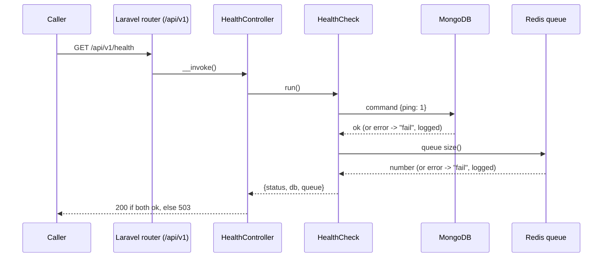

# System

> Status: **built in Phase 0.** Shared plumbing that every other module relies on: the health check, the one API error shape and the report generator. Not one of the thirteen business modules in the blueprint; it holds things that belong to no single business area.

## 1. What it does (plain words, no code)

- **Health check.** Anyone (a person, a monitor, Docker) can ask the API "are you working?" at `/api/v1/health`. The API checks that it can reach the database (MongoDB) and the job queue (Redis) and answers `ok` or `fail` for each.
- **One error shape.** Whenever something goes wrong on any request, the API answers the same way: an `error` object with a short code (`not_found`, `validation_failed`, `module_disabled`, …), a plain message and any details. Screens can therefore show errors the same way everywhere.
- **Security on every answer (Phase 9).** The API adds the security headers (CSP `default-src 'none'`, frame-ancestors none, no-referrer, no-store, HSTS in production) and lets the apps' web views call it with a token only, never cookies (see [security.md](../security.md), [apps.md](../apps.md)).
- **Virus scan of every upload (Phase 9).** Every file sent to a school route is checked by ClamAV before anything sees it; an infected file is refused and logged, and uploads stop when the scanner is down.
- **Export watermark and alert (Phase 9).** Every Excel or PDF export carries who made it, when and for which school; a large one alerts the Chief.
- **Load-test data (Phase 9).** `php artisan loadtest:seed` fills a separate database with 50 schools × 1,000 students for the k6 test ([performance.md](../performance.md)).
- **Report generator.** The command `php artisan report:generate` rewrites the parts of this report that can be read straight from the code (the list of modules, every API route, every collection), so those parts never go out of date.

## 2. Who uses it and from which screens

| Who | Where | What they see |
| --- | --- | --- |
| Everyone using the web app | Sidebar footer, [`frontend/src/features/shell/ServerStatus.tsx`](../../../frontend/src/features/shell/ServerStatus.tsx) | "Server: Connected" or "Server: Not reachable", checked every 30 seconds |
| Docker | `api` service healthcheck in [`infra/docker-compose.yml`](../../../infra/docker-compose.yml) | Uses Laravel's built-in `/up`; `horizon` and `reverb` start only after it passes |
| Uptime monitoring (later) | `GET /api/v1/health` | 200 when healthy, 503 when not |

## 3. Requests it handles

| Method and path | Input | Output | Permission | Errors |
| --- | --- | --- | --- | --- |
| `GET /api/v1/health` | none | `{"status":"ok","db":"ok","queue":"ok"}` with HTTP 200 | Public, no sign-in | HTTP 503 with `"status":"fail"` and the failing part set to `"fail"`. Never includes host names or error text |

Every other request in the API uses the error shape this module defines:

```json
{ "error": { "code": "not_found", "message": "The page or record was not found.", "details": {} } }
```

| HTTP | `code` | When |
| --- | --- | --- |
| 401 | `unauthenticated` | Not signed in |
| 403 | `forbidden` | Signed in but not allowed (a Policy said no) |
| 404 | `not_found` | Unknown route or record |
| 405 | `method_not_allowed` | Wrong HTTP method |
| 409 / 412 | `conflict` / `precondition_failed` | Used from Phase 6 for ETag conflicts |
| 422 | `validation_failed` | Input failed validation; `details` lists each field's messages |
| 429 | `too_many_requests` | Rate limit hit |
| 500 | `server_error` | A bug; with `APP_DEBUG=true` the details show the exception class and message |
| any | domain code | Thrown as `ApiException`, for example `module_disabled` (Phase 1) or `marks_locked` (Phase 6) |

## 4. Code map

| File | What it does |
| --- | --- |
| [`backend/app/Modules/System/routes.php`](../../../backend/app/Modules/System/routes.php) | Registers `GET health` (under `/api/v1`) |
| [`backend/app/Modules/System/Http/Controllers/HealthController.php`](../../../backend/app/Modules/System/Http/Controllers/HealthController.php) | Runs the check and picks HTTP 200 or 503 |
| [`backend/app/Modules/System/Domain/HealthCheck.php`](../../../backend/app/Modules/System/Domain/HealthCheck.php) | Pings MongoDB, asks the queue for its size, logs any failure, returns ok/fail per part |
| [`backend/app/Modules/System/Console/ReportGenerateCommand.php`](../../../backend/app/Modules/System/Console/ReportGenerateCommand.php) | `php artisan report:generate [--check]` |
| [`backend/app/Support/Http/ApiExceptionRenderer.php`](../../../backend/app/Support/Http/ApiExceptionRenderer.php) | Turns every exception on `/api/*` into the one error shape |
| [`backend/app/Support/Http/ApiException.php`](../../../backend/app/Support/Http/ApiException.php) | The exception domain code throws to return its own error code |
| [`backend/routes/api.php`](../../../backend/routes/api.php) | Loads every `app/Modules/*/routes.php` |
| [`backend/bootstrap/app.php`](../../../backend/bootstrap/app.php) | Sets the `/api/v1` prefix, loads module console commands, registers the error renderer |
| [`backend/config/report.php`](../../../backend/config/report.php) | Where the report folder is (`REPORT_PATH`) |
| [`frontend/src/lib/api.ts`](../../../frontend/src/lib/api.ts) | Front-end fetch helper that reads the error shape; `getHealth()`; the apps' bearer token |
| [`backend/app/Support/Http/SecurityHeaders.php`](../../../backend/app/Support/Http/SecurityHeaders.php) | Security headers on every API answer |
| [`backend/app/Support/Http/AppOriginCors.php`](../../../backend/app/Support/Http/AppOriginCors.php) | CORS for the apps' origins, without credentials |
| [`backend/app/Support/Uploads/*`](../../../backend/app/Support/Uploads/) | `ScanUploadedFiles` (school routes), `ClamAvScanner` (INSTREAM), `FakeVirusScanner` (tests only) |
| [`backend/app/Support/Exports/ExportGuard.php`](../../../backend/app/Support/Exports/ExportGuard.php), [`PdfTable.php`](../../../backend/app/Support/Exports/PdfTable.php) | Watermark, audit `export.made`, the Chief's large-export alert; a watermarked PDF table |
| [`backend/app/Modules/System/Console/LoadTestSeedCommand.php`](../../../backend/app/Modules/System/Console/LoadTestSeedCommand.php) | `loadtest:seed` (only a database whose name ends in `_load`, never production) |
| [`backend/config/uploads.php`](../../../backend/config/uploads.php), [`backend/config/exports.php`](../../../backend/config/exports.php) | Scanner driver and host; large-export rows |

## 5. How the code works, step by step



The report generator reads the router's route list, the folders under `app/Modules/` and every model class, builds a Markdown table for each, and replaces only the text between `<!-- generated:NAME:start -->` and `<!-- generated:NAME:end -->` markers in `README.md`, `api.md` and `data-dictionary.md`. With `--check` it writes nothing and fails if any table would change; CI runs it that way. A module whose report page has a different name is listed in `PAGE_ALIASES` (today only Identity → `identity-and-access.md`); `.github/scripts/check-report.mjs` keeps the same list, so the README link and the CI check agree.

## 6. Data it reads and writes

Reads nothing from collections; the health check only sends a `ping` command. Writes nothing to the database. `report:generate` writes Markdown files in `docs/report/`.

## 7. Links to other modules

Every module throws `ApiException` for its own error codes and is listed by the report generator. Nothing calls into the health check except HTTP callers.

## 8. Settings that change its behaviour

| Setting | Where | Effect |
| --- | --- | --- |
| `DB_CONNECTION`, `MONGODB_URI`, `MONGODB_DATABASE` | `backend/.env` / compose | Which MongoDB the health check pings |
| `QUEUE_CONNECTION`, `REDIS_HOST`, `REDIS_PORT` | `backend/.env` / compose | Which queue it asks |
| `APP_DEBUG` | `backend/.env` | When true, 500 errors include the exception class and message in `details` |
| `REPORT_PATH` | compose (`/docs/report`) or default `../docs/report` | Where `report:generate` writes |

## 9. Permissions and the rules behind them

The health endpoint is public on purpose and leaks no internal detail (a test checks this). The error renderer never decides permissions; it only formats the result of Policies.

## 10. How to change it

- **Add a dependency to the health check** (for example object storage in a later phase): add one `$this->check('storage', fn () => …)` line in `HealthCheck::run()`, add the key to the return type, update `HealthTest.php` and the response shape in this page and in `frontend/src/lib/api.ts`.
- **Add an error code:** throw `new ApiException('your_code', 'Message', 4xx, [...details])` from domain code; list the code on the module's page.
- **Generate another report table:** add a method to `ReportGenerateCommand` and an entry in its `$sections` map, then put the markers in the target page.

## 11. Tests that cover it

| Test | What it proves |
| --- | --- |
| [`backend/tests/Feature/System/HealthTest.php`](../../../backend/tests/Feature/System/HealthTest.php) | ok when both answer; 503 and `queue: fail` when the queue throws; 503 and `db: fail` when MongoDB is unreachable; no host names or exception text leak |
| [`backend/tests/Feature/Support/ApiErrorShapeTest.php`](../../../backend/tests/Feature/Support/ApiErrorShapeTest.php) | Unknown route, `ApiException` and validation errors all use the one shape |
| [`backend/tests/Feature/Support/RefreshMongoDatabaseTest.php`](../../../backend/tests/Feature/Support/RefreshMongoDatabaseTest.php) | The test-database reset helper empties the database between tests and only touches a `_test` database |
| [`frontend/src/features/shell/AppShell.test.tsx`](../../../frontend/src/features/shell/AppShell.test.tsx) | The sidebar shows "Connected" when health is ok |
| CI step "Generated report sections are up to date" | `report:generate --check` |
| [`backend/tests/Feature/Support/VirusScanTest.php`](../../../backend/tests/Feature/Support/VirusScanTest.php) | The four named uploads refused when infected, audited by hash; clean files stored; scanner down → 503; every route reading a file is behind the scanner; the real clamd protocol (with `CLAMAV_TEST_HOST`) |
| [`backend/tests/Feature/Fees/FeesTest.php`](../../../backend/tests/Feature/Fees/FeesTest.php) "watermarks Excel and PDF exports" | Watermark in the first row, printed footer and file properties; a watermarked template still imports; PDF watermark; large-export alert |
| [`backend/tests/Feature/Communication/AppPushTest.php`](../../../backend/tests/Feature/Communication/AppPushTest.php) | App origins allowed without credentials |

## 12. Decisions and limits

- The queue check asks the default queue connection for its size; that proves Redis answers but not that a Horizon worker is running. Horizon's own dashboard (`/horizon`, local only) shows workers.
- Health uses `/api/v1/health` for people and monitors and Laravel's `/up` for Docker, because `/up` needs nothing but PHP and starts answering first.
- See [decisions/0001-mongodb-replica-set-and-test-reset.md](../decisions/0001-mongodb-replica-set-and-test-reset.md).

## 13. Change history

| Date | Phase | What changed | Why |
| --- | --- | --- | --- |
| 2026-11-27 | 0 | Module created: health check, error shape, report generator | Phase 0 foundations |
| 2026-11-27 | Session 2 | Report generator links Identity to `identity-and-access.md` (`PAGE_ALIASES`); the error renderer turns a policy's "deny as not found" into a 404 `not_found` | The README linked a page that does not exist; parents asking for a whole class register must get 404, not 403 |
| 2026-11-28 | 9 | Security headers, app CORS, upload virus scan, export watermark and alert, load-test seeder | Phase 9 security pass, exports and load test |
| 2026-11-28 | 7–8 | Parallel test runs: each process of each run has its own database, cache prefix and fake disks (token `<n>_<run>`); a run drops its databases at the end and those of dead runs. `composer test` has no Composer time limit | Overlapping runs (and timed-out runs' workers) emptied each other's collections, so tests failed now and then |
