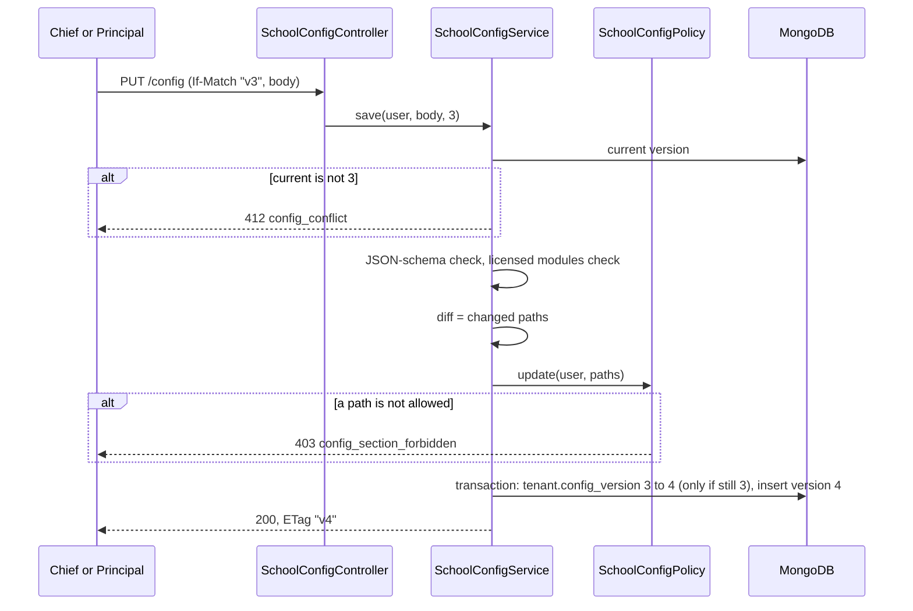

# Tenancy

> Status: **Phase 1 parts A and B built** (tenants, tenant isolation, public branding, versioned school config; part B moved config rights onto permission strings and seeds the system roles for every new school). The platform console arrives in part C.

## 1. What it does (plain words, no code)

Keeps every school's data apart. Each school is a *tenant*: every school record carries a `tenant_id`, and that value always comes from the signed-in user, never from what a browser sends. Any query on school data that forgets the school is refused (in code) and caught (in tests).

It also holds two school-wide things:

- **Public branding** for the sign-in screen: name, logo, accent colour, languages, sign-in methods. Nothing private is shown before sign-in.
- **The school config:** every school-level choice in one versioned document. Each save is a new version with who, when, why and a diff, and older versions can be restored (rollback writes a new version; history is never rewritten).

## 2. Who uses it and from which screens

| Who | What | Screen |
| --- | --- | --- |
| Anyone opening the app | Enters the school code; the app loads public branding | School-code entry (Phase 1 part C) |
| Chief Admin | Views and changes every setting; rolls back | Settings screens (Phase 2 onwards) |
| Principal | Views every setting; changes policies and academic settings only | Settings screens |
| Our platform team | Creates schools | `php artisan platform:create-school` (web console in part C) |

## 3. Requests it handles

All paths are under `/api/v1`. The full generated list is in [api.md](../api.md).

| Method and path | Input | Output | Who | Errors |
| --- | --- | --- | --- | --- |
| `GET /public/tenants/{code}/config` | school code, any case | `{data: {code, name, short_name, logo_url, accent, languages {default, featured, all}, login_methods}}`, cached 5 minutes | Anyone (60 a minute per IP) | `404 tenant_not_found` for unknown, pending or suspended schools |
| `GET /config` | — | `{data: {version, body, changed_by, reason, rolled_back_from, created_at}}` with `ETag: "v<version>"` | `config.view` (Chief, Principal) | `403 permission_denied` |
| `PUT /config` | header `If-Match: "v<version>"`; `{body, reason?}` | the saved version, new ETag (same version if nothing changed) | `config.edit` (Chief: all) or `config.edit_policies` (Principal: some sections) | `403 permission_denied`, `428 precondition_required`, `412 config_conflict`, `422 config_invalid`, `422 module_not_licensed`, `403 config_section_forbidden` |
| `GET /config/versions` | — | the last 100 versions: version, diff, changed_by, reason, rolled_back_from, created_at | Chief, Principal | `403 forbidden` |
| `GET /config/versions/{v}` | — | that version's body | Chief, Principal | `404 config_version_not_found` |
| `POST /config/versions/{v}/rollback` | `If-Match`; `{reason?}` | a new version holding version v's body | Same rules as `PUT /config` | as `PUT /config`, plus `404 config_version_not_found` |

The `/config` routes run in the `school` middleware group (auth, `tenant`, `device`, `mfa.enrolled`, `licence`, so an expired licence makes them read-only), and each names its permission.

**Phase 2.**

- **Logo:** `POST /config/logo` (PNG, JPEG or WebP, up to 512 KB, `config.edit`) stores the logo privately and sets `school.logo_url`. `GET /public/tenants/{code}/logo` serves it for the sign-in screen and the brand stack ([`SchoolLogoController.php`](../../../backend/app/Modules/Tenancy/Http/Controllers/SchoolLogoController.php)).
- **Config:** `sign_in.methods` may now include `student_login`.

## 4. Code map

Back end, `backend/app/Modules/Tenancy/`:

| File | What it does |
| --- | --- |
| [`Models/Tenant.php`](../../../backend/app/Modules/Tenancy/Models/Tenant.php) | A school (platform level). `_id` is `t_<ULID>`; code, name, group_id, status (pending, active, suspended), config_version, contact |
| [`Models/SchoolConfig.php`](../../../backend/app/Modules/Tenancy/Models/SchoolConfig.php) | One config version; append-only (updates and deletes throw) |
| [`Schemas/school-config.schema.json`](../../../backend/app/Modules/Tenancy/Schemas/school-config.schema.json) | JSON Schema for the config body; every object forbids unknown keys |
| [`Domain/ConfigSchema.php`](../../../backend/app/Modules/Tenancy/Domain/ConfigSchema.php) | Validates a body against the schema (`opis/json-schema`) |
| [`Domain/ConfigDiff.php`](../../../backend/app/Modules/Tenancy/Domain/ConfigDiff.php) | Works out the changed settings as a list of path, from, to |
| [`Domain/ConfigSections.php`](../../../backend/app/Modules/Tenancy/Domain/ConfigSections.php) | The sections the Principal may change (allow-list) |
| [`Domain/SchoolConfigService.php`](../../../backend/app/Modules/Tenancy/Domain/SchoolConfigService.php) | Current version, history, save, rollback, and version 1 at activation |
| [`Domain/DefaultConfig.php`](../../../backend/app/Modules/Tenancy/Domain/DefaultConfig.php) | The first config a school gets |
| [`Domain/PublicConfig.php`](../../../backend/app/Modules/Tenancy/Domain/PublicConfig.php) | Builds the public branding from an explicit allow-list |
| [`Domain/TenantProvisioner.php`](../../../backend/app/Modules/Tenancy/Domain/TenantProvisioner.php) | Platform side: creates a pending school |
| [`Policies/SchoolConfigPolicy.php`](../../../backend/app/Modules/Tenancy/Policies/SchoolConfigPolicy.php) | Who may view the config, and who may change each changed path |
| [`Http/Controllers/PublicConfigController.php`](../../../backend/app/Modules/Tenancy/Http/Controllers/PublicConfigController.php) | `GET /public/tenants/{code}/config` |
| [`Http/Controllers/SchoolConfigController.php`](../../../backend/app/Modules/Tenancy/Http/Controllers/SchoolConfigController.php) | The `/config` routes; reads If-Match, sets ETag |
| [`Http/Middleware/SetTenantFromUser.php`](../../../backend/app/Modules/Tenancy/Http/Middleware/SetTenantFromUser.php) | Middleware `tenant`: sets the school from the signed-in user |
| [`Console/CreateSchoolCommand.php`](../../../backend/app/Modules/Tenancy/Console/CreateSchoolCommand.php) | `php artisan platform:create-school` |
| [`TenancyServiceProvider.php`](../../../backend/app/Modules/Tenancy/TenancyServiceProvider.php) | Binds `TenantContext`, registers the Policy and the query guard |
| [`routes.php`](../../../backend/app/Modules/Tenancy/routes.php) | The routes above |

Shared isolation code, `backend/app/Support/Tenancy/`:

| File | What it does |
| --- | --- |
| [`TenantContext.php`](../../../backend/app/Support/Tenancy/TenantContext.php) | Which school the current request or job works for: `set`, `require`, `run($tenantId, fn)`, and `bypass($reason, fn)` for the one documented exception |
| [`BelongsToTenant.php`](../../../backend/app/Support/Tenancy/BelongsToTenant.php) | Trait for every school model: scope, creating hook, tenant-checked updates and deletes |
| [`TenantScope.php`](../../../backend/app/Support/Tenancy/TenantScope.php) | Adds `tenant_id = current` to every query; throws when no school is set |
| [`TenantQueryGuard.php`](../../../backend/app/Support/Tenancy/TenantQueryGuard.php) | Watches every MongoDB command; records or logs any school-data query without `tenant_id` |
| [`MissingTenantContext.php`](../../../backend/app/Support/Tenancy/MissingTenantContext.php), [`CrossTenantWrite.php`](../../../backend/app/Support/Tenancy/CrossTenantWrite.php) | The two errors the isolation code throws |

## 5. How the code works, step by step

**A school request.** `auth:sanctum` finds the user (decision [0005](../decisions/0005-tenant-scope-and-sign-in-exception.md) explains how it loads the user before the school is known). `tenant` sets `TenantContext` from `user.tenant_id` and refuses platform accounts and suspended schools. From then on every query on a `BelongsToTenant` model gets `where tenant_id = <school>`, creates get the school's `tenant_id`, and updates and deletes carry `tenant_id` in their filter. A record of another school can't be changed: the trait throws `CrossTenantWrite` before anything is sent. The context is cleared when the request ends.

**The guard.** `TenantQueryGuard` sees every command the MongoDB driver sends. For `find`, `count`, `distinct`, `findAndModify`, `aggregate`, `update`, `delete` and `insert` on a collection that is not on the platform list (`config/tenancy.php`), it checks for `tenant_id` in the filter, in the first `$match`, or in each inserted document. Unknown collections count as school data (fail closed). In tests every violation fails the test that caused it; in development it is logged.

**Saving the config.**

Rollback loads the old body and saves it through the same path, so the same checks and section rules apply.

## 6. Data it reads and writes

| Collection | Fields | Indexes | Notes |
| --- | --- | --- | --- |
| `tenants` (platform) | `_id` (`t_<ULID>`), `code`, `name`, `group_id`, `status`, `config_version`, `contact {email, phone}`, timestamps | `code` unique; `group_id` | `group_id` is the Group level (a trust with several branches); its dashboard ships in v2 |
| `school_configs` (school) | `tenant_id`, `version`, `body`, `diff [{path, from, to}]`, `changed_by {id, name, level}`, `reason`, `rolled_back_from`, timestamps | `tenant_id + version` unique | Append-only, no soft deletes |

Generated list: [data-dictionary.md](../data-dictionary.md).

## 7. Links to other modules

- **Licensing** calls `SchoolConfigService::initialise()` during activation, and its `module:<name>` middleware reads `body.modules`. The service asks Licensing which modules the licence includes.
- **Identity** provides the user and the permission checks; `SchoolConfigPolicy` asks `AccessControl` for `config.view`, `config.edit` and `config.edit_policies`. `TenantProvisioner` seeds the system roles of every new school. **Audit** records each config version (the diff, not the body); a version is "academic" when every changed path is one the Principal may edit.
- Every later school module uses `BelongsToTenant` and the `tenant` middleware.
- Audit (Phase 1 part B) will record each config save; until then the version itself records who, when, why and what.

## 8. Settings that change its behaviour

- `TENANCY_QUERY_GUARD` (`log`, `record`, `off`) and `config/tenancy.php` → `platform_collections`.
- The config keys themselves are listed in [configuration.md](../configuration.md#school-config-keys).

## 9. Permissions and the rules behind them

| Action | Chief | Principal | Everyone else |
| --- | --- | --- | --- |
| View the config and its history | Yes | Yes | No |
| Change `policies.attendance`, `policies.leave`, `policies.marks`, `policies.fees`, `academic` | Yes | Yes | No |
| Change `school`, `branding`, `modules`, `locale`, `sign_in` | Yes | No | No |
| Roll back | Yes | Only if every path the rollback changes is one the Principal may change | No |

Rules fixed in code: the section list is an allow-list, so a section added later is Chief-only until it is added to `ConfigSections`; one forbidden path refuses the whole save; a module can be switched on only if the licence includes it; the schema has no setting that lets a clerk change locked marks.

Part B maps these checks onto the RBAC permission strings without changing the section rules.

## 10. How to change it

- **Add a setting:** add it to `Schemas/school-config.schema.json` (with `additionalProperties: false` kept), give it a default in `Domain/DefaultConfig.php`, add a row to [configuration.md](../configuration.md#school-config-keys). If the Principal should edit it and it is outside the existing Principal sections, add the section to `ConfigSections::PRINCIPAL_EDITABLE`. Existing schools keep their current body; a migration or the setup wizard fills the new key.
- **Add a school model:** use `BelongsToTenant`, start every index with `tenant_id`, and add its collection to nothing (school collections are the default).
- **Add a platform collection:** add it to `platform_collections` in `config/tenancy.php` and explain why in decision 0005.
- Tests to run: `docker compose exec api composer test`.

## 11. Tests that cover it

- [`tests/Feature/Tenancy/TenantIsolationTest.php`](../../../backend/tests/Feature/Tenancy/TenantIsolationTest.php): cross-school reads return nothing; cross-school creates, updates, moves and deletes are refused; no school set throws; the guard records raw reads, updates, deletes, inserts and aggregates without `tenant_id`, treats unknown collections as school data, ignores platform collections (tokens included) and allows the documented bypass.
- [`tests/Feature/Tenancy/PublicConfigTest.php`](../../../backend/tests/Feature/Tenancy/PublicConfigTest.php): exactly the public keys, nothing private, any-case code, latest branding, 404 for unknown, pending and suspended schools.
- [`tests/Feature/Tenancy/SchoolConfigTest.php`](../../../backend/tests/Feature/Tenancy/SchoolConfigTest.php): ETag, new version with diff, no-op save, If-Match required and conflict, schema errors, no locked-marks setting, unlicensed module, rollback, section rights for each section and role.
- Every test in the suite fails if the guard records a query without `tenant_id` ([`tests/TestCase.php`](../../../backend/tests/TestCase.php)).

## 12. Decisions and limits

- One shared database with `tenant_id` on every document: see "Keeping schools apart" in the blueprint.
- The scope throws instead of returning everything when no school is set; the only way around it is `TenantContext::bypass()` with a reason ([0005](../decisions/0005-tenant-scope-and-sign-in-exception.md)).
- The guard checks the top-level filter (or a top-level `$and`, or the first `$match`). A query that only names `tenant_id` deeper inside `$or` is reported, on purpose.
- The diff treats lists (terms, the leave chain, languages) as one value.
- `logo_url` is a storage path; signed links for files arrive with file storage in Phase 2.

## 13. Change history

| Date | Phase | What changed | Why |
| --- | --- | --- | --- |
| 2026-11-27 | 0 | Page created from the template | Phase 0 starts the Application Report |
| 2026-11-27 | 1A | Tenants, tenant isolation and guard, public branding, versioned config with section rights | Phase 1 items 1, 3, 4 and 5 |
| 2026-11-27 | 1B | Config rights on permission strings; system roles seeded per school; `user_can_choose_language` removed and `available_languages` renamed `featured_languages` (every user may pick any language); config versions audited | Phase 1 items 6 to 8 and the owner's language rule |
| 2026-11-27 | 1C | `platform:create-school` and the console create schools through `Platform\SchoolConsole` (audited); `platform_sessions` and `platform_audit_logs` are platform collections | Phase 1 item 10 |
| 2026-11-27 | 2 | School logo upload and public logo URL; `student_login` sign-in method | Phase 2 setup wizard and rule 4 |
| 2026-11-27 | 4 | New `policies.attendance` keys in the schema and the defaults: `late_entry_days` (7), `school_starts_at` (08:00), `periods_per_day` (8), `staff.late_after` (08:15), `staff.geofence` {enabled, lat, lng, radius_m} | Phase 4 attendance ([attendance.md](attendance.md)) |
| 2026-11-27 | 5 | `policies.leave.chain` may include `vice_principal` and must include `principal`; new `policies.leave.student_principal_after_days` (3); `ConfigSections::CHIEF_ONLY` keeps `policies.leave.clerk_can_reject` the Chief's | Phase 5 leave and the blueprint's "the Chief switches on clerk_can_reject" |
| 2026-11-27 | 6 | New `policies.marks.class_teacher_can_enter` (false): class teachers type marks only when the school switches it on | The matrix's "Enter marks: Class (if enabled)" |
