# Admin training guide

For the people who run Campus TAB at a school: the Chief Admin, the Principal and the office (Clerk). Plain steps; each part fits in one training session. The pictures come from the demo school (Sunrise Public School, made-up people).

**Before you start:** use the address your school was given (or the app). Sign in every time: the app never remembers you, and closing it signs you out. Clerk and above need an authenticator app (Google Authenticator or Microsoft Authenticator) on their phone.

## Part 1. Signing in and finding your way

1. Enter your **school code** (on your ID card or the school's letter), then your email or phone and password.
2. Type the 6-digit code from your authenticator app.
3. The **Home** page shows your own jobs for today. The menu on the left (or the bottom bar on a phone) has your screens; you see only what your role allows.
4. Top bar: **search** (Ctrl K), **New** (quick create), the **bell** (notifications), and your **account menu** (language, theme, devices, privacy, sign out).

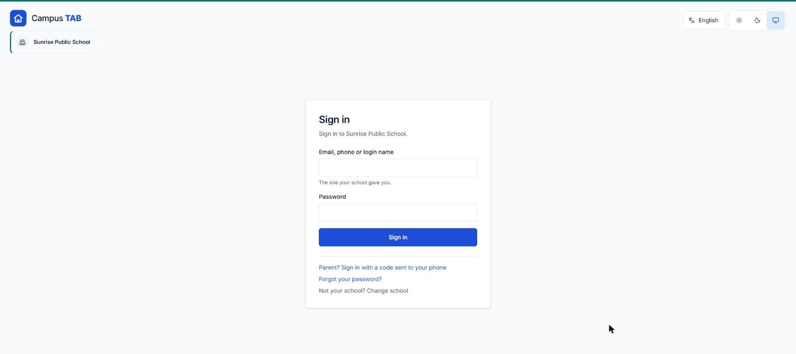
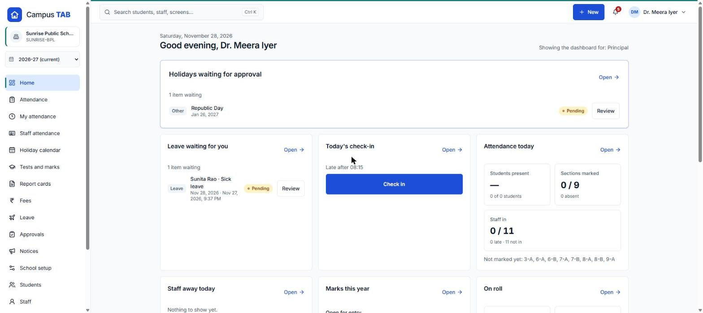

**If you are signed out while working:** a sign-in box appears over the page. Sign in again and carry on; what you typed is kept.

## Part 2. Setting up the school (Chief, once)

1. **School settings:** name, short name, board, logo, colour. Fill in the **grievance contact**: the person parents and staff contact about personal data.
2. **School setup:** the year, classes and sections, subjects, and which teacher teaches what.
3. **Students → Import:** download the template, fill it in Excel, upload, read the check report, then **Commit**. Leave PEN and APAAR empty: parents give consent for those in their own account.
4. **Staff:** add staff; each person gets a link to set their own password. Nobody else ever sees or types it.

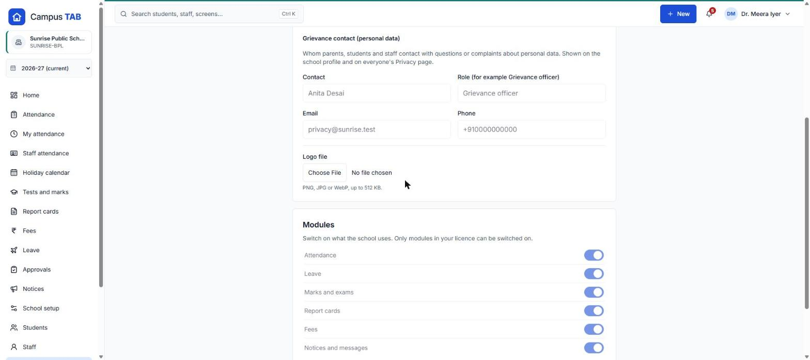
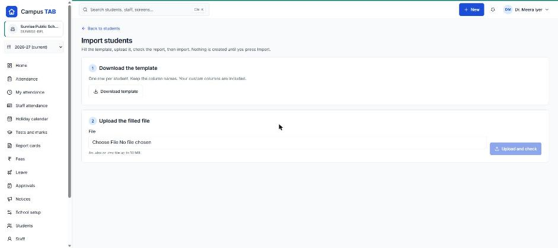

## Part 3. Every day

**Attendance (teachers):** open **Attendance**, everyone starts as present, tap the absent ones, **Save**. It takes under a minute for a class of 45. If the internet is down, keep the paper register and enter it later (with a reason).

**Leave:** staff apply in **Leave**. The Clerk checks, the Principal decides in **Approvals**. Parents apply for their child; the class teacher decides.

**Fees (Fee Collector):** **Fees → Counter**: find the student, take the amount, choose the mode, print the receipt. At the end of the day **close the counter**; the Clerk or Principal confirms the count.

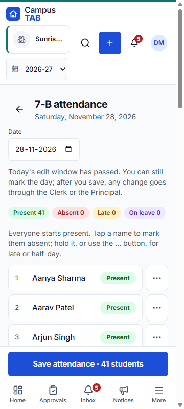
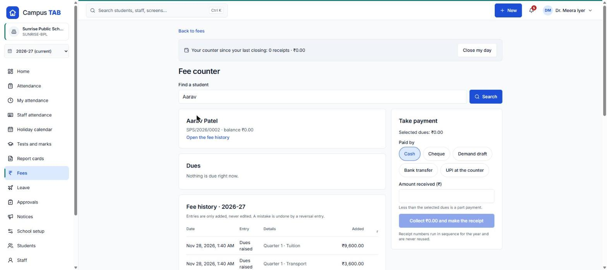
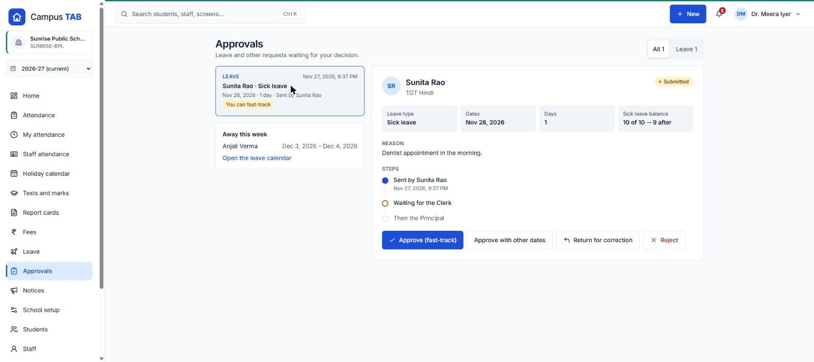

## Part 4. Tests, marks and report cards

1. The Principal sets the **assessment scheme** once (Tests → Schemes). Teachers create class tests for their own subjects; the office schedules exams.
2. Teachers enter marks in the **markbook** (keyboard, paste from Excel). Then: submit → class teacher verifies → office locks → Principal publishes.
3. A **locked** mark changes only through a correction request that the Principal approves from their own account with a fresh code.
4. **Report cards:** generate for a section, review, publish. Each card has a QR code anyone can check.

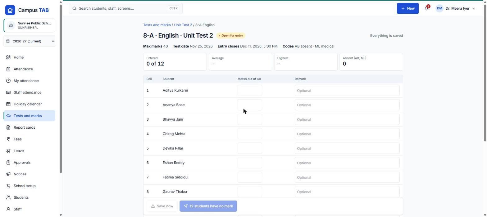

## Part 5. Year end (Principal)

**Report cards → Year-end promotion:**

1. Name the new year and its dates, then **Show the preview**: every student and what happens to them.
2. **Unpaid fees:** every student who still owes fees is listed. Choose, for each, **Carry to the new year** (usual) or **Leave in the old year** (it then can only be viewed, not collected). Approve once with your authenticator code.
3. **Apply the promotion:** the new year starts and the old year closes. A closed year can only be viewed.

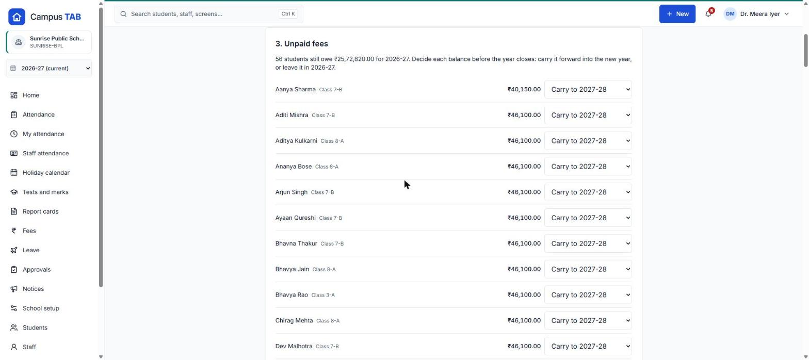

## Part 6. Privacy (Chief and Principal)

The school is responsible for the personal data it holds (DPDP Act). Campus TAB has no advertising, tracking or outside analytics.

1. **Privacy office → Privacy notice:** write the notice (have a lawyer check it), **Publish**. A published version never changes; publish a new version instead. Everyone is told.
2. Parents give or refuse **consent** for each purpose on their own **Privacy** page (account menu → Privacy). Only their own answer counts; the office cannot tick it for them.
3. **Privacy office → Requests:** copies, corrections and erasures people ask for. Answer by the due date; write what you did (the person sees it). Erasing a child's details is the Chief's, with a code and the admission number typed.
4. **Privacy office → Retention:** each night Campus TAB lists data that is past its keeping time. Nothing is deleted until the Chief reads the list and confirms with a code.
5. **Privacy office → Incidents:** if personal data may have leaked, record it at once and follow the [breach runbook](../how-to/breach-runbook.md). The Data Protection Board must be told within 72 hours.

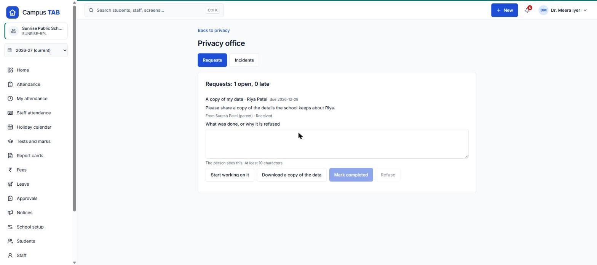
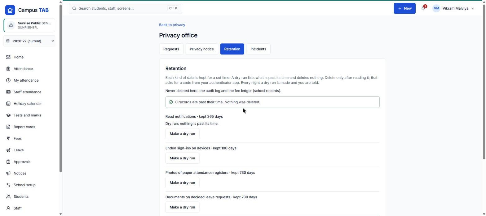
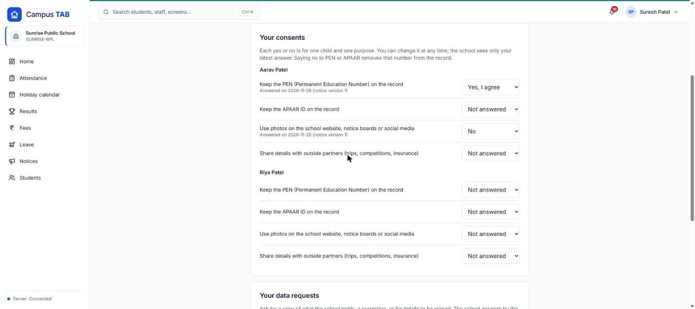

## Part 7. Keeping accounts safe (Chief)

- **Roles:** a person can only manage people below their own level.
- **Devices:** everyone can see where they are signed in and sign out a lost phone. Higher roles can end someone else's sign-ins.
- **Support access:** Campus TAB staff can see your school only if the Chief grants time-limited access. Every action is logged.
- **Audit log:** every change, who made it, when, from which device. It cannot be edited by anyone.
- **Exports:** every Excel or PDF export shows who made it, when and for which school, and a large export alerts the Chief.

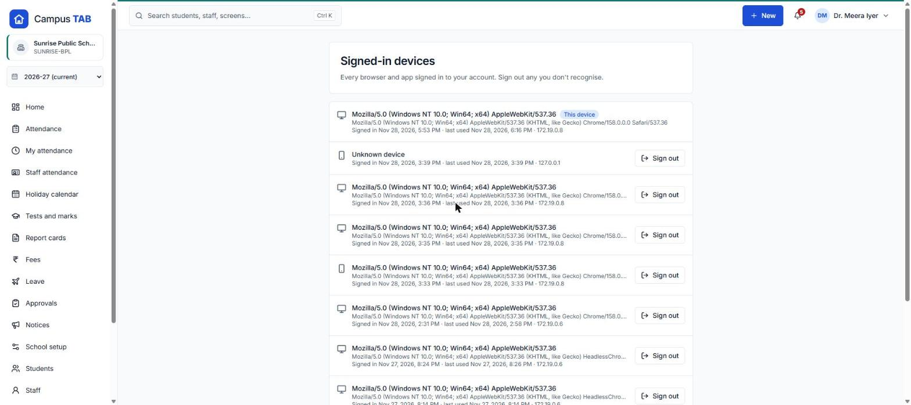
